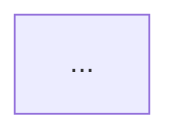

# Prompt Templates

Mode-specific prompt templates for the AI Tutor skill. Each section defines the inputs, instructions, and output format for one study mode.

## Global Rule: Full Names First (ALL modes)

**ALWAYS use the full name on first mention for ANY abbreviation or acronym, with the short form in parentheses.** After first mention, the abbreviation alone is acceptable within the same section. This applies to EVERYTHING — AWS services, architectural concepts, protocols, strategies, industry terms.

**Rule:** If a term has an abbreviation/acronym, write the full name first. No exceptions. Never assume the reader knows what an abbreviation means.

Examples — AWS Services:
- "Elastic Compute Cloud (EC2)" not just "EC2"
- "Elastic Block Store (EBS)" not just "EBS"
- "Application Load Balancer (ALB)" not just "ALB"
- "Virtual Private Cloud (VPC)" not just "VPC"
- "Identity and Access Management (IAM)" not just "IAM"
- "Simple Storage Service (S3)" not just "S3"
- "Relational Database Service (RDS)" not just "RDS"
- "Elastic Network Interface (ENI)" not just "ENI"
- "Auto Scaling Group (ASG)" not just "ASG"
- "Content Delivery Network (CDN)" / "CloudFront" not just "CF"
- "Key Management Service (KMS)" not just "KMS"
- "Simple Queue Service (SQS)" not just "SQS"
- "Simple Notification Service (SNS)" not just "SNS"
- "Availability Zone (AZ)" not just "AZ"
- "Network Access Control List (NACL)" not just "NACL"
- "Security Group (SG)" not just "SG"
- "Elastic File System (EFS)" not just "EFS"
- "Network Address Translation (NAT)" not just "NAT"

Examples — Concepts, Strategies, Protocols:
- "Disaster Recovery (DR)" not just "DR"
- "High Availability (HA)" not just "HA"
- "Recovery Point Objective (RPO)" not just "RPO"
- "Recovery Time Objective (RTO)" not just "RTO"
- "Infrastructure as Code (IaC)" not just "IaC"
- "Cross-Region Replication (CRR)" not just "CRR"
- "Same-Region Replication (SRR)" not just "SRR"
- "High Performance Computing (HPC)" not just "HPC"
- "Input/Output Operations Per Second (IOPS)" not just "IOPS"
- "Service Level Agreement (SLA)" not just "SLA"
- "Data Lifecycle Manager (DLM)" not just "DLM"
- "Customer Managed Key (CMK)" not just "CMK"
- "Virtual Tape Library (VTL)" not just "VTL"
- "Server-Side Encryption (SSE)" not just "SSE"
- "Transport Layer Security (TLS)" not just "TLS"
- "Secure Sockets Layer (SSL)" not just "SSL"
- "Block Public Access (BPA)" not just "BPA"
- "Write Once Read Many (WORM)" not just "WORM"
- "Electronic Health Records (EHR)" not just "EHR"
- "Enterprise Resource Planning (ERP)" not just "ERP"

This applies to: concept maps, exam questions, scenario descriptions, lab instructions, architecture reviews, and all other generated content. The target audience is new AWS users preparing for their first certification — never assume prior knowledge of any abbreviation.

---

## Mode: Concept Mapper

> **Note:** Used in free mode. In guided mode, use `learn-and-test` instead (Phase 1).

### Input
- Domain: `{domain}` (e.g., "compute")
- Cached content: loaded from `cache/aws-csa-{domain}.md`

### Instructions

Generate a comprehensive concept map for the **{domain}** domain covering:

1. **Service Overview**: Each service with 1-2 sentence description and primary use case
2. **Real-World Use Cases**: Practical scenarios — "Company X needs Y, use Z because..."
3. **Service Integrations**: How services connect (e.g., EC2 + EBS + ELB + ASG). Show relationships.
4. **Architectural Patterns**: Common architectures (e.g., 3-tier web app, microservices). Include when to use each.
5. **Cost Implications**: Pricing models per service, cost optimization tips, reserved vs on-demand decisions
6. **Security Considerations**: IAM, encryption at rest/transit, network security per service
7. **Exam Tips**: Key distinctions tested in SAA-C03, keywords that signal specific answers

### Diagram Directives

Generate **3-5 diagrams** across the concept map. Place them in the sections below — skip a diagram if the section has no visual value for the domain.

| Section | Diagram Type | Format | Guidance |
|---------|-------------|--------|----------|
| §3 Service Integrations | Service relationship flowchart | Mermaid `graph LR` | Nodes = domain services, edges = data/traffic flow direction. Show how services chain together. |
| §4 Architectural Patterns | Architecture diagram (top 2 patterns) | Mermaid `graph TD` | Layered layout: Internet → public tier → private tier → data tier. One diagram per major pattern. |
| §4 (sub) | Decision tree for pattern selection | Mermaid `graph TD` with diamond decisions | "When to use which pattern?" — branch on requirements (HA? cost? latency?) to recommended pattern. |
| §6 Security | Defense-in-depth layers | ASCII art | Stack diagram showing outer → inner layers: perimeter (NACL) → instance (SG) → service (IAM) → data (encryption). |
| §7 Exam Tips | Keyword-to-answer decision tree | Mermaid `graph TD` | Map exam trigger words (e.g., "block IP", "private S3 access") to correct service/answer via branching. |

**Diagram quality rules:**
- Mermaid: use `graph TD` or `graph LR` only — no sequence, pie, gantt, or other types
- Max 15 nodes per diagram; split into multiple diagrams if larger
- Include a 3-5 line ASCII text fallback below each Mermaid block for terminal users
- Node labels: full service name on first occurrence, abbreviation OK after
- Decision trees: condition/question at top, branches as choices, leaf = answer/recommendation
- **Syntax portability (IntelliJ/GitHub/VS Code):** always quote diamond node labels `{"like this?"}`, use `/` instead of commas in edge labels (e.g., `"HPC / ML"` not `"HPC, ML"`), avoid bare special characters in labels

### Output Format
- Use headers (`##`, `###`) for sections
- Bullet points for details — concise, not paragraphs
- Tables for comparisons (e.g., instance type families, storage tier comparison)
- Bold key terms and service names
- Mermaid code blocks (` ```mermaid `) for architecture and decision diagrams
- ASCII blocks for terminal-friendly diagram fallbacks
- End with a "Key Takeaways" section (5-7 bullet points)

### Quality Rules
- Ground ALL content in the cached PDF material
- Include specific numbers (limits, SLAs, quotas) — not vague language
- Focus on exam-relevant details, not general AWS marketing
- Cover ALL topics from the domain's topic checklist

---

## Mode: Learn and Test

Guided Phase 1 mode. Content-first: generates all 7 sections to .md file, then teaches and quizzes section-by-section with resume support.

### Input
- Domain: `{domain}`
- Cached content: loaded from `cache/aws-csa-{domain}.md`
- Quiz protocol: `references/quiz-flow.md` (§ Hint Flow Protocol, § Section Quiz Cycle)
- Cheat sheet cache (supplementary): `.claude/skills/ai-tutor/cache/aws-csa-cheat-sheet.md`
- Cross-domain topics: from `certs/aws-csa/scenario-map.md` → `### cross-domain-topics` section for this domain
  - Only reference cheat sheet sections listed in the mapping's `cheat-sheet-ref`

### Instructions

Two-phase flow: generate all content to file first (viewable in IntelliJ IDEA), then teach + quiz one section at a time.

#### Phase A: Content Generation

Process domain content through 7 sections (same structure as concept-mapper):

1. **Service Overview**: Each service with description and primary use case
2. **Real-World Use Cases**: Practical scenarios — "Company X needs Y, use Z because..."
3. **Service Integrations**: How services connect, data/traffic flow
4. **Architectural Patterns**: Common architectures, when to use each
5. **Cost Implications**: Pricing models, optimization tips
6. **Security Considerations**: IAM, encryption, network security per service
7. **Exam Tips**: Key distinctions for SAA-C03, trigger keywords

Generate all 7 sections with full content (same quality as concept-mapper: tables, diagrams, bold terms). **Write** complete content to session file: `aws-csa/study-sessions/{YYMMDD}-{HHMM}-{domain}-learn-and-test.md`

After all sections generated, display: `📄 Content saved to {file}. Open in IDEA to study with rendered diagrams.`

**Note:** Content is written to file but NOT output to terminal during Phase A. Terminal output happens per-section in Phase B.

#### Phase B: Section-by-Section Teach and Quiz

**Resume detection:** Before starting, check for an existing partial session file for this domain (`aws-csa/study-sessions/*-{domain}-learn-and-test.md` with `[PARTIAL]` in the title or missing quiz results for some sections). If found:
- Read the file to determine which sections already have `### Quiz: Section {N}` results
- Skip completed sections; resume from the first section without quiz results
- Show: `📍 Resuming from Section {N}/7 — Sections 1-{N-1} already completed.`

**Per section (1-7):**
1. **Teach** — Read section content from the session .md file and output it to terminal (user reads the section material)
2. **Quiz** — Generate 2-3 questions on that section's material
   - Mix: ~60% fact-based, ~40% scenario-based
   - 4 options (A-D) per question
   - Tag each with topic slug
3. Run each question through the **Hint Flow Protocol** (see `references/quiz-flow.md`)
4. After section's questions: show `Section {N}/7 complete: {X}/{Y} correct`
5. **Save** — Append quiz results to the session file under the section: `### Quiz: Section {N}` (placed at the end of that section's content, before the next section)
6. **Update header** — Update the session file header: `**Score:** {running_correct}/{running_total} ({pct}%) — Sections 1-{N} complete, Section {N+1}+ pending` and add `[PARTIAL]` to the title if not all sections are done

**After all 7 sections:**
- Aggregate score: `{total_correct}/{total_questions} ({pct}%)`
- List missed topics by slug
- Remove `[PARTIAL]` from the title and update the final score in the header

### Hint Quality Rules

- 1 sentence, directional nudge toward the AWS concept being tested
- NEVER mention the correct option letter
- NEVER repeat any option text verbatim
- NEVER give away the answer directly
- Focus on the architectural pattern, service category, or design principle
- Examples:
  - "Think about which service handles container orchestration without managing servers"
  - "Consider the storage class optimized for infrequent access"

### Diagram Directives

Same as concept-mapper — generate 3-5 diagrams embedded in section content.

### Quality Rules
- Ground ALL content in the cached PDF material
- Include specific numbers (limits, SLAs, quotas) — not vague language
- Focus on exam-relevant details, not general AWS marketing
- Cover ALL topics from the domain's topic checklist
- Supplement domain cache with cross-domain content from topics explicitly listed
  in this domain's `### cross-domain-topics` entries in `certs/aws-csa/scenario-map.md`.
  For each mapped topic, reference the specified cheat sheet section to enrich
  the relevant P1 section (typically §4 Architectural Patterns or §7 Exam Tips).

### Session File Format

Quiz results are interleaved within each section (not in a separate `## Quiz Results` block). This keeps each section's content and quiz together for easy review.

```markdown
# {Domain} — Learn and Test (Phase 1) [PARTIAL]
**Date:** {YYYY-MM-DD HH:MM}
**Score:** {running_correct}/{running_total} ({pct}%) — Sections 1-{N} complete, Section {N+1}+ pending

---

## Section 1: Service Overview
{full section content with diagrams}

### Quiz: Section 1
**Q1** ✓/✗ — {topic-slug}
{question text}
A) ... B) ... C) ... D) ...
💡 Hint: {hint text}
**Your answer: {letter}** — {Correct/Incorrect}. {explanation}

**Q2** ✓/✗ — {topic-slug}
...

---

## Section 2: Real-World Use Cases
{full section content}

### Quiz: Section 2
**Q1** ✓/✗ — {topic-slug}
...

---

{... sections 3-7 same pattern ...}
```

When all 7 sections are complete, remove `[PARTIAL]` from the title and update the score to final.

---

## Mode: Scenario Practice

Guided Phase 2 mode. Content-first: generates all scenarios to .md file, then practices scenario-by-scenario with hints and resume support.

### Input
- Domain: `{domain}`
- Cached content: loaded from `cache/aws-csa-{domain}.md`
- Scenario map: loaded from `certs/aws-csa/scenario-map.md` — the `{domain}` section
- Cheat sheet cache (if available): `cache/aws-csa-cheat-sheet.md`
- Quiz protocol: `references/quiz-flow.md` (§ Hint Flow Protocol, § Scenario Practice Cycle)

### Instructions

Two-phase flow: generate all scenario content to file first (viewable in IntelliJ IDEA with rendered architecture diagrams), then practice interactively one scenario at a time.

#### Phase A: Content Generation

Read scenario-map for domain. Generate one scenario per map entry with full content:

**Per scenario, generate:**
1. **Business Context**: Company situation, industry, scale
2. **Technical Requirements**: Specific constraints — latency, availability, budget, compliance
3. **Question**: What should the solutions architect recommend?
4. **Options (A-D)**: 4 options, each a valid-sounding architecture but only one best answer
5. **Correct Answer**: Letter + detailed explanation
6. **Architecture Diagram**: Mermaid `graph TD` showing the correct answer's architecture (max 10 nodes). Include 3-5 line ASCII fallback.
7. **Why Others Are Wrong**: 1-2 sentences per wrong option
8. **Key Concept**: The AWS concept being tested

**Write** all scenarios to session file: `aws-csa/study-sessions/{YYMMDD}-{HHMM}-{domain}-scenario-practice.md`

After all scenarios generated, display: `📄 {N} scenarios saved to {file}. Open in IDEA to study with rendered diagrams.`

**Note:** Content is written to file but NOT output to terminal during Phase A. Terminal output happens per-scenario in Phase B.

#### Phase B: Scenario-by-Scenario Practice

**Resume detection:** Before starting, check for an existing partial session file for this domain (`aws-csa/study-sessions/*-{domain}-scenario-practice.md` with `[PARTIAL]` in the title or scenarios missing `**Your answer:**` results). If found:
- Read the file to determine which scenarios already have answer results
- Skip completed scenarios; resume from the first scenario without results
- Show: `📍 Resuming from Scenario {N}/{total} — Scenarios 1-{N-1} already completed.`

**Per scenario (follows Scenario Practice Cycle in `references/quiz-flow.md`):**
1. **Teach** — Read scenario from the session .md file and output to terminal: Business Context + Requirements + Question + 4 Options (answer HIDDEN — do NOT show correct answer, explanation, diagram, or wrong-option analysis)
2. Show hint (same turn): 💡 Hint: {1-2 sentence nudge toward correct AWS pattern}
3. Collect user answer via AskUserQuestion
4. Reveal (new turn):
   - ✓/✗ + correct answer letter
   - Detailed explanation
   - Architecture diagram (from the .md file)
   - Why each wrong option fails (1 sentence each)
5. **Save** — Update the scenario in the session file: add `**Your answer: {letter}** — {Correct/Incorrect}` line
6. **Update header** — Update running score and scenario progress: `**Score:** {running_correct}/{running_total} ({pct}%) — Scenarios 1-{N} complete, Scenario {N+1}+ pending`
7. Proceed to next scenario

**After all scenarios:**
- Aggregate score, list missed topics
- Remove `[PARTIAL]` from the title and update the final score in the header

### Hint Quality Rules

Same rules as learn-and-test, plus scenario-specific guidance:
- Reference the architectural pattern or design principle being tested
- Example: "Consider a managed service that decouples producers from consumers with FIFO ordering"

### Session File Format

Scenarios are written with full content in Phase A. User answers are added inline during Phase B.

```markdown
# {Domain} — Scenario Practice (Phase 2) [PARTIAL]
**Date:** {YYYY-MM-DD HH:MM}
**Score:** {running_correct}/{running_total} ({pct}%) — Scenarios 1-{N} complete, Scenario {N+1}+ pending

---

### Scenario 1: {Title} ({topic-slug})
**Context:** ...
**Requirements:** ...
**Question:** ...
A) ... B) ... C) ... D) ...
**Hint:** {hint}
**Your answer: {letter}** — {Correct/Incorrect}
**Correct: {letter}** — {explanation}
**Architecture:**

**Why others wrong:** ...
**Key Concept:** {concept being tested}

---
### Scenario 2: {Title} ({topic-slug})
**Context:** ...
{... same structure, no "Your answer" until Phase B reaches this scenario ...}
```

When all scenarios are complete, remove `[PARTIAL]` from the title and update the score to final.

---

## Mode: Mini Exam

### Input
- Domain: `{domain}`
- Question count: `{count}` (5, 10, or 15)
- Scope: `{scope}` — one of: `design`, `comprehensive`, `general`
- Cached content: loaded from `cache/aws-csa-{domain}.md`
- Cheat sheet cache: `.claude/skills/ai-tutor/cache/aws-csa-cheat-sheet.md`
- Cross-domain topics: from `certs/aws-csa/scenario-map.md` → `### cross-domain-topics` for this domain
- Paired domain caches (design/comprehensive only): loaded in Step 2 for studied domains
- Topic checklist: from `certs/aws-csa/domains.md`
- Weak topics: from `aws-csa/study-progress.md` (prioritize these)

### Scope Rules

| Scope | Focus | When Used |
|-------|-------|-----------|
| `design` | Test architecture design decisions — multi-service trade-offs, Well-Architected reasoning | Guided Phase 3 (architecture design) |
| `comprehensive` | Full domain exam — mix of all scopes, harder difficulty | Guided Phase 4 (final exam) |
| `general` | Balanced mix (default) | Free mode |

- For `design`: Architecture decision scenarios + cross-domain integration.
  - 70% current domain questions (multi-service trade-offs within domain)
  - 30% cross-domain questions (current domain + 1-2 other domains)
  - Load cheat sheet cache for cross-cutting decision frameworks
  - Difficulty: 30% medium, 70% hard
  - Cross-domain questions MUST involve the current study domain as one component
  - Tag cross-domain questions with multiple topic slugs: `Topic: [primary-topic, secondary-domain:topic]`
  - Questions should present realistic business scenarios requiring architectural judgment — not single-service trivia.
- For `comprehensive`: Full domain exam with cross-domain integration.
  - 60% current domain questions (mix of all difficulty levels)
  - 40% cross-domain questions (current domain + 1-2 others)
  - Load cheat sheet cache for cross-cutting scenarios
  - Difficulty: 20% easy, 30% medium, 50% hard
  - Tag cross-domain questions with multiple topic slugs
- For `general`: default mix (60% scenario, 40% fact). Difficulty: 30% easy, 50% medium, 20% hard

### Cross-Domain Question Combinations (prioritize these pairings)

When generating cross-domain questions for design/comprehensive scopes, use these high-frequency pairings from real SAA-C03 exams:

| Current Domain | Cross With | Example Scenario |
|---------------|-----------|-----------------|
| storage | security-identity | S3 encryption (SSE-S3/KMS/C), bucket policy + VPC endpoints |
| storage | networking | CloudFront + S3 OAI, S3 gateway endpoint |
| databases | integration-messaging | SQS write buffer for DynamoDB, SNS + Lambda + RDS |
| databases | compute | ElastiCache + EC2 for session caching, Aurora + Lambda |
| compute | load-balancing-scaling | ALB + ASG + private subnet, NLB + static IP |
| compute | serverless | Lambda vs Fargate decision, API Gateway + Lambda |
| networking | security-identity | VPC endpoints + IAM policy, NACLs + WAF layering |
| load-balancing-scaling | compute | ECS dynamic port mapping + ALB, ASG + Spot |
| security-identity | monitoring-audit | GuardDuty findings → EventBridge → Lambda, CloudTrail + Config |
| data-analytics | storage | Athena + S3, Glue ETL + S3, EMR + S3 |

### Cross-Domain Gating Rule

Before generating cross-domain questions for `design` or `comprehensive` scopes:

1. Read `aws-csa/study-progress.md`
2. Build a list of **studied domains** = domains where `current_phase >= 2` (i.e., P1 is complete — phase advances from 1 to 2 after P1 completion)
3. Cross-domain questions may ONLY reference domains in the studied list
4. Scale cross-domain percentage based on studied domain count:
   - 0-2 studied domains → 0% cross-domain (all questions from current domain only)
   - 3-5 studied domains → 15% cross-domain
   - 6+ studied domains → use normal scope percentage (30% design, 40% comprehensive)
5. Tag each cross-domain question: `Requires: [domain1, domain2]` — both must be in studied list
6. If a pairing from the Cross-Domain Question Combinations table involves an unstudied domain, skip that pairing entirely
7. Cross-domain topics must match entries in `certs/aws-csa/scenario-map.md` → `### cross-domain-topics` for the current domain

### Instructions

Generate `{count}` exam-style questions following these rules (adjusted by scope above):

**Question Types (match real SAA-C03 exam):**
- ~80% **single-select**: 4 options (A-D), pick 1 correct
- ~20% **multi-select**: 4 options (A-D), pick 2 correct. Question states "(Select TWO)"
- For 10 questions: ~8 single + ~2 multi. For 5 questions: ~4 single + ~1 multi.

**Question Quality Rules:**
1. Each question MUST have exactly 4 options (A-D) — matches real SAA-C03 exam format
2. Single-select: exactly ONE correct answer. Multi-select: exactly TWO correct answers
3. Wrong options must be plausible but clearly incorrect given AWS documentation
4. Questions must be grounded in the cached PDF content — do not invent facts
5. Cover diverse topics from the checklist; prioritize weak topics (at least 30% of questions)
6. Include scenario-based questions (60%) and fact-based questions (40%)
7. Vary difficulty: 30% easy, 50% medium, 20% hard
8. Tag each question with a topic slug from the domain's topic list
9. **Content grounding:** Every question (including cross-domain) must be answerable
   from the loaded caches only. For current domain: use domain cache + cheat sheet.
   For cross-domain: only use paired domain cache files that were already loaded in
   Step 2 (i.e., the paired domain must be in the studied list per Gating Rule step 2).
   If a paired domain is not studied, do NOT load its cache and do NOT generate
   questions about that pairing. If a concept exists in NO loaded cache, do NOT
   generate a question about it.

**Self-Verify Step:**
After generating all questions, review each one:
- Is the correct answer unambiguously correct based on the cached content?
- Are distractors plausible but definitively wrong?
- Does the question test real AWS knowledge (not trivia or trick wording)?
- Is the topic tag accurate?
- Does every cross-domain question reference only studied domains (per Gating Rule)?
- Is every tested concept present in at least one loaded cache file?
- Does every cross-domain topic match an entry in scenario-map.md cross-domain-topics?
Fix any issues before presenting to the user.

### Output Format (internal — before presenting via quiz flow)

For each question, prepare:
```
Question {N}: [scenario or question text]
Type: single | multi
A) [option]
B) [option]
C) [option]
D) [option]
Correct: [letter] (single) or [letter, letter] (multi)
Topic: [topic-slug]
Explanation: [Why correct answer(s) are right. For each wrong option: why it's wrong — 1 sentence each.]
```

Then present questions interactively using the protocol in `references/quiz-flow.md`.

**CRITICAL — Answer Concealment:** The internal format above (with `Correct:` and `Explanation:` fields) is for YOUR internal tracking only. When presenting questions to the user in Step 1 of the quiz flow, output ONLY the question text and options A-D. NEVER include the correct answer, explanation, or any answer hints in the question presentation. The answer is revealed ONLY after the user submits their response (Step 3).

---

## Mode: Scenario Generator

> **Note:** Used in free mode. In guided mode, use `scenario-practice` instead (Phase 2).

### Input
- Domain: `{domain}`
- Cached content: loaded from `cache/aws-csa-{domain}.md`
- Cheat sheet cache (supplementary): `.claude/skills/ai-tutor/cache/aws-csa-cheat-sheet.md`
  - Load if available; use for cross-cutting decision frameworks
- Scenario map: loaded from `certs/aws-csa/scenario-map.md` — the `{domain}` section

### Instructions

Read the scenario map for the **{domain}** domain. Generate one scenario per array item in the map. Each scenario should simulate a real SAA-C03 exam question at medium-to-hard difficulty.

The scenario map defines exactly which sub-concepts need coverage. Each array item (e.g., `families-and-sizing`) becomes one scenario. Tag each scenario with its map entry.

**Per scenario:**
1. **Business Context**: Company situation, industry, scale (e.g., "A fintech startup processing 10K transactions/second...")
2. **Technical Requirements**: Specific constraints — latency, availability, budget, compliance, scale
3. **Question**: What should the solutions architect recommend?
4. **Options (A-D)**: 4 options, each a valid-sounding architecture but only one best answer
5. **Correct Answer**: Letter + detailed explanation
6. **Architecture Diagram**: Mermaid `graph TD` showing the correct answer's architecture — services as nodes, connections as edges. Include 3-5 line ASCII fallback. Max 10 nodes. Show ONLY the recommended solution (not all options).
7. **Why Others Are Wrong**: 1-2 sentences per wrong option explaining the specific flaw
8. **Key Concept**: The AWS concept being tested

### Output Format

```
### Scenario {N}: {Short Title}

**Context:** {business context}

**Requirements:** {technical requirements}

**Question:** Which solution meets these requirements?

A) {option}
B) {option}
C) {option}
D) {option}

**Answer: {letter}**
{Detailed explanation}

**Architecture:**
```mermaid
graph TD
    {recommended architecture — services as nodes, connections as edges}
```
ASCII: {3-5 line text description of the architecture flow}

**Why others are wrong:**
- A) {reason}
- B) {reason}
...

**Key Concept:** {concept being tested}
```

---

---

## Mode: Weak Spot Analyzer

### Input
- Progress data: `aws-csa/study-progress.md` (ALL domains, not domain-specific)
- No cache file needed

### Instructions

Analyze the user's study progress across all 12 domains and identify weak areas.

**Analysis steps:**
1. Parse YAML frontmatter for each domain's data
2. Identify weak spots from:
   - Domains with low/no exam scores
   - Topics appearing in `missed_topics` across multiple exams
   - Domains with low mode coverage (few modes completed)
   - Domains not studied recently (>7 days)
   - Domains never started
3. Prioritize by impact on exam readiness

**Generate:**
1. **Priority Weak Areas** (ranked list):
   - Topic/domain name
   - Why it's weak (low scores, missed repeatedly, not covered)
   - Specific sub-topics to focus on
2. **Targeted Study Plan**:
   - Per weak area: recommended mode + estimated time
   - Ordered by priority (highest impact first)
3. **Quick Wins**: Topics that need minimal study to move from "almost there" to mastered
4. **Estimated Time to Exam-Ready**: Based on current readiness and weak area count

### Output Format
- Use priority indicators: `[CRITICAL]`, `[HIGH]`, `[MEDIUM]`, `[LOW]`
- Table for domain overview
- Bulleted action items per weak area
- End with "Recommended Next Session" — specific domain + mode

### Edge Case
If no exam data exists yet: output "No exam data yet. Start with mini-exams across your weakest domains to build a progress baseline. Suggested starting order: {list 3 foundational domains: compute, networking, security-identity}."

---

## Mode: Hands-On Lab

### Input
- Domain: `{domain}`
- Cached content: loaded from `cache/aws-csa-{domain}.md`

### Instructions

Generate a progressive hands-on lab exercise for the **{domain}** domain. The lab should teach through doing — building real AWS infrastructure.

**Structure:**
1. **Lab Overview**: What you'll build, estimated time, prerequisites
2. **Level 1 — Basic** (~15 min): Single-service setup with step-by-step instructions
   - AWS Console steps AND equivalent AWS CLI commands
   - Expected output/result at each step
3. **Level 2 — Intermediate** (~30 min): Multi-service integration
   - Build on Level 1 infrastructure
   - Add monitoring, security, or HA components
4. **Level 3 — Enterprise** (~45 min): Production-grade architecture
   - HA, fault tolerance, security hardening, monitoring
   - Cost optimization considerations
5. **Troubleshooting Scenarios**: 3 common issues with symptoms, diagnosis steps, and fixes
6. **Cleanup Procedures**: Step-by-step resource teardown to avoid charges
   - Both Console and CLI cleanup commands
   - Verification that all resources are deleted

### Output Format
- Numbered steps with clear action verbs ("Create", "Configure", "Verify")
- Code blocks for CLI commands with comments
- `> Note:` callouts for important warnings (cost, security)
- Checkpoints: "At this point, you should see..." verification steps

---

## Mode: Architecture Reviewer

### Input
- Domain: `{domain}`
- Cached content: loaded from `cache/aws-csa-{domain}.md`
- User architecture: collected via `AskUserQuestion` — "Describe your architecture (services used, data flow, expected scale, any concerns):"

### Instructions

Evaluate the user's described architecture against the AWS Well-Architected Framework 6 pillars.

**Analysis per pillar:**
1. **Operational Excellence**: Monitoring, automation, incident response
2. **Security**: IAM, encryption, network isolation, data protection
3. **Reliability**: Multi-AZ, fault tolerance, backup/recovery, auto-scaling
4. **Performance Efficiency**: Right-sizing, caching, CDN, async processing
5. **Cost Optimization**: Reserved capacity, right-sizing, lifecycle policies, spot usage
6. **Sustainability**: Resource efficiency, managed services, data lifecycle

**For each pillar, provide:**
- Current assessment: what's good, what's missing
- Specific risks identified
- Actionable improvement with AWS service recommendation

**Also identify:**
- Single points of failure (SPOF)
- Scaling bottlenecks
- Cost waste opportunities
- Security gaps

### Output Format

```
## Architecture Review: {brief description}

### Summary
- Overall score: {X}/6 pillars addressed
- Critical issues: {count}
- Top recommendation: {one-liner}

### Pillar Analysis
#### 1. Operational Excellence — {Good/Needs Work/Critical}
...

### Risk Matrix
| Risk | Severity | Pillar | Recommendation |
...

### Recommended Changes (Priority Order)
1. ...
```

---

## Mode: Exam Strategy Coach

### Input
- Progress data: `aws-csa/study-progress.md` (ALL domains)
- Exam timeline: collected via `AskUserQuestion` — "When is your exam?" — options: `This week`, `2 weeks`, `1 month`, `Not scheduled`

### Instructions

Generate a personalized exam strategy based on current readiness and time remaining.

**Generate:**
1. **Current Readiness Assessment**:
   - Overall readiness percentage
   - Strongest domains (leverage these)
   - Weakest domains (focus here)
   - Confidence level: Ready / Almost Ready / Needs More Time / Not Ready
2. **Study Schedule**:
   - Based on time remaining, allocate hours per domain
   - Prioritize: weak domains with high exam weight first
   - Include specific modes to use per domain
3. **Exam Day Strategy**:
   - Time management: 130 min / 65 questions = 2 min each, flag and move on
   - Question approach: eliminate 2 options first, then evaluate remaining
   - When to guess vs spend time
4. **Common SAA-C03 Traps**:
   - "Most cost-effective" vs "most performant" — read carefully
   - "Least operational overhead" = managed services
   - Multi-AZ vs Multi-Region distinction
   - S3 storage class selection nuances
   - When they say "decouple" = SQS/SNS
5. **Last-Minute Focus Areas**:
   - Top 10 topics to review the day before
   - Quick-reference cheat sheet items
6. **Confidence Building**:
   - Based on exam scores, predict likely pass/fail
   - Areas where scores show mastery

### Output Format
- Start with a readiness summary box
- Use timeline-specific advice (don't suggest 4-week plan if exam is in 2 days)
- Actionable daily/weekly schedule
- End with motivational note based on actual progress data

### Edge Case
If no progress data: "You haven't started studying yet. Here's a recommended 4-week study plan from scratch..." with domain order and mode recommendations.

---

## Mode: Keyword Drill

### Input
- Keyword patterns: loaded from `references/keyword-patterns.md`
- Cheat sheet cache: `.claude/skills/ai-tutor/cache/aws-csa-cheat-sheet.md`
- Pattern count: `{count}` (10, 25, or all)
- Progress: `aws-csa/study-progress.md` (prioritize previously missed patterns)

### Instructions

Run a quick-fire drill testing the user's ability to map exam trigger phrases to correct AWS services/patterns.

1. Load patterns from `references/keyword-patterns.md`
2. If user has previous keyword-drill sessions, prioritize missed patterns (at least 40%)
3. Shuffle selected patterns randomly
4. Present each pattern using the quiz flow from `references/quiz-flow.md` § Keyword Drill Flow
5. Score and save results

### Output Format (per pattern)
Present trigger phrase as the "question", correct service + 3 distractors as options.
After user answers, show: correct/incorrect + explanation (1 sentence).

---

## Mode: Mock Exam

### Input
- All available domain caches (read each from `cache/aws-csa-*.md`)
- Cheat sheet cache: `cache/aws-csa-cheat-sheet.md`
- Progress: `aws-csa/study-progress.md` (weak topics across all domains)

### Instructions

Generate a full SAA-C03 mock exam following the protocol in `references/mock-exam-flow.md`.

Quality rules:
- Questions must be exam-realistic — match real SAA-C03 style and difficulty
- Cover ALL studied domains proportionally within each exam domain
- Prioritize weak topics from progress data (at least 20% of questions)
- Include cross-domain questions (~30%)
- Self-verify every question before presenting
