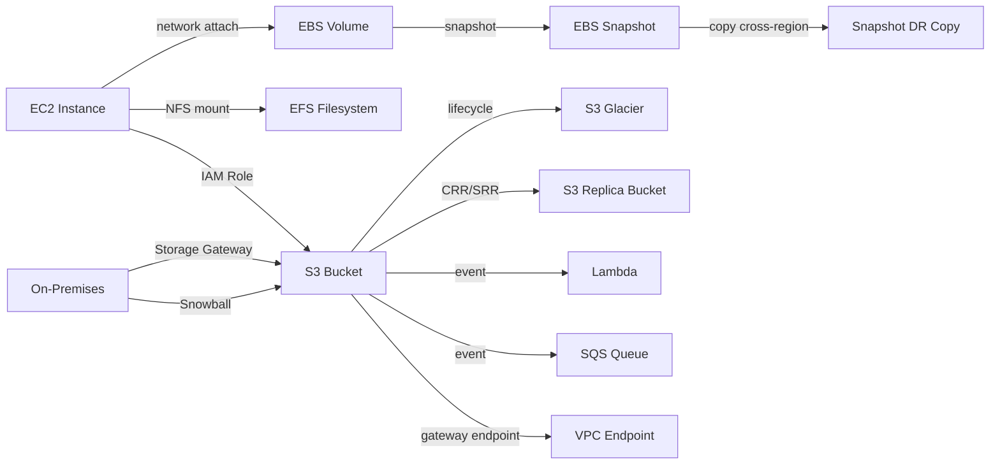
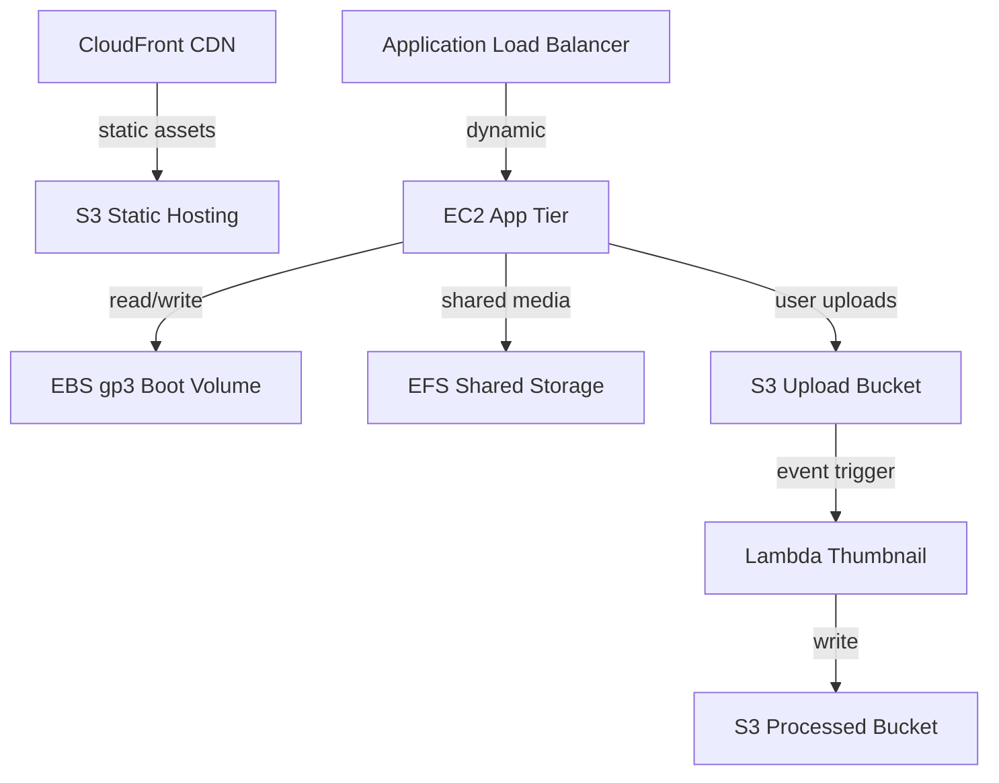
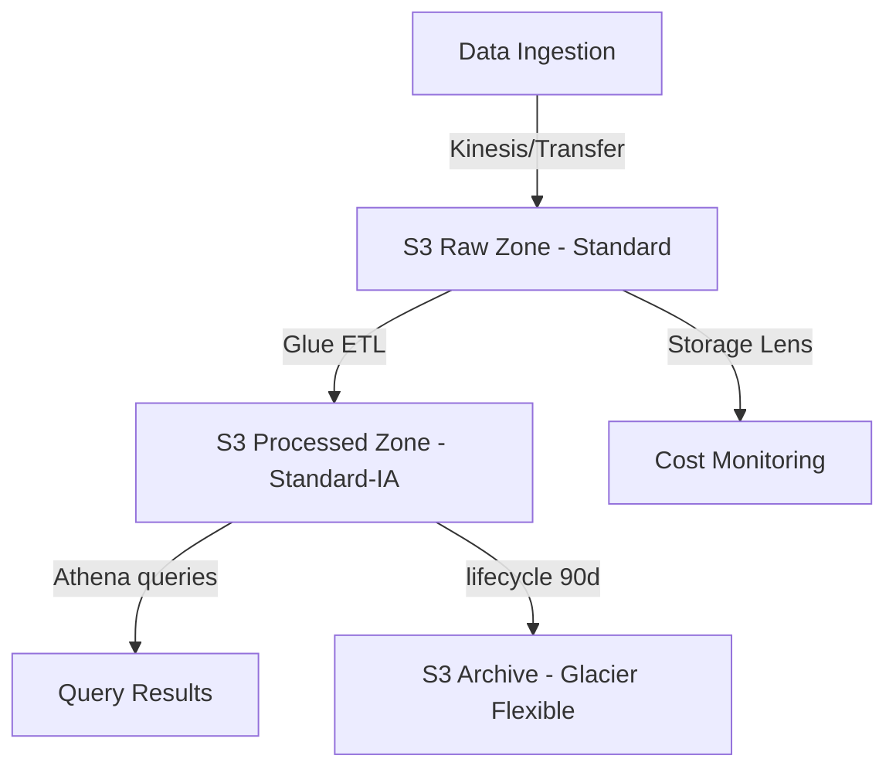
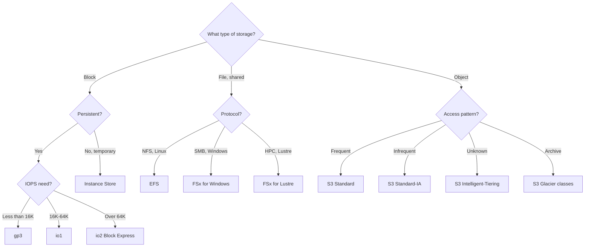
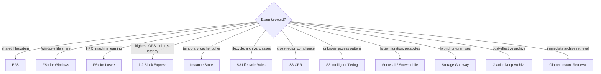

# Storage Domain — Concept Map
## Generated: 2026-05-15 23:42 | Phase 1: LEARN

## 1. Service Overview

### Elastic Block Store (EBS)
- **Network-attached** block storage for Elastic Compute Cloud (EC2) instances
- Persists independently of instance lifecycle (unless Delete on Termination enabled)
- **Locked to a single Availability Zone (AZ)** — move via snapshots only
- Use cases: boot volumes, databases, transactional workloads

### EBS Snapshots
- Point-in-time backup of EBS volumes, stored in Simple Storage Service (S3) internally
- Copy across AZs and regions for migration/DR
- **Snapshot Archive**: 75% cheaper, 24-72 hour restore
- **Fast Snapshot Restore (FSR)**: No latency on first use (extra cost)
- **Recycle Bin**: Recover deleted snapshots (1 day–1 year retention)

### EC2 Instance Store
- **Physically attached** disk — highest I/O performance
- **Ephemeral**: data lost on stop/terminate/hardware failure
- Use cases: buffer, cache, scratch data, temporary processing
- Cannot detach or reattach

### Elastic File System (EFS)
- Managed Network File System (NFS) — shared across multiple EC2 instances
- **Multi-AZ** by default (Standard), auto-scales to petabyte
- **Linux/POSIX only** — does NOT work with Windows
- ~3x cost of gp2 Elastic Block Store (EBS)
- Storage tiers: Standard, Infrequent Access (IA), Archive
- Throughput modes: Bursting, Provisioned (up to 3 GiB/s read), Elastic

### Simple Storage Service (S3)
- **Object storage** with virtually unlimited capacity
- 11 nines durability (99.999999999%) across multiple AZs
- Max object size: 50 TB (multi-part upload required >5 GB)
- Bucket names globally unique, region-scoped

### S3 Storage Classes

| Class | Availability | Min Storage | Retrieval Time | Best For |
|-------|-------------|-------------|----------------|----------|
| Standard | 99.99% | None | Instant | Frequent access |
| Standard-IA | 99.9% | 30 days | Instant | Infrequent, rapid retrieval |
| One Zone-IA | 99.5% | 30 days | Instant | Recreatable data |
| Glacier Instant | — | 90 days | Milliseconds | Quarterly access |
| Glacier Flexible | — | 90 days | 1 min–12 hrs | Archival, rare access |
| Glacier Deep Archive | — | 180 days | 12–48 hrs | Compliance/legal hold |
| Intelligent-Tiering | 99.9% | None | Instant | Unknown patterns |
| Express One Zone | 99.95% | None | Single-digit ms | Ultra-high performance |

### FSx
- Managed third-party file systems (Lustre, Windows File Server, NetApp ONTAP, OpenZFS)
- **FSx for Lustre**: HPC, ML training, linked to S3
- **FSx for Windows**: SMB protocol, Active Directory integration

### Snow Family
- Physical data transfer devices for edge computing and migration
- **Snowcone**: 8-14 TB, portable, edge computing
- **Snowball Edge**: 80 TB storage, compute capability
- **Snowmobile**: Exabyte-scale (100 PB per truck)

### Storage Gateway
- Hybrid cloud storage bridge — on-premises to AWS
- **S3 File Gateway**: NFS/SMB → S3
- **FSx File Gateway**: Low-latency access to FSx for Windows
- **Volume Gateway**: iSCSI block storage backed by S3 + EBS snapshots
- **Tape Gateway**: Virtual tape library → S3 Glacier

---

## 2. Real-World Use Cases

- **Media company** stores 500 TB of video assets → S3 Standard for active content, Glacier Deep Archive for pre-2020 catalog, Lifecycle Rules auto-transition after 90 days
- **Fintech startup** runs MySQL on EC2 → io2 Block Express for 100K+ sustained IOPS, Multi-Attach disabled (database doesn't support cluster filesystem)
- **Data science team** shares training data → EFS across 50 EC2 instances in 3 AZs, lifecycle to IA for datasets not accessed in 30 days
- **Enterprise migrating** 50 TB from data center → Snowball Edge shipped to AWS, then S3 Transfer Acceleration for incremental updates
- **Compliance team** needs 7-year data retention → S3 Object Lock (Compliance mode) + Glacier Deep Archive, bucket policy denies deletion
- **Global SaaS** needs multi-region redundancy → Cross-Region Replication (CRR) with versioning, application-level failover

---

## 3. Service Integrations



```
ASCII fallback:
  On-Prem ──StorageGW/Snowball──► S3 ──lifecycle──► Glacier
  EC2 ──network──► EBS ──snapshot──► Snapshot ──copy──► DR Region
  EC2 ──NFS──► EFS (multi-AZ shared)
  EC2 ──IAM Role + VPC Endpoint──► S3 ──CRR──► Replica Bucket
  S3 ──event──► Lambda / SQS
```

---

## 4. Architectural Patterns

### Pattern A: 3-Tier Web App Storage



```
ASCII fallback:
  CloudFront → S3 (static)
  ALB → EC2 (gp3 EBS boot + EFS shared) → S3 (uploads)
  S3 upload event → Lambda → S3 processed
```

### Pattern B: Data Lake + Analytics



```
ASCII fallback:
  Ingestion → S3 Raw (Standard) → Glue ETL → S3 Processed (Standard-IA)
  Processed → Athena queries | lifecycle 90d → Glacier Flexible
```

### Decision Tree: Which Storage Service?



```
ASCII fallback:
  Block storage? → Persistent → IOPS <16K: gp3 | 16-64K: io1 | >64K: io2 BE
                → Ephemeral → Instance Store
  File shared?  → NFS/Linux: EFS | SMB/Windows: FSx Windows | HPC: FSx Lustre
  Object?       → Frequent: Standard | Infrequent: Standard-IA | Unknown: Intelligent-Tiering | Archive: Glacier
```

---

## 5. Cost Implications

| Service | Pricing Model | Optimization Tips |
|---------|--------------|-------------------|
| **EBS gp3** | Per GB/month + IOPS/throughput if above baseline | Upgrade from gp2 — same price, better baseline |
| **EBS io2** | Per GB + per provisioned IOPS | Only for databases needing >16K IOPS |
| **EBS Snapshots** | Per GB stored (incremental) | Archive old snapshots (75% savings) |
| **EFS** | Per GB used (no provisioning) | Use IA tier lifecycle (up to 92% savings) |
| **S3 Standard** | ~$0.023/GB + requests | Lifecycle to IA/Glacier for aging data |
| **S3 Standard-IA** | ~$0.0125/GB + retrieval fee | Watch 30-day minimum — short holds cost more |
| **S3 Glacier Deep Archive** | ~$0.00099/GB | Cheapest long-term; budget 12-48hr retrieval |
| **S3 Intelligent-Tiering** | Variable + monitoring fee/object | Best when access patterns unpredictable |
| **Snow Family** | Per device + shipping + days held | Cheaper than network transfer for >10 TB |

---

## 6. Security Considerations

```
┌─────────────────────────────────────────────┐
│          DEFENSE-IN-DEPTH LAYERS            │
├─────────────────────────────────────────────┤
│  Account Level                              │
│  ├── S3 Block Public Access (account-wide)  │
│  ├── SCPs (Organizations)                   │
│                                             │
│  Bucket Level                               │
│  ├── Bucket Policy (resource-based)         │
│  ├── Versioning + MFA Delete                │
│  ├── Object Lock (WORM compliance)          │
│                                             │
│  Object Level                               │
│  ├── IAM Policies (user-based)              │
│  ├── ACLs (legacy, avoid)                   │
│  ├── Pre-signed URLs (temporary access)     │
│                                             │
│  Data Level                                 │
│  ├── SSE-S3 (default) / SSE-KMS / SSE-C    │
│  ├── HTTPS enforced (aws:SecureTransport)   │
│  ├── S3 Access Points (per-app policies)    │
│                                             │
│  Network Level                              │
│  ├── VPC Gateway Endpoint (S3/DynamoDB)     │
│  ├── VPC Endpoint Policy                    │
│  └── Access Points with VPC Origin          │
└─────────────────────────────────────────────┘
```

**EBS encryption**: AES-256, uses Key Management Service (KMS). Encryption at rest + in transit between EC2 and EBS. Snapshots of encrypted volumes are encrypted. Unencrypted → encrypted requires snapshot + copy with encryption enabled.

**EFS encryption**: At rest via KMS, in transit via NFS mount helper with TLS.

---

## 7. Exam Tips

### Keyword-to-Answer Decision Tree



```
ASCII fallback:
  "shared filesystem"         → EFS
  "Windows file share"        → FSx for Windows
  "HPC / ML training"         → FSx for Lustre
  "highest IOPS, sub-ms"      → io2 Block Express
  "temporary / cache"         → Instance Store
  "lifecycle / archive"       → S3 Lifecycle Rules
  "cross-region compliance"   → S3 CRR
  "unknown access pattern"    → S3 Intelligent-Tiering
  "petabyte migration"        → Snowball / Snowmobile
  "hybrid / on-premises"      → Storage Gateway
  "cheapest long-term"        → Glacier Deep Archive
  "instant archive retrieval" → Glacier Instant Retrieval
```

### Key Distinctions for SAA-C03

- **gp2 vs gp3**: gp3 lets you scale IOPS independently of size. gp2 ties IOPS to volume size (3 IOPS/GiB). gp3 is newer and generally preferred.
- **io1/io2 vs gp3**: Only use io when you need >16,000 IOPS or Multi-Attach. io2 Block Express goes to 256,000 IOPS.
- **EBS vs Instance Store**: "persistent" → EBS. "highest performance, temporary" → Instance Store.
- **EFS vs EBS**: "multiple instances sharing data" → EFS. "single instance block storage" → EBS.
- **S3 Standard-IA vs One Zone-IA**: Both infrequent access. One Zone = single AZ risk, 20% cheaper. "Recreatable" data = One Zone-IA.
- **CRR vs SRR**: Cross-Region = compliance, DR. Same-Region = log aggregation, test environments.
- **SSE-S3 vs SSE-KMS vs SSE-C**: S3 default = SSE-S3. Need audit trail = SSE-KMS. Customer manages keys = SSE-C (HTTPS required).
- **Bucket Policy evaluated BEFORE Default Encryption** — can force stronger encryption.
- **Replication only applies to NEW objects** after enabling — use S3 Batch Replication for existing.
- **Delete markers can be replicated (optional)** but version ID deletes are NEVER replicated (prevents cascading).
- **MFA Delete**: Only root account can enable. Requires MFA to permanently delete versions or suspend versioning.
- **S3 Pre-signed URLs**: CLI default 3600s, max 168 hours (7 days). Console max 12 hours.
- **VPC Gateway Endpoint**: Free, only for S3 and DynamoDB. Interface Endpoint costs per hour + per GB.

---

## Key Takeaways

1. **EBS is AZ-locked** — snapshots are the only way to move data across AZs or regions
2. **EFS is shared + multi-AZ** but 3x the cost of EBS and Linux-only
3. **Instance Store = fastest but ephemeral** — never use for persistent data
4. **S3 has 8 storage classes** — know the minimum storage periods (30/90/180 days) to avoid exam traps
5. **S3 Replication only copies new objects** — S3 Batch Replication handles existing objects
6. **SSE-S3 is default encryption** — SSE-KMS adds audit trail via CloudTrail
7. **Storage Gateway bridges on-premises to AWS** — know which gateway type maps to which protocol (NFS/SMB/iSCSI/VTL)
