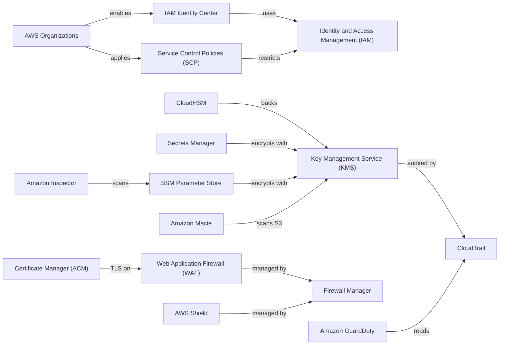
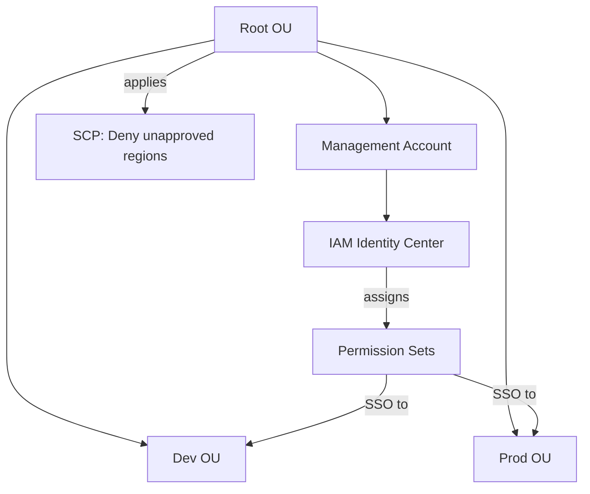
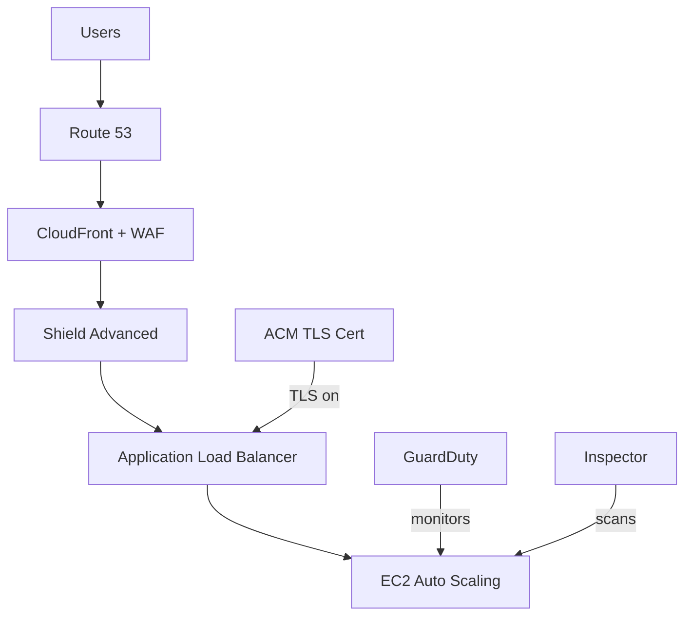
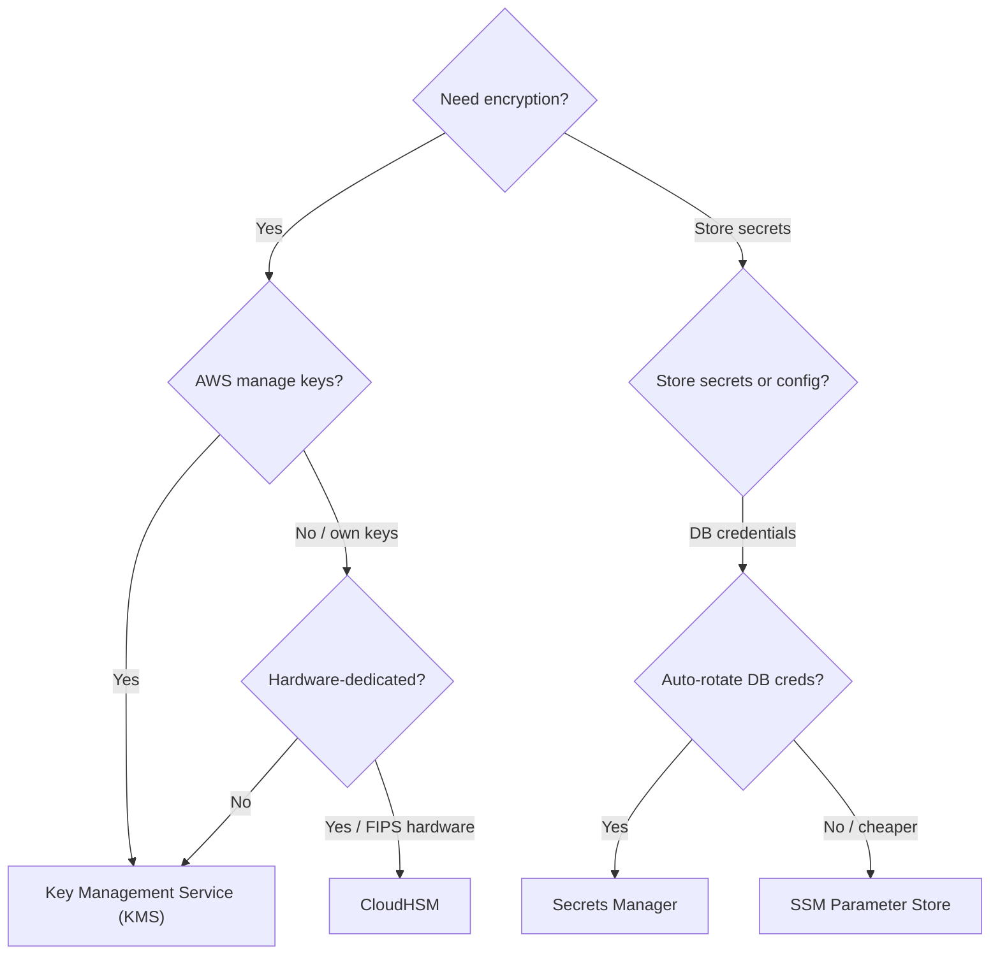
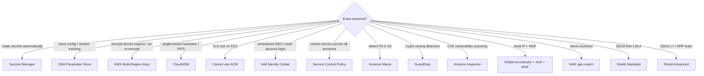

# Security & Identity — Concept Map (Phase 1)

## 1. Service Overview

### Identity & Access Management

| Service | Description | Primary Use Case |
|---------|-------------|-----------------|
| **Identity and Access Management (IAM)** | Global service for managing users, groups, roles, and policies | Authentication & authorization for all AWS resources |
| **AWS Organizations** | Multi-account management with consolidated billing | Enterprise account governance and cost aggregation |
| **Service Control Policies (SCP)** | Organization-level permission guardrails | Restrict what services/actions member accounts can use |
| **IAM Identity Center** (ex-SSO) | Single sign-on for all AWS accounts and business apps | Centralized login for multi-account environments |
| **AWS Control Tower** | Automated multi-account setup with guardrails | Governed landing zone for new AWS environments |

### Encryption & Key Management

| Service | Description | Primary Use Case |
|---------|-------------|-----------------|
| **Key Management Service (KMS)** | Managed encryption key service, integrated with IAM | Encrypt EBS, S3, RDS, and 100+ AWS services |
| **CloudHSM** | Dedicated single-tenant Hardware Security Module (HSM) | FIPS 140-2 Level 3 compliance with full key ownership |
| **AWS Certificate Manager (ACM)** | Free public/private TLS certificate provisioning | HTTPS on Application Load Balancer (ALB), CloudFront, API Gateway |
| **Systems Manager (SSM) Parameter Store** | Hierarchical config/secret storage with versioning | Application config and non-rotated secrets |
| **Secrets Manager** | Secret storage with built-in automatic rotation | Database credentials with auto-rotation (native Relational Database Service (RDS) integration) |

### Threat Detection & Protection

| Service | Description | Primary Use Case |
|---------|-------------|-----------------|
| **Web Application Firewall (WAF)** | Layer 7 HTTP filtering (SQL injection, XSS, geo-block, rate-limit) | Protect ALB, API Gateway, CloudFront from web exploits |
| **AWS Shield** | DDoS protection (Standard=free L3/4; Advanced=$3,000/mo L7) | Absorb volumetric and application-layer DDoS attacks |
| **AWS Firewall Manager** | Centralized WAF/Shield/SG rules across Organization accounts | Auto-apply security policies to new resources at scale |
| **Amazon GuardDuty** | ML-based threat detection from CloudTrail, VPC Flow Logs, DNS | Detect compromised instances, crypto mining, unusual API calls |
| **Amazon Inspector** | Automated vulnerability scanning (CVE database) | Scan EC2 instances, ECR container images, Lambda functions |
| **Amazon Macie** | ML-based sensitive data discovery in Simple Storage Service (S3) | Find and alert on Personally Identifiable Information (PII) in S3 |

---

## 2. Real-World Use Cases

- **Fintech startup** needs audit trail for all key usage → **KMS** + CloudTrail (every encrypt/decrypt call logged)
- **Healthcare company** stores patient records in S3 → **Macie** to detect PII; **KMS** for encryption at rest; **ACM** for HTTPS
- **Enterprise** with 50 AWS accounts → **Organizations** + **SCP** to block unapproved regions; **IAM Identity Center** for SSO
- **E-commerce site** facing frequent bot attacks → **WAF** rate-based rules + geo-match; **Shield Advanced** if volumetric DDoS
- **SaaS platform** rotating DB credentials every 30 days → **Secrets Manager** with Lambda auto-rotation + native RDS integration
- **Global app** needs client-side field encryption across regions → **KMS Multi-Region Keys** + DynamoDB Global Tables
- **Compliance-heavy org** needs hardware-backed encryption → **CloudHSM** (single-tenant, FIPS 140-2 Level 3, you own the keys)

---

## 3. Service Integrations



```
ASCII fallback:
Organizations ──→ SCP ──→ restricts IAM
Organizations ──→ IAM Identity Center ──→ uses IAM
CloudHSM ──→ backs KMS ←── Secrets Manager / SSM encrypt with
GuardDuty reads ←── CloudTrail ←── audits KMS
Firewall Manager ──→ manages WAF + Shield
```

---

## 4. Architectural Patterns

### Pattern A: Multi-Account Governance



```
ASCII: Root OU → Management Account (IAM Identity Center + Permission Sets)
       Root OU → Dev OU / Prod OU (SCP restricts both)
       Permission Sets → SSO into Dev + Prod accounts
```

### Pattern B: Defense-in-Depth Web Security



```
ASCII: Users → Route 53 → CloudFront+WAF → Shield → ALB (ACM TLS) → EC2
       GuardDuty + Inspector monitor EC2 in background
```

### Decision Tree: Which Encryption Service?



---

## 5. Cost Implications

| Service | Pricing Model | Cost Optimization |
|---------|--------------|-------------------|
| **IAM** | Free | N/A — always free |
| **KMS — AWS Owned Keys** | Free (SSE-S3, SSE-SQS) | Use these defaults when custom key control isn't needed |
| **KMS — AWS Managed Keys** | Free (named `aws/rds`, `aws/ebs`) | Good balance: free + CloudTrail audit |
| **KMS — Customer Managed Keys** | $1/month + $0.03/10K API calls | Only when you need custom rotation/policy/cross-account |
| **CloudHSM** | ~$1.60/hr per HSM (~$1,150/mo) | Only for FIPS compliance or Oracle TDE; no free tier |
| **SSM Parameter Store Standard** | Free (10K params, 4 KB max) | Default choice for config; upgrade to Advanced only if needed |
| **SSM Parameter Store Advanced** | $0.05/param/month (100K params, 8 KB) | Only for parameter policies (TTL/expiration) |
| **Secrets Manager** | $0.40/secret/month + $0.05/10K API calls | Use only for secrets needing auto-rotation; SSM for everything else |
| **ACM** | Free for public certs | Always free on ALB/CloudFront/API GW |
| **Shield Standard** | Free (automatic) | Already active — no action needed |
| **Shield Advanced** | $3,000/month/org | Only if frequent DDoS attacks justify cost |
| **WAF** | $5/Web ACL/month + $1/rule/month + $0.60/M requests | Consolidate rules into rule groups to minimize cost |
| **GuardDuty** | Pay per volume analyzed (30-day free trial) | Enable in all accounts — cost scales with log volume |

---

## 6. Security Considerations

```
Defense-in-Depth Layers (outer → inner):

┌─────────────────────────────────────────────────────┐
│  PERIMETER: Shield (DDoS) + WAF (L7 filtering)     │
│  ┌─────────────────────────────────────────────────┐│
│  │  EDGE: CloudFront + ACM (TLS/HTTPS)            ││
│  │  ┌─────────────────────────────────────────────┐││
│  │  │  NETWORK: Security Groups + NACLs           │││
│  │  │  ┌─────────────────────────────────────────┐│││
│  │  │  │  IDENTITY: IAM Policies + SCP + Roles   ││││
│  │  │  │  ┌─────────────────────────────────────┐││││
│  │  │  │  │  DATA: KMS encryption at rest       │││││
│  │  │  │  │       Secrets Manager (credentials) │││││
│  │  │  │  │       Macie (PII detection)         │││││
│  │  │  │  └─────────────────────────────────────┘││││
│  │  │  └─────────────────────────────────────────┘│││
│  │  └─────────────────────────────────────────────┘││
│  └─────────────────────────────────────────────────┘│
│  DETECTION: GuardDuty + Inspector + CloudTrail      │
└─────────────────────────────────────────────────────┘
```

**Key security principles:**
- **IAM Policy Evaluation**: Explicit Deny always wins → SCP → Resource-based → Identity-based → Permission Boundary → Session
- **Assuming a role** = you give up original permissions; **Resource-based policy** = you keep original permissions
- **SCP does NOT apply to Management Account** — it always has full admin
- **Permission Boundaries** apply to users and roles only — NOT groups
- **KMS keys are regional** — copying encrypted snapshots across regions requires re-encryption with a destination-region key
- **ACM certs cannot be deployed to EC2** — only ALB, CloudFront, API Gateway

---

## 7. Exam Tips

### Keyword-to-Answer Decision Tree



```
ASCII: "rotate secrets" → Secrets Manager
       "config + version" → SSM Parameter Store
       "encrypt cross-region" → KMS Multi-Region Keys
       "hardware FIPS" → CloudHSM
       "TLS on EC2" → NOT ACM (use 3rd-party cert)
       "SSO multi-account" → IAM Identity Center
       "restrict org-wide" → SCP
       "PII in S3" → Macie
       "crypto mining" → GuardDuty
       "CVE scan" → Inspector
       "fixed IP + WAF" → Global Accelerator + ALB
```

### Critical Exam Traps

1. **Groups cannot contain other groups** — only users; a common trick question
2. **SCP does NOT restrict the management account** — it always has full admin power
3. **Assuming a role = lose original permissions**; Resource-based policy = keep them — critical for cross-account scenarios
4. **WAF deploys on ALB, API Gateway, CloudFront, AppSync, Cognito** — NOT on Network Load Balancer (NLB) (Layer 4)
5. **ACM cannot deploy certs to EC2** — only to ALB, CloudFront, API Gateway
6. **ACM for Edge-Optimized API Gateway** — cert MUST be in **us-east-1**
7. **SSE-KMS replication requires explicit config** — SSE-S3 replicates by default
8. **Multi-Region KMS keys are NOT global** — independent replicas with same key material
9. **Shield Standard is automatic and free** — don't pay for basic DDoS protection
10. **Inspector scans only 3 things**: EC2 (via SSM agent), ECR container images, Lambda functions

---

## Key Takeaways

1. **IAM is the foundation** — every AWS service depends on it; master policy evaluation logic (Explicit Deny wins)
2. **KMS is the default encryption answer** — "encryption" in an exam question almost always means KMS
3. **Secrets Manager vs SSM Parameter Store** — rotation + RDS = Secrets Manager; everything else = SSM (cheaper)
4. **CloudHSM = hardware ownership** — use only when FIPS compliance or full key control is required
5. **WAF + Shield + Firewall Manager** form a layered DDoS defense — know which layer each covers (L3/4 vs L7)
6. **GuardDuty = behavior detection; Inspector = vulnerability scanning; Macie = PII in S3** — don't confuse them
7. **IAM Identity Center** is the modern answer for multi-account SSO — replaces manual cross-account role assumption
