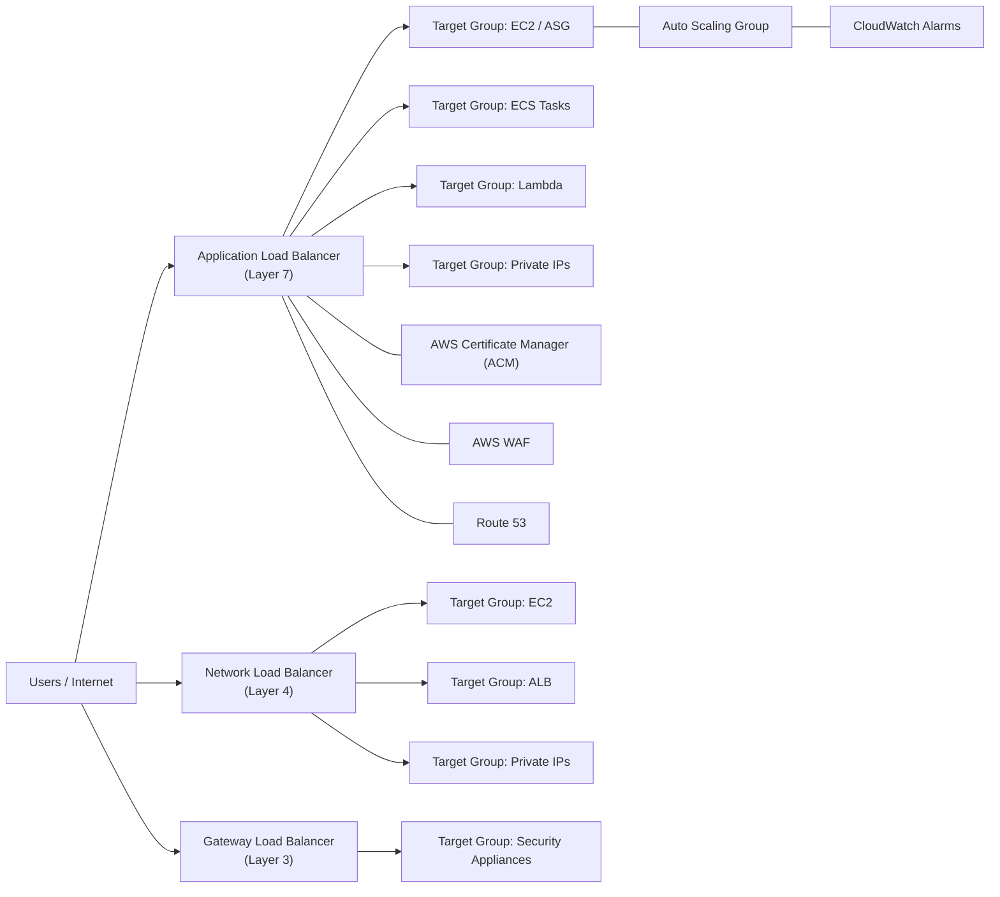
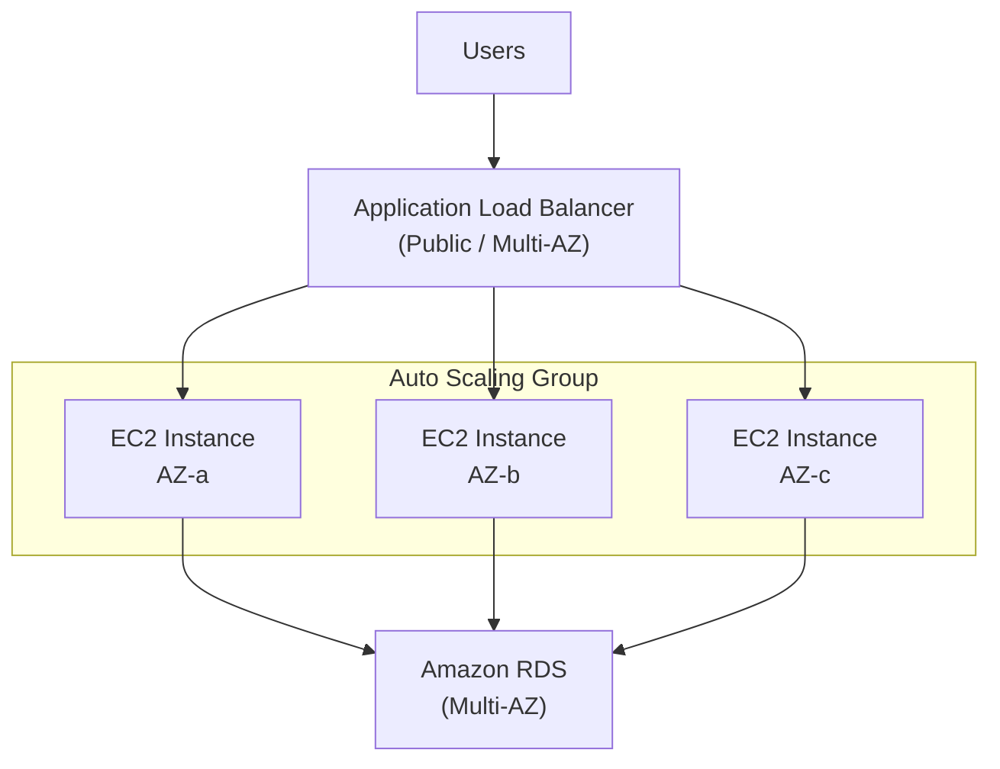
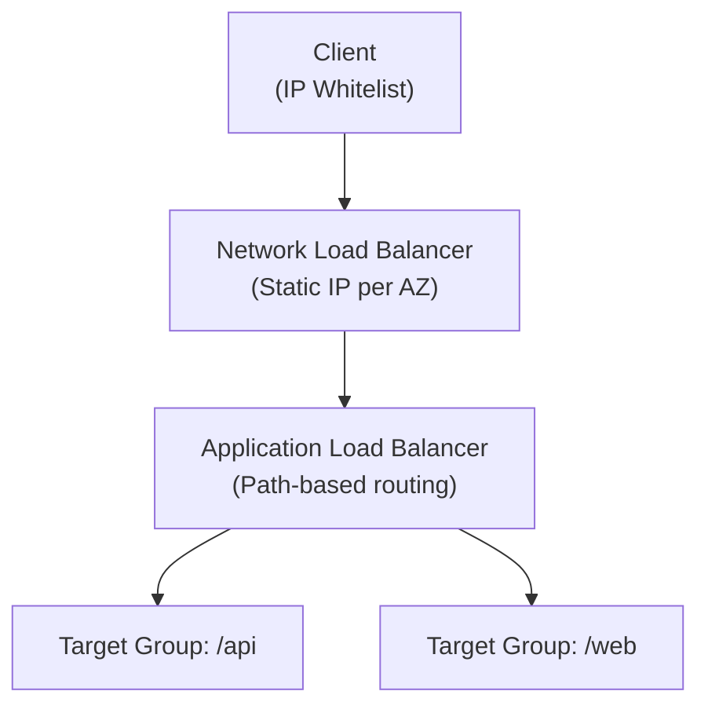
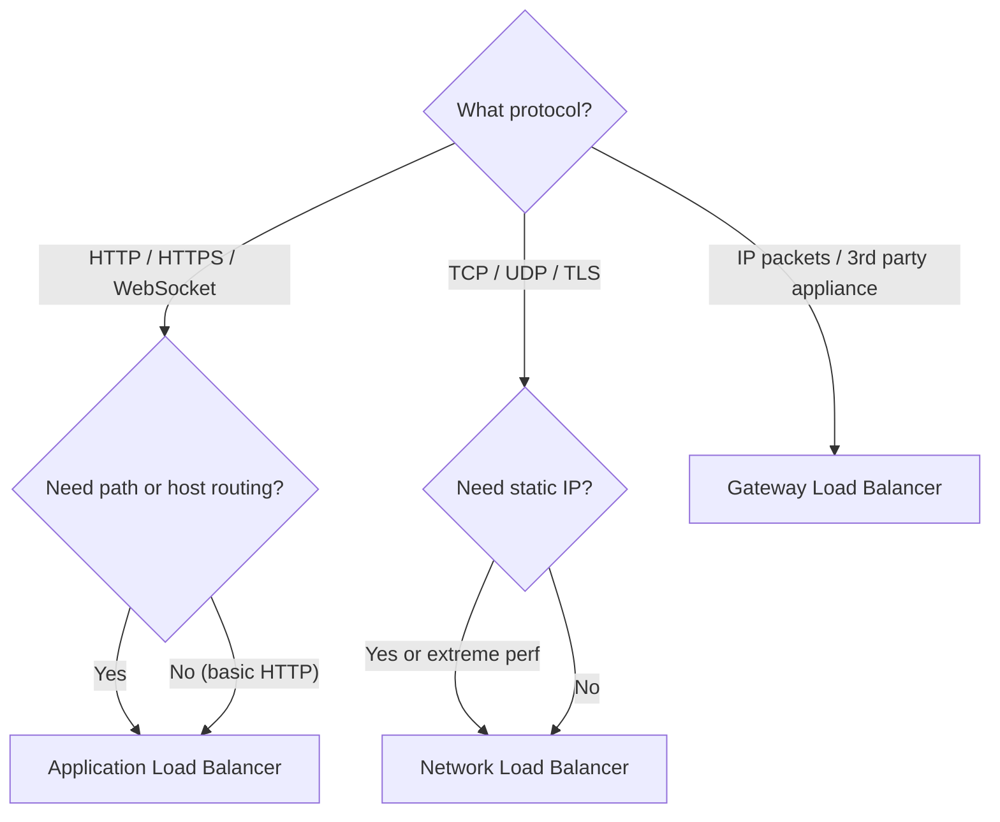
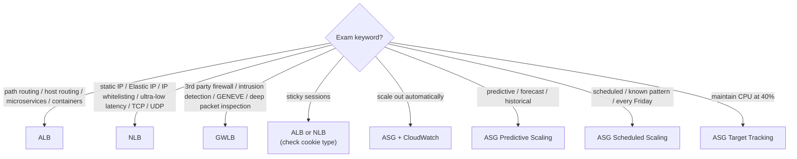

# Load Balancing & Scaling — Concept Mapper (Phase 1)
**Date:** 2026-05-19 11:43
**Domain:** Load Balancing & Scaling
**Topics:** application-load-balancer (ALB), network-load-balancer (NLB), gateway-load-balancer (GWLB), classic-load-balancer (CLB), auto-scaling-group (ASG), sticky-sessions, cross-zone-load-balancing, ssl-server-name-indication (SNI), connection-draining

---

## 1. Service Overview

### Elastic Load Balancer (ELB) — Managed Load Balancing

| Type | Layer | Protocols | Year | Key Use Case |
|------|-------|-----------|------|-------------|
| **Classic Load Balancer (CLB)** | 4/7 | TCP, HTTP, HTTPS | 2009 | Legacy — avoid for new deployments |
| **Application Load Balancer (ALB)** | 7 | HTTP, HTTPS, WebSocket, HTTP/2 | 2016 | Microservices, containers, path/host routing |
| **Network Load Balancer (NLB)** | 4 | TCP, TLS, UDP | 2017 | Extreme performance, static IPs, millions req/sec |
| **Gateway Load Balancer (GWLB)** | 3 | IP packets (GENEVE port 6081) | 2020 | 3rd-party firewalls, intrusion detection, deep packet inspection |

### Auto Scaling Group (ASG)
- Automatically scales EC2 count based on load (scale out/in)
- Enforces min/desired/max capacity; re-creates unhealthy instances
- **ASG itself is free** — only pay for underlying EC2 instances
- Uses **Launch Templates** (Launch Configurations are deprecated)

---

## 2. Real-World Use Cases

- **"E-commerce app needs to handle Black Friday traffic spikes"** → ALB + ASG with Predictive Scaling (ML-based forecasting from historical patterns)
- **"Financial trading platform needs ultra-low latency TCP connections"** → NLB (millions req/sec, static IP per Availability Zone (AZ))
- **"Company needs to inspect all traffic through 3rd-party firewall appliances"** → Gateway Load Balancer (GWLB) with transparent network gateway
- **"Microservices with path-based routing: `/users`, `/orders`, `/search`"** → ALB with multiple Target Groups per URL path
- **"Need static IP for whitelisting but also HTTP routing"** → NLB in front of ALB (stacking pattern)
- **"Scheduled batch jobs every Friday at 5 PM"** → ASG Scheduled Scaling (increase min capacity ahead of known demand)

---

## 3. Service Integrations



### Target Group Support Matrix

| Target Type | ALB | NLB | GWLB |
|-------------|-----|-----|------|
| EC2 instances | ✓ | ✓ | ✓ |
| ECS tasks | ✓ | ✗ | ✗ |
| Lambda functions | ✓ | ✗ | ✗ |
| Private IP addresses | ✓ | ✓ | ✓ |
| ALB (stacking) | ✗ | ✓ | ✗ |

---

## 4. Architectural Patterns

### Pattern 1: Standard Web Application (ALB + ASG)



### Pattern 2: NLB + ALB Stacking (Static IP + HTTP Routing)



### Decision Tree: Which Load Balancer?



---

## 5. Cost Implications

| Service | Pricing Model | Key Considerations |
|---------|---------------|-------------------|
| **ALB** | Per hour + per LCU | Cross-zone LB is free; one ALB replaces multiple CLBs |
| **NLB** | Per hour + per NLCU | Cross-zone LB **incurs charges** if enabled |
| **GWLB** | Per hour + per GLCU | Cross-zone LB **incurs charges** if enabled |
| **CLB** | Per hour + per GB processed | Legacy pricing; migrate to ALB for savings |
| **ASG** | Free (pay only for EC2) | Use Predictive Scaling to avoid over-provisioning |

---

## 6. Security Considerations

### Security Group Pattern
```
                  ┌─────────────────────┐
  Internet ──────►│  LB Security Group  │
                  │  Inbound: 80/443    │
                  │  Source: 0.0.0.0/0  │
                  └────────┬────────────┘
                           │
                  ┌────────▼────────────┐
                  │  EC2 Security Group │
                  │  Inbound: 80        │
                  │  Source: LB SG ID   │  ← Only LB can reach EC2
                  └─────────────────────┘
```

- **ALB/CLB**: Client IP NOT visible to backend — must read `X-Forwarded-For`, `X-Forwarded-Port`, `X-Forwarded-Proto` headers
- **NLB**: Client IP IS visible (Layer 4 pass-through)
- **SSL/TLS termination**: Manage certs via AWS Certificate Manager (ACM)
- **Server Name Indication (SNI)**: ALB and NLB support multiple SSL certs per LB. CLB does NOT.
- **WAF integration**: Only ALB supports AWS WAF. NLB does NOT.

---

## 7. Exam Tips — Keyword Decision Tree



### Critical Exam Traps

| Trap | What They Test | Correct Answer |
|------|---------------|----------------|
| Cross-zone defaults | "Which LB has cross-zone enabled by default?" | ALB only (free). NLB/GWLB/CLB = disabled. |
| SNI support | "Multiple SSL certs on one LB?" | ALB & NLB yes. CLB = NO (one cert per CLB). |
| Client IP behind ALB | "How does EC2 see real client IP?" | `X-Forwarded-For` header |
| NLB → ALB | "Is this a valid architecture?" | Yes — NLB target group can point to ALB |
| GWLB port | "What protocol/port?" | GENEVE on port 6081 |
| ASG cost | "How much does ASG cost?" | Free — only pay for EC2 instances |
| Launch Template vs Config | "Which should you use?" | Launch Template (Configurations deprecated) |
| Deregistration Delay | "What is 300 second default?" | Time for in-flight requests to complete |
| Cooldown period | "Why doesn't ASG scale again?" | Default 300s cooldown after each scaling action |
| Sticky session cookies | "Which cookie name for ALB?" | `AWSALB` (duration), `AWSALBAPP` (application) |
| WAF on NLB | "Can you attach WAF to NLB?" | NO — WAF only on ALB, CloudFront, API Gateway |
| Lambda as target | "Can ALB route to Lambda?" | Yes — HTTP request converted to JSON event |

---

## Key Takeaways

- **ALB = Layer 7 (HTTP)**: Path/host routing, microservices, containers, Lambda, WebSocket. Cross-zone enabled by default (free).
- **NLB = Layer 4 (TCP/UDP)**: Static IP per AZ, millions req/sec, ultra-low latency. Can target ALB for stacking.
- **GWLB = Layer 3 (IP)**: 3rd-party network appliances (firewalls, IDS/IPS). GENEVE protocol on port 6081.
- **SNI**: Multiple SSL certs on ALB/NLB. NOT on CLB.
- **ASG scaling types**: Target Tracking (simplest), Simple/Step (alarm-based), Scheduled (known times), Predictive (ML forecast).
- **ASG is free**; cooldown default 300s; uses Launch Templates (not deprecated Launch Configurations).
- **Security pattern**: LB SG allows internet → EC2 SG allows only LB SG ID. Use `X-Forwarded-For` for client IP behind ALB.
