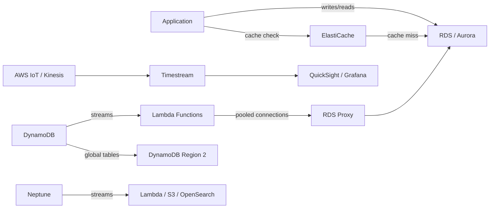
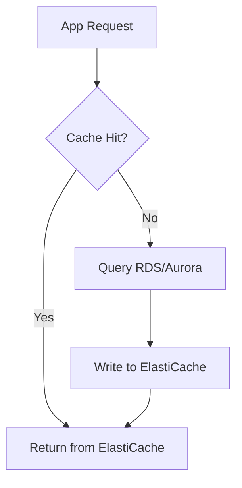
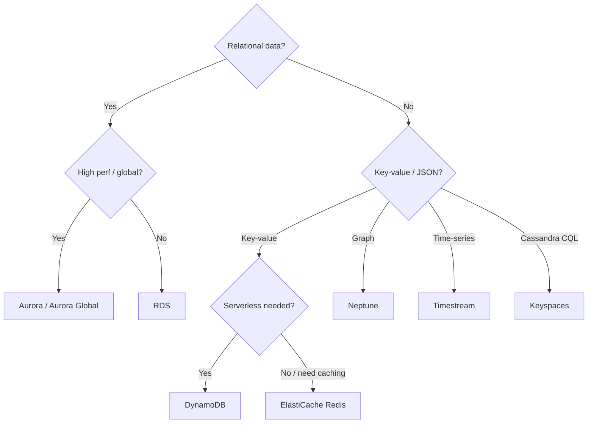
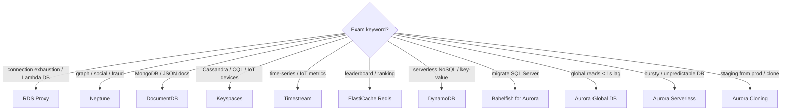

# Databases Domain — Concept Map

## 1. Service Overview

### Relational (SQL/OLTP)

**Amazon Relational Database Service (RDS)**
- Managed SQL database supporting PostgreSQL, MySQL, MariaDB, Oracle, MS SQL Server, IBM DB2, Aurora
- AWS manages provisioning, OS patching, backups (Point-in-Time Recovery / PITR), monitoring
- Cannot SSH in (exception: RDS Custom for Oracle/MS SQL Server)
- Use case: standard relational workloads, transactions, moderate scale

**Amazon Aurora**
- AWS-proprietary, MySQL/PostgreSQL-compatible
- 5x MySQL performance, 3x PostgreSQL performance on RDS — costs ~20% more
- Storage auto-grows 10 GB increments up to 256 TB
- Up to 15 read replicas with < 10 ms lag; failover < 30 seconds
- Use case: high-performance relational, global distribution, HA-native

### In-Memory Cache

**Amazon ElastiCache**
- Managed Redis or Memcached; sub-millisecond latency
- **Requires heavy application code changes** to implement
- Use case: DB query caching, session store, gaming leaderboards (Redis Sorted Sets)

### NoSQL / Serverless

**Amazon DynamoDB**
- Serverless, fully managed NoSQL; millisecond latency; Multi-Availability Zone (AZ) by default
- Provisioned (with auto-scaling) or on-demand capacity
- Security via Identity and Access Management (IAM) only — no Security Groups (SGs)
- Use case: serverless apps, key/value, rapidly evolving schemas, distributed cache (Time to Live / TTL)

### Purpose-Built Databases

| Service | Model | Use Case |
|---------|-------|----------|
| **Amazon DocumentDB** | MongoDB-compatible JSON | Store/query/index JSON documents |
| **Amazon Neptune** | Graph database | Social networks, fraud detection, knowledge graphs |
| **Amazon Keyspaces** | Apache Cassandra-compatible | IoT device info, time-series at scale |
| **Amazon Timestream** | Time series | IoT metrics, operational analytics (1000x faster, 1/10th cost vs RDBMS) |

---

## 2. Real-World Use Cases

- **E-commerce checkout** → Aurora (transactions, HA, fast failover) + ElastiCache Redis (session store, cart caching)
- **Gaming leaderboard** → ElastiCache Redis Sorted Sets (real-time ranking, guaranteed uniqueness)
- **Lambda-heavy app exhausting DB connections** → Relational Database Service (RDS) Proxy (connection pooling, 66% faster failover)
- **Migrate SQL Server to AWS with minimal code changes** → Babelfish for Aurora PostgreSQL (T-SQL compatibility)
- **Unpredictable, bursty workload** → Aurora Serverless (auto-scale to zero, pay per second)
- **Global low-latency reads** → Aurora Global Database (< 1s replication, RTO < 1 min)
- **Social network relationship queries** → Neptune (billions of relations, ms latency)
- **IoT sensor time-series at massive scale** → Timestream (tiered storage: memory → cost-optimized)
- **Staging database from production without impact** → Aurora Database Cloning (copy-on-write, instant)

---

## 3. Service Integrations



```
ASCII fallback:
App → ElastiCache (hit?) → yes: return | no: → RDS → write to cache
Lambda (many) → RDS Proxy (pool) → RDS/Aurora
DynamoDB → Streams → Lambda → fan-out
IoT/Kinesis → Timestream → QuickSight/Grafana
```

---

## 4. Architectural Patterns

### Pattern A: Cache-Aside (Lazy Loading)



```
ASCII: App → ElastiCache? → HIT → return
                          → MISS → RDS → write cache → return
```

- Data can become stale; needs invalidation strategy
- Write Through variant: update cache on every DB write (no stale data, but write penalty)

### Pattern B: Stateless App with Session Store

- User → any app instance → read/write session in ElastiCache → all instances share state
- Enables horizontal scaling without sticky sessions

### Pattern C: Lambda + RDS Proxy

- Lambda functions open many short-lived connections → overwhelms RDS
- RDS Proxy pools connections, enforces IAM auth, reduces failover time by 66%
- Proxy is **never publicly accessible** — must be in Virtual Private Cloud (VPC)

### Pattern D: Aurora Global Database

- 1 primary region (read/write) + up to 10 secondary regions (read-only)
- Replication lag < 1 second; DR promotion RTO < 1 minute
- Up to 16 replicas per secondary region

### Pattern Selection Decision Tree



```
ASCII: Relational? → Yes → High perf? → Aurora / No → RDS
                   → No  → Key-value? → Serverless? → DynamoDB / Cache? → ElastiCache
                         → Graph → Neptune | Time-series → Timestream | CQL → Keyspaces
```

---

## 5. Cost Implications

| Service | Pricing Model | Cost Optimization |
|---------|--------------|-------------------|
| RDS | Instance hours + storage + I/O | Reserved Instances for steady workloads; stop and snapshot instead of running idle (stopped RDS still charges storage) |
| Aurora | Instance hours + I/O requests + storage | Aurora Serverless for bursty workloads; cloning instead of full copies |
| ElastiCache | Node hours + data transfer | Right-size instance types; use Reserved Nodes |
| DynamoDB | Read/Write Capacity Units (RCU/WCU) or On-Demand | On-Demand for unpredictable; Provisioned + auto-scaling for steady; export/import via S3 avoids RCU/WCU |
| Aurora Global | Primary + secondary instance hours + replication | Cross-Region Read Replicas cheaper if lower HA acceptable |

**Key cost traps:**
- Aurora costs ~20% more than RDS but is more efficient per query
- RDS same-region cross-AZ replication is FREE; cross-region costs data transfer fees
- Stopped RDS instances still charge for storage — snapshot & delete to save

---

## 6. Security Considerations

```
┌─────────────────────────────────────────────┐
│  PERIMETER: VPC / Subnets / NACLs           │
│  ┌─────────────────────────────────────────┐ │
│  │  NETWORK: Security Groups               │ │
│  │  ┌─────────────────────────────────────┐ │ │
│  │  │  ACCESS: IAM / RDS Proxy IAM Auth   │ │ │
│  │  │  ┌─────────────────────────────────┐ │ │ │
│  │  │  │  DATA: KMS encryption at rest   │ │ │ │
│  │  │  │  TLS encryption in transit       │ │ │ │
│  │  │  └─────────────────────────────────┘ │ │ │
│  │  └─────────────────────────────────────┘ │ │
│  └─────────────────────────────────────────┘ │
└─────────────────────────────────────────────┘
```

- **RDS/Aurora at-rest**: Key Management Service (KMS); must be set at launch. Unencrypted master → replicas cannot be encrypted. To encrypt existing: snapshot → restore encrypted.
- **RDS/Aurora in-transit**: TLS by default (AWS root certs)
- **ElastiCache Redis**: Redis AUTH token + SSL; IAM auth supported
- **ElastiCache Memcached**: SASL-based authentication
- **DynamoDB**: IAM only — no Security Groups, no database-level passwords
- **RDS Proxy**: Enforces IAM auth; credentials stored in Secrets Manager; never publicly accessible

---

## 7. Exam Tips — Keyword Decision Tree



```
ASCII:
connection exhaustion → RDS Proxy
graph/social/fraud → Neptune
MongoDB/JSON → DocumentDB
Cassandra/CQL → Keyspaces
time-series/IoT → Timestream
leaderboard → ElastiCache Redis Sorted Sets
serverless NoSQL → DynamoDB
SQL Server migration → Babelfish
global < 1s replication → Aurora Global
bursty workload → Aurora Serverless
staging clone → Aurora Cloning
```

### Critical Distinctions for the Exam

| Concept | Truth | Common Trap |
|---------|-------|-------------|
| Read Replica | ASYNC, for read scaling, can be cross-region | Not for DR — that's Multi-AZ |
| Multi-AZ | SYNC, for DR/HA only, standby NOT readable | Not for scaling reads |
| Aurora backups | Cannot be disabled (1-35 days always) | RDS can disable (set to 0) |
| ElastiCache | Requires heavy code changes | Not a drop-in cache |
| RDS Proxy | Never publicly accessible (VPC only) | Cannot be internet-facing |
| RDS Custom | SSH allowed (Oracle/MS SQL Server) | Standard RDS: no SSH |
| DynamoDB auth | IAM only — no SGs | Not managed via SGs |
| Encrypting existing RDS | Snapshot → restore encrypted | Cannot encrypt in-place |

---

## Key Takeaways

1. **RDS vs Aurora**: Aurora for higher performance/HA needs (5x MySQL, 3x PostgreSQL), but ~20% more cost
2. **Read Replica = read scaling (ASYNC)**, **Multi-AZ = disaster recovery (SYNC)** — never confuse these
3. **RDS Proxy** solves Lambda connection exhaustion — never publicly accessible, IAM + Secrets Manager
4. **Aurora Global Database** for global reads with < 1s lag and DR RTO < 1 minute
5. **ElastiCache Redis vs Memcached**: Redis for HA/persistence/sorted sets; Memcached for simple horizontal sharding
6. **DynamoDB** uses IAM only (no SGs); can replace ElastiCache for session data via TTL
7. **Purpose-built databases**: Neptune (graph), DocumentDB (MongoDB), Keyspaces (Cassandra), Timestream (time-series) — know keyword-to-service mapping
