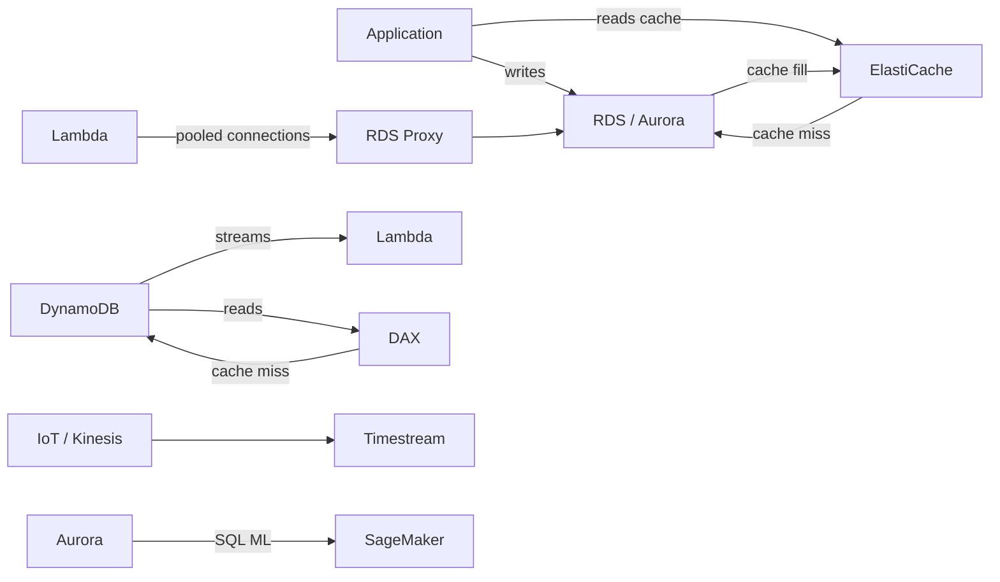
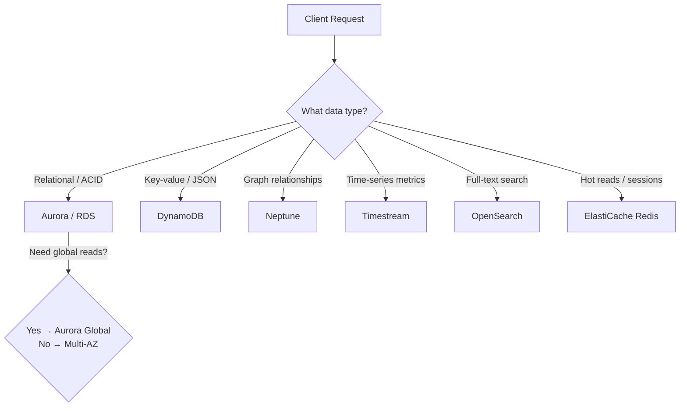
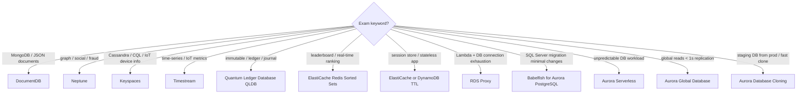

# Databases — Learn and Test (Phase 1)
**Date:** 2026-05-29 18:02
**Score:** 15/18 (83%) — All 7 sections complete
**Missed topics:** aurora-ml, defense-in-depth, babelfish

---

## Section 1: Service Overview

### Amazon Relational Database Service (RDS)
Managed SQL database supporting PostgreSQL, MySQL, MariaDB, Oracle, Microsoft SQL Server, IBM DB2, and Aurora. AWS handles provisioning, OS patching, continuous backups (PITR), and monitoring.

| Feature | Detail |
|---------|--------|
| Storage | Backed by Elastic Block Store (EBS) |
| Scaling | Vertical (instance resize) + horizontal (read replicas) |
| SSH access | **Not allowed** (managed service) — except RDS Custom |
| Use case | Relational datasets, Online Transaction Processing (OLTP), SQL queries |

**RDS Custom** — available for Oracle and Microsoft SQL Server only. Full OS/DB admin access (SSH or SSM Session Manager). Must deactivate Automation Mode before customizing.

### Amazon Aurora
AWS proprietary; PostgreSQL and MySQL compatible.
- 5x MySQL on RDS performance; 3x PostgreSQL on RDS
- Storage auto-grows: 10 GB increments → up to 256 TB
- Up to 15 read replicas with sub-10 ms lag
- 6 copies of data across 3 AZs automatically
- Failover in < 30 seconds
- Costs ~20% more than standard RDS

### Amazon ElastiCache
Managed in-memory data store — Redis or Memcached. Sub-millisecond latency.

| | Redis | Memcached |
|---|---|---|
| Multi-AZ + failover | Yes | No |
| Read replicas | Yes | No |
| Persistence | AOF | None |
| Data structures | Sets, Sorted Sets | Basic key-value |

**Important:** Requires heavy application code changes.

### Amazon DynamoDB
Serverless NoSQL — millisecond latency, Multi-AZ by default. Uses IAM only for security. Capacity: provisioned (with auto-scaling) or on-demand.

### Specialty Databases
| Service | Type | Trigger Keyword |
|---------|------|----------------|
| DocumentDB | MongoDB-compatible document DB | "JSON documents", "MongoDB" |
| Neptune | Graph database | "social network", "fraud detection" |
| Keyspaces | Cassandra-compatible | "CQL", "Cassandra", "IoT device info" |
| Timestream | Time-series DB | "IoT metrics", "time-series analytics" |
| QLDB | Ledger/immutable | "immutable journal", "financial ledger" |

### Quiz: Section 1
**Q1** ✓ — rds-custom
Oracle DB with full OS access + managed benefits → which service?
A) RDS for Oracle with Multi-AZ B) RDS Custom for Oracle C) Oracle on EC2 D) Aurora with Oracle compatibility
💡 Hint: Which RDS variant gives managed benefits while allowing OS access?
**Your answer: B** — Correct. RDS Custom for Oracle gives full OS/DB admin access with managed backups.

**Q2** ✓ — dynamodb
Mobile gaming app, JSON documents, unpredictable traffic (100-10K req/s), zero capacity planning → which DB?
A) Aurora Serverless B) RDS MySQL Auto Scaling C) DynamoDB on-demand D) ElastiCache Redis cluster
💡 Hint: Serverless, handles JSON/key-value natively, auto-scales based on traffic.
**Your answer: C** — Correct. DynamoDB on-demand scales instantly with zero capacity planning for JSON/key-value workloads.

**Q3** ✓ — elasticache
Which statement about ElastiCache is TRUE?
A) Memcached supports Multi-AZ + persistence B) No app code changes needed C) Redis Sorted Sets for leaderboards D) Redis has no auth beyond SGs
💡 Hint: Which engine supports sorted sets and rankings?
**Your answer: C** — Correct. Redis Sorted Sets guarantee uniqueness and automatic ordering for real-time leaderboards.

---

## Section 2: Real-World Use Cases

### When to Use Which Database
- SQL + joins + transactions + highest perf → Aurora
- SQL + specific engine (Oracle, SQL Server) → RDS
- Key-value / JSON + serverless → DynamoDB
- Graph relationships → Neptune
- MongoDB-compatible → DocumentDB
- Cassandra-compatible → Keyspaces
- Time-series → Timestream
- In-memory cache / sessions → ElastiCache

### Real-World Scenarios
1. E-commerce: Aurora (catalog/orders) + DynamoDB/ElastiCache (sessions) + OpenSearch (search)
2. Social Media: Aurora (profiles) + Neptune (connections) + ElastiCache (feed cache)
3. IoT: DynamoDB (device state) + Timestream (metrics) + Neptune (device relationships)
4. Financial: Aurora (transactions) + QLDB (audit trail) + Neptune (fraud detection)
5. Migration: Oracle → RDS Custom; SQL Server → Babelfish; MongoDB → DocumentDB; Cassandra → Keyspaces

### Quiz: Section 2
**Q1** ✓ — rds-custom
Healthcare EHR Oracle migration, need custom patches + OS scripts + minimal app changes → which target?
A) Aurora PostgreSQL + Babelfish B) RDS for Oracle (standard) C) RDS Custom for Oracle D) DynamoDB with DMS
💡 Hint: "Oracle" + "custom OS patches" + "minimal app changes"
**Your answer: C** — Correct. RDS Custom for Oracle keeps Oracle engine with full OS access.

**Q2** ✓ — elasticache
Real-time leaderboard, millions of players, instant ranking → which solution?
A) DynamoDB with GSI B) Aurora PostgreSQL ORDER BY C) ElastiCache Redis Sorted Sets D) Memcached custom ranking
💡 Hint: In-memory data structure guaranteeing uniqueness + automatic ordering.
**Your answer: C** — Correct. Redis Sorted Sets purpose-built for real-time rankings.

---

## Section 3: Service Integrations

### Caching Patterns

**Lazy Loading (Cache-Aside) with ElastiCache + Relational Database Service (RDS)**
- App queries ElastiCache first → **cache hit**: return immediately (sub-ms) → **cache miss**: read from RDS → write result to ElastiCache
- Stale data risk: cache doesn't know when DB changes
- Mitigation: Time-To-Live (TTL) expiry or Write-Through pattern

**Write-Through with ElastiCache + RDS**
- Every DB write also updates ElastiCache → **no stale data**
- Trade-off: higher write latency (two writes), wasted cache space for rarely-read data
- Best practice: combine Write-Through + TTL for balance

**DynamoDB Accelerator (DAX)**
- In-memory cache purpose-built for DynamoDB — **microsecond** read latency
- Fully managed, no application code change needed (unlike ElastiCache)
- Sits between app and DynamoDB transparently

| Pattern | Latency | Code Change | Stale Data Risk |
|---------|---------|-------------|-----------------|
| ElastiCache Lazy Loading | sub-ms | Heavy | Yes (until TTL) |
| ElastiCache Write-Through | sub-ms | Heavy | No |
| DAX for DynamoDB | microsecond | None | No (write-through) |

### Connection Management

**RDS Proxy + Lambda**
- Lambda functions open many short-lived connections → exhausts DB connection pool
- RDS Proxy pools and shares connections → reduces CPU/RAM stress on RDS/Aurora
- Reduces failover time by up to 66%
- Enforces Identity and Access Management (IAM) authentication; credentials stored in Secrets Manager
- **Never publicly accessible** — must be within Virtual Private Cloud (VPC)

### Event-Driven Patterns

**DynamoDB Streams + Lambda**
- Ordered stream of item-level modifications (INSERT, MODIFY, REMOVE)
- Trigger Lambda functions for real-time reactions
- **Required** for DynamoDB Global Tables (active-active replication)
- Alternative: Kinesis Data Streams adapter for higher fan-out

**Neptune Streams**
- Real-time ordered sequence of graph changes → HTTP REST API
- Fan-out to Simple Storage Service (S3), OpenSearch, ElastiCache
- Use case: sync graph data to analytics or search layers

### Machine Learning Integration

**Aurora Machine Learning**
- Call Amazon SageMaker or Amazon Comprehend directly via SQL queries
- Use cases: fraud detection, sentiment analysis, product recommendations
- No data movement needed — predictions returned inline with query results

### Data Pipeline Integration

**Timestream Ingestion Pipeline**
- Sources: AWS IoT Core / Kinesis Data Streams / Prometheus / Telegraf / Managed Streaming for Apache Kafka (MSK)
- Processing: Lambda or Kinesis Data Analytics (Apache Flink)
- Storage: Amazon Timestream (memory tier → cost-optimized tier)
- Consumption: QuickSight / SageMaker / Grafana / JDBC



```
ASCII fallback:
App ──write──► RDS/Aurora ◄──cache miss── ElastiCache ◄──read── App
Lambda ──► RDS Proxy ──► RDS/Aurora
DynamoDB ──streams──► Lambda    |    App ──► DAX ──► DynamoDB
IoT/Kinesis ──► Timestream ──► QuickSight
Aurora ──SQL──► SageMaker (ML predictions)
```

### Quiz: Section 3
**Q1** ✓ — rds-proxy
A serverless application uses hundreds of Lambda functions that connect to an Aurora MySQL database. During peak traffic, the database starts rejecting connections with "Too many connections" errors. Which solution addresses this with the LEAST operational overhead?
A) Increase the Aurora instance class to support more connections and set Lambda reserved concurrency limits B) Place an RDS Proxy between Lambda and Aurora to pool and share database connections C) Migrate from Aurora to DynamoDB to eliminate connection management entirely D) Implement connection pooling logic within each Lambda function using a shared connection object
💡 Hint: Think about the managed service specifically designed to solve Lambda-to-database connection exhaustion.
**Your answer: B** — Correct. RDS Proxy pools and shares connections across Lambda invocations, reducing DB stress and failover time by 66%.

**Q2** ✓ — dax
An application uses DynamoDB as its primary datastore. Read traffic is extremely hot on a small set of keys, causing throttling. The team wants microsecond read latency with minimal code changes. Which caching solution?
A) Deploy an ElastiCache Redis cluster with Lazy Loading B) Enable DynamoDB Accelerator (DAX) in front of the DynamoDB table C) Add DynamoDB read replicas using Global Tables D) Switch DynamoDB to on-demand capacity mode
💡 Hint: Consider the in-memory cache that sits transparently in front of DynamoDB with no application code changes.
**Your answer: B** — Correct. DAX delivers microsecond reads with zero code changes, sitting transparently between app and DynamoDB.

**Q3** ✗ — aurora-ml
A company runs Aurora MySQL and wants to add fraud detection to SQL queries without moving data to a separate ML service. Which approach requires the LEAST data pipeline changes?
A) Export Aurora data nightly to S3, run SageMaker batch inference, import predictions back B) Use DynamoDB Streams to send order data to a SageMaker endpoint C) Enable Aurora Machine Learning to call SageMaker directly from SQL queries D) Deploy a Lambda function triggered by Aurora event notifications that calls Comprehend
💡 Hint: Think about which Aurora feature lets you invoke ML models directly within SQL.
**Your answer: D** — Incorrect. Correct: C. Aurora ML calls SageMaker/Comprehend directly from SQL — predictions inline with query results, no pipeline needed.

---

## Section 4: Architectural Patterns

### Pattern 1: Web Application with Caching Layer

```
Internet → Application Load Balancer (ALB) → EC2/ECS → ElastiCache (sessions + DB cache) → Aurora (primary data)
```

- **When to use**: Traditional web apps with predictable relational data + high read load
- ElastiCache stores user sessions (stateless app tier) + DB query cache
- Aurora handles transactions; read replicas for read scaling

### Pattern 2: Serverless API with DynamoDB

```
API Gateway → Lambda → DynamoDB (+ DAX for hot reads)
```

- **When to use**: Unpredictable traffic, pay-per-request, rapid schema evolution
- Zero server management; scales from 0 to millions of requests
- DAX adds microsecond reads with no code change

### Pattern 3: Global Application with Aurora Global Database

```
Primary Region (us-east-1): Aurora Read/Write
Secondary Regions (eu-west-1, ap-southeast-1): Aurora Read-Only
Replication lag < 1 second; DR promotion RTO < 1 minute
```

- **When to use**: Global user base, low-latency reads worldwide, cross-region Disaster Recovery (DR)
- Up to 10 secondary regions, 16 read replicas each

### Pattern 4: Event-Driven Data Processing

```
DynamoDB → DynamoDB Streams → Lambda → S3 / OpenSearch / SNS
```

- **When to use**: Real-time reactions to data changes (notifications, indexing, analytics)
- Global Tables require Streams enabled (active-active multi-region)

### Pattern 5: Hybrid Database Architecture

| Tier | Service | Purpose |
|------|---------|---------|
| Transactional | Aurora / RDS | Orders, accounts, ACID transactions |
| Cache | ElastiCache Redis | Session store, leaderboards, hot queries |
| NoSQL | DynamoDB | User preferences, cart, key-value lookups |
| Search | OpenSearch | Full-text search, log analytics |
| Graph | Neptune | Fraud detection, social connections |
| Time-series | Timestream | IoT metrics, operational monitoring |



```
ASCII fallback:
Client Request
  ├─ Relational/ACID ──► Aurora / RDS
  ├─ Key-value/JSON ──► DynamoDB
  ├─ Graph ──► Neptune
  ├─ Time-series ──► Timestream
  ├─ Full-text search ──► OpenSearch
  └─ Hot reads/sessions ──► ElastiCache Redis
```

### Quiz: Section 4
**Q1** ✓ — dynamodb-serverless-pattern
A startup needs fully serverless backend, unpredictable traffic (100-500K req/s), simple key-value data. Which architecture?
A) ALB → ECS Fargate → Aurora Serverless B) API Gateway → Lambda → DynamoDB on-demand + DAX C) API Gateway → Lambda → Aurora Serverless + RDS Proxy D) CloudFront → ALB → ASG EC2 → DynamoDB provisioned
💡 Hint: Match key-value data model + unpredictable traffic to the natively serverless database.
**Your answer: B** — Correct. API GW → Lambda → DynamoDB on-demand is the fully serverless key-value stack with zero capacity planning.

**Q2** ✓ — aurora-global
A global e-commerce company needs low-latency reads from 3 continents + cross-region DR with RTO < 1 minute. Which Aurora feature?
A) Aurora Multi-AZ across 3 AZs B) Aurora Global Database with secondary regions C) Aurora Read Replicas per region + manual promotion D) Aurora Serverless + DynamoDB Streams replication
💡 Hint: Aurora feature for global distribution with sub-second replication and fast promotion.
**Your answer: B** — Correct. Aurora Global Database: <1s replication lag, <1 min DR promotion, up to 10 secondary regions.

---

## Section 5: Cost Implications

### Pricing Models by Service

| Service | Pricing Model | Cost Optimization |
|---------|--------------|-------------------|
| **RDS** | Instance hours + storage + I/O + backups | Reserved Instances for steady workloads; stop idle dev/test DBs (snapshot + restore) |
| **Aurora** | Instance hours + storage + I/O (pay per million requests) | Aurora Serverless for intermittent workloads; ~20% more than RDS but higher efficiency |
| **Aurora Serverless** | Pay per Aurora Capacity Unit (ACU)-second | Best for unpredictable/spiky workloads — scales to zero |
| **DynamoDB On-Demand** | Pay per read/write request | Unpredictable traffic; no capacity planning |
| **DynamoDB Provisioned** | Provisioned Read Capacity Units (RCU) / Write Capacity Units (WCU) + auto-scaling | Predictable traffic with auto-scaling; cheaper than on-demand for steady loads |
| **ElastiCache** | Node hours (instance type) | Right-size nodes; use Reserved Nodes for long-term |
| **DAX** | Node hours | Only when microsecond reads needed; otherwise DynamoDB alone |

### Key Cost Traps

- **Stopped RDS still charges for storage** — snapshot and delete if idle long-term, restore when needed
- **RDS Read Replicas cross-region** — incur data transfer costs (same-region is free)
- **Aurora backups cannot be disabled** — always incur backup storage costs
- **DynamoDB Global Tables** — pay for replicated writes in each region
- **ElastiCache** — requires code changes; don't provision if you won't invest in app integration

### Cost Decision Framework

| Scenario | Cheapest Option |
|----------|----------------|
| Steady relational workload | RDS Reserved Instance |
| Spiky/unpredictable relational | Aurora Serverless |
| High-read key-value | DynamoDB Provisioned + DAX |
| Unpredictable NoSQL | DynamoDB On-Demand |
| Long-term idle dev DB | Snapshot → delete → restore later |

### Quiz: Section 5
**Q1** ✓ — rds-cost
Dev RDS MySQL idle every weekend. Most cost-effective approach?
A) Aurora Serverless scales to zero B) Stop RDS Friday, start Monday C) Snapshot → delete → restore weekly D) Scheduled smaller instance weekends
💡 Hint: Consider what happens to charges when RDS is "stopped" vs fully deleted.
**Your answer: C** — Correct. Snapshot → delete eliminates all instance+EBS charges. Stopped RDS still charges for storage and auto-restarts after 7 days.

**Q2** ✓ — dynamodb-pricing
SaaS app with predictable DynamoDB traffic (5K reads/s daytime, near zero overnight), currently on-demand. How to reduce costs?
A) Provisioned + auto-scaling (500-5000 RCU) B) On-demand + DAX C) Provisioned fixed 5000 RCU D) Reserved Capacity 5000 RCU 1-year
💡 Hint: Provisioned is cheaper than on-demand for predictable patterns; auto-scaling prevents overnight waste.
**Your answer: A** — Correct. Provisioned + auto-scaling adjusts to actual traffic, avoiding paying for 5K RCU overnight.

---

## Section 6: Security Considerations

### Encryption

| Service | At Rest | In Transit | Key Management |
|---------|---------|------------|----------------|
| **RDS/Aurora** | Key Management Service (KMS); defined at launch | TLS by default (AWS root certs) | AWS-managed or Customer Managed Key (CMK) |
| **DynamoDB** | KMS (AWS-owned / AWS-managed / CMK) | TLS | Per-table encryption settings |
| **ElastiCache Redis** | KMS | TLS (SSL in-flight) | AUTH token + Security Groups (SG) |
| **ElastiCache Memcached** | Not supported | Not natively supported | SASL authentication |

### Critical Security Rules

- **RDS**: If master is NOT encrypted, read replicas CANNOT be encrypted
- **To encrypt existing unencrypted RDS**: snapshot → restore as encrypted (cannot encrypt in-place)
- **RDS Proxy**: enforces Identity and Access Management (IAM) authentication; credentials in Secrets Manager; **never** publicly accessible
- **DynamoDB**: security through IAM only — no Security Groups, no username/password
- **RDS Custom**: SSH allowed (Oracle / SQL Server only) — unique exception to "no SSH" rule
- **Aurora audit logs**: can be sent to CloudWatch Logs for longer retention

### Network Security

| Layer | Control |
|-------|---------|
| VPC | RDS/Aurora/ElastiCache must be in VPC; DynamoDB is VPC endpoint accessible |
| Subnet | Place databases in **private subnets** only |
| Security Groups | Control inbound access to RDS/Aurora/ElastiCache |
| IAM | DynamoDB access; RDS/Aurora IAM Authentication option |
| RDS Proxy | VPC-only access; IAM enforcement; connection pooling |

```
Defense-in-depth layers (databases):
┌─────────────────────────────────────────┐
│ VPC (network isolation)                  │
│  ┌──────────────────────────────────┐   │
│  │ Private Subnet (no internet)      │   │
│  │  ┌───────────────────────────┐   │   │
│  │  │ Security Group (port ACL)  │   │   │
│  │  │  ┌────────────────────┐   │   │   │
│  │  │  │ IAM Auth (identity) │   │   │   │
│  │  │  │  ┌─────────────┐   │   │   │   │
│  │  │  │  │ KMS (encrypt)│   │   │   │   │
│  │  │  │  └─────────────┘   │   │   │   │
│  │  │  └────────────────────┘   │   │   │
│  │  └───────────────────────────┘   │   │
│  └──────────────────────────────────┘   │
└─────────────────────────────────────────┘
```

### Quiz: Section 6
**Q1** ✓ — rds-encryption
Existing unencrypted RDS MySQL needs encryption at rest for compliance. How to enable with minimal downtime?
A) Modify instance to enable encryption + reboot B) Encrypted snapshot → restore as new instance C) Enable KMS on existing EBS volumes D) New encrypted instance + DMS replication
💡 Hint: RDS encryption cannot be changed in-place — think snapshot-based approach.
**Your answer: B** — Correct. RDS encryption can't be added in-place; snapshot → copy with encryption → restore is the standard method.

**Q2** ✓ — rds-proxy-security
Which statement about database security is TRUE?
A) DynamoDB uses SGs + username/password B) Memcached supports KMS + TLS C) RDS Proxy: IAM auth + Secrets Manager + VPC-only D) Unencrypted master can have encrypted replicas
💡 Hint: Which managed service sits between Lambda and databases, enforcing IAM auth while remaining VPC-internal?
**Your answer: C** — Correct. RDS Proxy enforces IAM auth, uses Secrets Manager, never publicly accessible.

**Q3** ✗ — defense-in-depth
Aurora defense-in-depth: which combination provides MOST security layers?
A) Public subnet + SG + KMS B) Private subnet + VPC + SG + IAM Auth + KMS C) Private subnet + RDS Proxy + IAM + KMS + SG + Secrets Manager D) IAM Auth + KMS only
💡 Hint: Count layers: network → subnet → port → identity → encryption → credential management.
**Your answer: B** — Incorrect. Correct: C. RDS Proxy adds IAM enforcement + Secrets Manager = 6 layers vs B's 4 layers.

---

## Section 7: Exam Tips

### Keyword-to-Answer Decision Tree



```
ASCII fallback:
MongoDB/JSON docs ──► DocumentDB
Graph/social/fraud ──► Neptune
Cassandra/CQL ──► Keyspaces
Time-series/IoT ──► Timestream
Immutable/ledger ──► QLDB
Leaderboard ──► ElastiCache Redis
Sessions ──► ElastiCache or DynamoDB
Lambda connections ──► RDS Proxy
SQL Server migration ──► Babelfish
Unpredictable workload ──► Aurora Serverless
Global reads ──► Aurora Global DB
Fast clone ──► Aurora Cloning
```

### Critical Distinctions (Exam Traps)

| Statement | True/False | Explanation |
|-----------|-----------|-------------|
| Multi-AZ is for read scaling | **FALSE** | Multi-AZ is DR only; standby is NOT readable |
| ElastiCache requires no code changes | **FALSE** | Requires **heavy** application code changes |
| Aurora backups can be disabled | **FALSE** | Aurora automated backups CANNOT be disabled (RDS can set retention to 0) |
| RDS Read Replicas same-region cross-AZ are free | **TRUE** | No data transfer fee within same region |
| RDS Custom allows SSH | **TRUE** | Oracle and SQL Server only; standard RDS does NOT allow SSH |
| RDS Proxy is publicly accessible | **FALSE** | Never publicly accessible — VPC only |
| DynamoDB uses Security Groups | **FALSE** | DynamoDB security is IAM only |
| DAX requires code changes | **FALSE** | Seamless integration, no app code change |
| Aurora costs more than RDS | **TRUE** | ~20% more but higher efficiency |

### Read Replica vs Multi-AZ — The #1 Exam Distinction

| Feature | Read Replica | Multi-AZ |
|---------|-------------|----------|
| Replication | **ASYNC** | **SYNC** |
| Purpose | **Read scaling** | **Disaster Recovery (DR)** |
| Readable? | **Yes** (SELECT only) | **No** (standby only) |
| Cross-region | Yes (costs $$) | No |
| Failover | Manual promotion | Automatic DNS failover |
| App changes | Must update connection string | No changes (same DNS) |

### Aurora vs RDS — When to Choose Which

| Choose Aurora When | Choose RDS When |
|-------------------|----------------|
| Need 5x MySQL / 3x PostgreSQL performance | Need Oracle, SQL Server, IBM DB2, MariaDB |
| Need auto-scaling storage (up to 256 TB) | Budget-constrained (Aurora is ~20% more) |
| Need 15 read replicas with sub-10ms lag | Simpler workloads; fewer replicas sufficient |
| Need global distribution (Aurora Global) | Need OS/DB access (RDS Custom) |
| Need instant failover (< 30s) | Need specific engine features |
| Need database cloning for staging | |

### Key Takeaways
- **Database selection** is about matching the data model (relational, key-value, graph, time-series) to the right service
- **Read Replica = read scaling (ASYNC)** vs **Multi-AZ = DR (SYNC)** — most tested distinction
- **RDS Proxy** solves Lambda connection exhaustion and speeds up failover by 66%
- **DAX** gives microsecond reads with zero code change; **ElastiCache** requires heavy code changes
- **Aurora Serverless** for unpredictable workloads; **Aurora Global** for worldwide reads
- **Specialty databases** are triggered by keywords: graph→Neptune, time-series→Timestream, ledger→QLDB
- **Encrypt existing unencrypted RDS**: snapshot → restore as encrypted (no in-place option)

### Quiz: Section 7
**Q1** ✓ — read-replica-vs-multi-az
Company wants read scaling + automatic DR failover. Which combination?
A) Read Replicas (reads) + Multi-AZ (DR) B) Read Replicas only C) Multi-AZ only D) Cross-region Read Replicas
💡 Hint: Two separate features solving two different problems — ASYNC for reads, SYNC for DR.
**Your answer: A** — Correct. Read Replicas (ASYNC read scaling) + Multi-AZ (SYNC DR failover) are complementary.

**Q2** ✗ — babelfish
SQL Server migration with minimal code changes, T-SQL stored procedures. Which service?
A) Aurora PostgreSQL + Babelfish B) RDS for SQL Server + Multi-AZ C) RDS Custom for SQL Server D) DynamoDB + MGN
💡 Hint: "SQL Server migration" + "minimal code changes" + "T-SQL" = Babelfish trigger.
**Your answer: C** — Incorrect. Correct: A. Babelfish for Aurora PostgreSQL runs T-SQL natively on Aurora, enabling migration with minimal code changes.

**Q3** ✓ — aurora-backups, elasticache-code-changes (multi-select)
Which TWO statements are TRUE? (Select TWO)
A) DAX requires heavy code changes B) Aurora backups can't be disabled; RDS can set to 0 C) Multi-AZ standby serves read queries D) ElastiCache requires significant code changes
💡 Hint: Which caching service needs no code changes vs heavy changes; which backup behavior differs.
**Your answer: B, D** — Correct. Aurora backups always-on (can't disable); ElastiCache requires heavy app code changes.

---

## Final Summary
- **Total Score:** 15/18 (83%)
- **Missed topics:** aurora-ml, defense-in-depth (RDS Proxy layers), babelfish
- **Strong areas:** rds-proxy, dax, dynamodb, aurora-global, rds-encryption, read-replica-vs-multi-az, cost-optimization
- **Key lessons:**
  - Aurora ML calls SageMaker/Comprehend directly from SQL — no external pipeline needed
  - RDS Proxy adds IAM enforcement + Secrets Manager = more defense-in-depth layers than direct IAM Auth
  - "SQL Server migration + minimal changes + T-SQL" = Babelfish for Aurora PostgreSQL trigger
