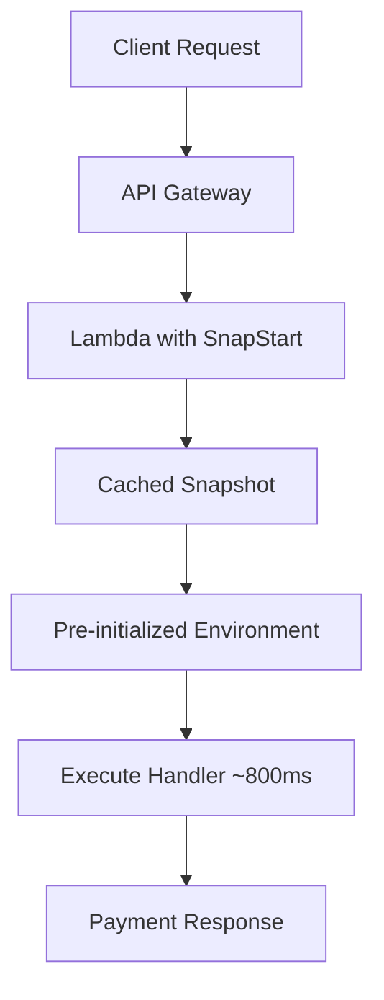
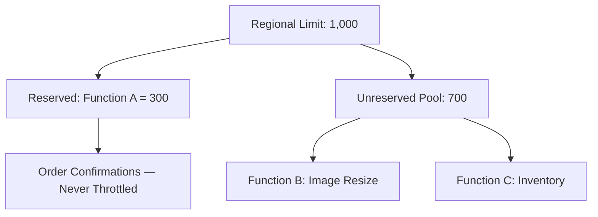
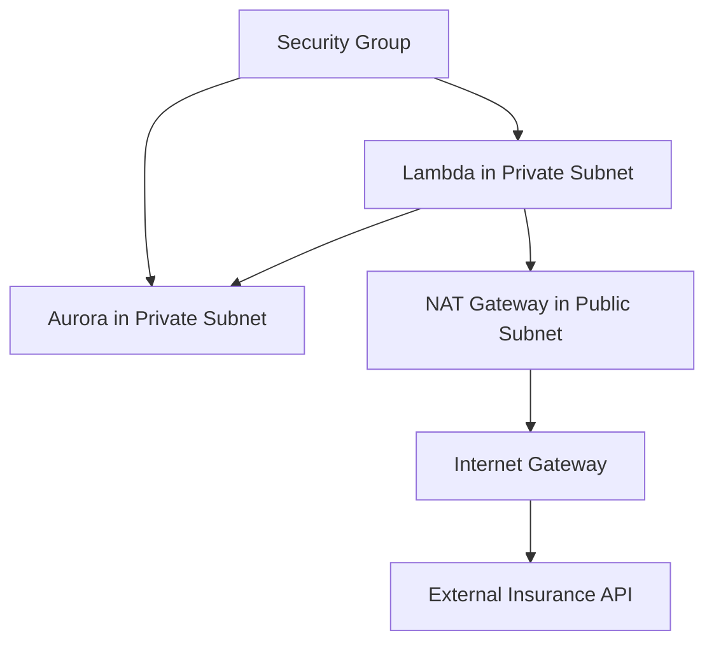
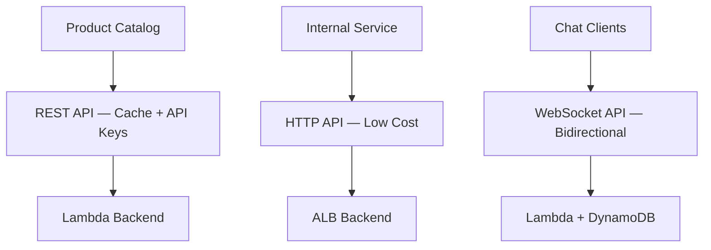
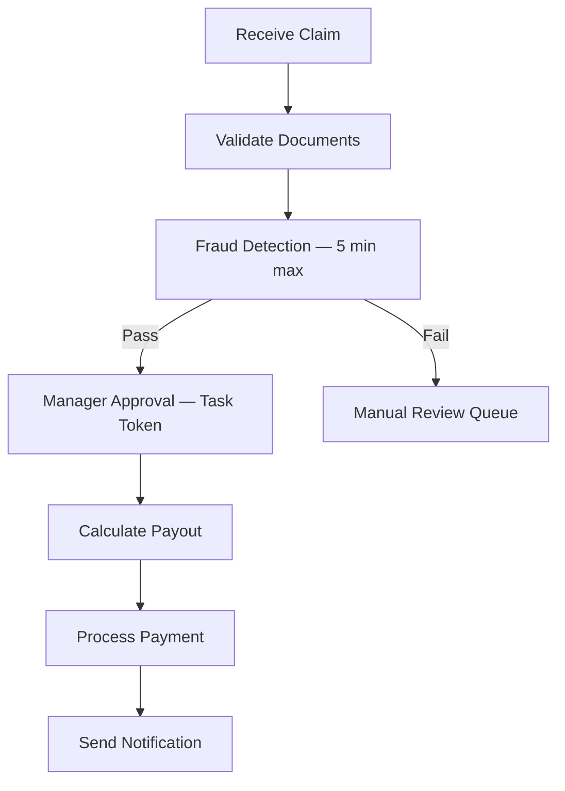
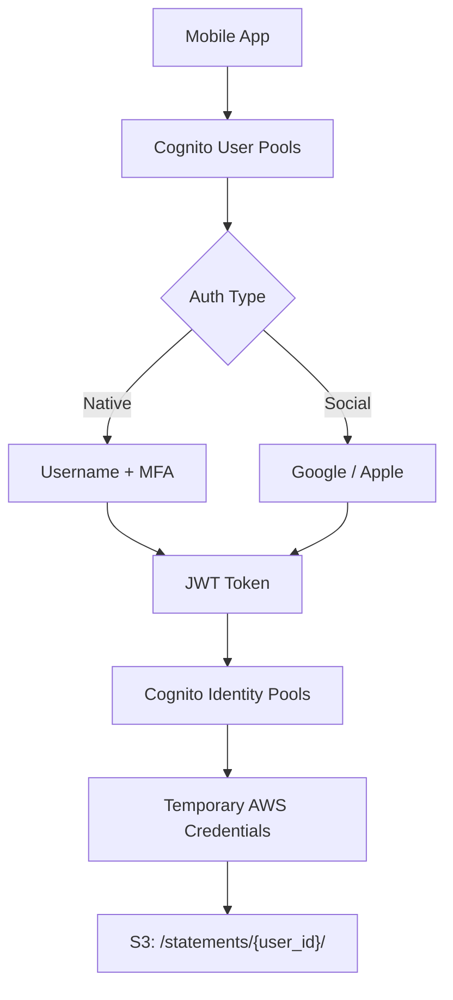
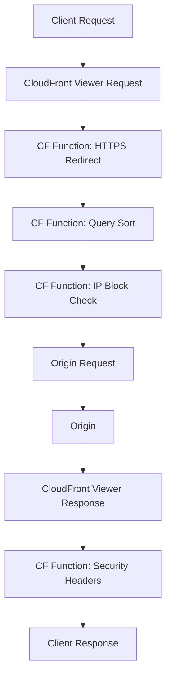

# Serverless — Scenario Practice (Phase 2)
**Date:** 2026-06-01 09:10
**Score:** 6/8 (75%) — All 8 scenarios complete

---

### Scenario 1: Cold Start Optimization (lambda — cold-start-optimization)
**Context:** A fintech company runs a customer-facing payment validation API using AWS Lambda with Java 17 runtime. The function processes credit card transactions with an average execution time of 800ms. During off-peak hours (2 AM–6 AM), the function scales to zero. When the first morning transactions arrive at 6 AM, customers experience 8–12 second response times due to cold starts. The function has heavy dependencies (~200 MB uncompressed) including fraud detection libraries. The company needs sub-second cold starts without significantly increasing costs.

**Requirements:**
- Java 17 runtime with heavy dependencies
- Sub-second cold start latency
- Minimal cost increase
- No application code changes preferred

**Question:** What should the solutions architect recommend to eliminate cold start latency most cost-effectively?

A) Enable Provisioned Concurrency with a minimum of 50 instances to keep functions warm during off-peak hours, scaling up to 200 during peak
B) Enable Lambda SnapStart for the Java function to pre-initialize from a cached snapshot, reducing cold starts by up to 10x at no extra cost
C) Migrate to Elastic Container Service (ECS) Fargate with Application Load Balancer (ALB) to maintain always-on containers with pre-loaded dependencies
D) Reduce the deployment package to under 50 MB by splitting the function into microservices, each with fewer dependencies

**Hint:** One Lambda feature specifically targets Java/Python/.NET cold starts using snapshot-based initialization — and it's free.
**Your answer: B** — Correct
**Correct: B** — Lambda SnapStart pre-initializes the function execution environment from a cached snapshot. For Java (and Python/.NET), this reduces cold start latency by up to 10x with **no additional cost**. The snapshot captures the initialized state after the INIT phase, so heavy dependencies are already loaded.
**Architecture:**

**Why others wrong:**
- A) Provisioned Concurrency works but costs significantly more — you pay for pre-allocated instances 24/7, and 50 instances during off-peak is wasteful.
- C) Migrating to ECS Fargate eliminates serverless benefits (auto-scaling to zero, pay-per-use) and adds operational complexity.
- D) Splitting into microservices is a major refactoring effort, doesn't guarantee sub-second cold starts, and adds inter-service latency.
**Key Concept:** Lambda SnapStart eliminates Java/Python/.NET cold starts using snapshot-based initialization at no extra cost — preferred over Provisioned Concurrency when the runtime is supported.

---

### Scenario 2: Concurrency Limits and Throttling (lambda — concurrency-limits)
**Context:** An e-commerce platform uses multiple Lambda functions in the same region: Function A processes order confirmations (mission-critical, ~200 concurrent), Function B handles product image resizing from Simple Storage Service (S3) uploads (~500 concurrent during sales), and Function C runs real-time inventory updates from DynamoDB Streams (~300 concurrent). During a flash sale, customers report "Internal Server Error" on order confirmations. CloudWatch logs show ThrottleError (429) on Function A. The region's default concurrent execution limit is 1,000.

**Requirements:**
- Function A (orders) must never be throttled
- Functions B and C can tolerate brief delays
- Stay within the 1,000 regional concurrent limit
- No limit increase requested yet

**Question:** What should the solutions architect recommend to protect Function A from throttling?

A) Increase Function A's memory to 10 GB so it processes faster and releases concurrency slots sooner
B) Set Reserved Concurrency on Function A to 300, guaranteeing it always has 300 slots regardless of Functions B and C usage
C) Set Reserved Concurrency on Functions B and C to cap them at 300 each, leaving 400 unreserved slots available for Function A
D) Enable Provisioned Concurrency on Function A with 200 pre-allocated instances to ensure warm execution environments

**Hint:** Reserved Concurrency acts as both a guarantee (minimum slots) AND a ceiling (maximum slots) for a specific function.
**Your answer: D** — Incorrect
**Correct: B** — Reserved Concurrency on Function A guarantees 300 concurrent execution slots exclusively for order processing. Even if Functions B and C consume the remaining 700 unreserved slots, Function A's 300 reserved slots are untouchable. This directly prevents throttling on the mission-critical function.
**Architecture:**

**Why others wrong:**
- A) More memory makes each invocation faster but doesn't prevent the concurrency pool from being exhausted by other functions — the core problem is slot allocation, not speed.
- C) Capping B and C at 300 each (600 total reserved) leaves only 400 unreserved, but Function A would still compete in the unreserved pool — it's not guaranteed any specific number of slots.
- D) Provisioned Concurrency pre-warms instances to eliminate cold starts but does NOT reserve concurrency slots — Function A can still be throttled if the unreserved pool is exhausted.
**Key Concept:** Reserved Concurrency = guaranteed + capped slots per function. Provisioned Concurrency = pre-warmed instances (cold start elimination). They solve different problems.

---

### Scenario 3: Lambda in Virtual Private Cloud (VPC) (lambda — lambda-in-vpc)
**Context:** A healthcare company deploys a Lambda function to process patient records. The function needs to query an Amazon Aurora database in a private subnet and call an external insurance verification API over the internet. The Lambda function is deployed with default settings (no VPC configuration). Developers report that the function can reach the external API successfully but fails to connect to Aurora with "Connection timed out" errors.

**Requirements:**
- Lambda must access Aurora in a private subnet
- Lambda must also reach the external insurance API over the internet
- HIPAA compliance requires private database connectivity
- Minimize cold start impact

**Question:** What should the solutions architect recommend?

A) Deploy Lambda in the Virtual Private Cloud (VPC) with private subnets, add a Network Address Translation (NAT) Gateway in a public subnet for internet access, and configure Security Groups to allow Lambda → Aurora traffic
B) Make Aurora publicly accessible with strong Security Group rules restricting access to the Lambda function's Elastic IP addresses
C) Deploy Lambda in the VPC with public subnets and assign a public IP to the Lambda function for internet access, while also accessing Aurora via private subnet routing
D) Use VPC Peering between the Lambda default VPC and the Aurora VPC to enable private connectivity without deploying Lambda in a VPC

**Hint:** Default Lambda runs in an AWS-owned VPC that cannot reach private resources. To access private resources AND the internet, Lambda needs both VPC placement and a route to the internet.
**Your answer: A** — Correct
**Correct: A** — Lambda must be deployed in the customer VPC to access Aurora in a private subnet. Since Lambda functions in a VPC lose direct internet access, a NAT Gateway in a public subnet provides the outbound internet path for the insurance API calls. Security Groups control Lambda → Aurora traffic on the database port.
**Architecture:**

**Why others wrong:**
- B) Making Aurora publicly accessible violates HIPAA compliance and AWS security best practices — databases should never be public, especially with patient data.
- C) Lambda functions deployed in a VPC cannot be assigned public IPs directly — they always get private IPs from the subnet. Public IP assignment is not an option for Lambda.
- D) VPC Peering connects two customer VPCs — Lambda's default VPC is AWS-owned and cannot be peered with. There's no mechanism to peer with the Lambda execution environment.
**Key Concept:** Lambda in VPC = private resource access but loses internet. NAT Gateway restores internet access. Default Lambda = internet access but no private resources.

---

### Scenario 4: REST vs HTTP vs WebSocket API (api-gateway — rest-vs-http-vs-websocket-api)
**Context:** A startup is building three API endpoints: (1) a public product catalog API with response caching and API key usage plans for rate limiting third-party integrations, (2) a simple internal microservice proxy that routes to an Application Load Balancer (ALB) backend with minimal latency requirements, and (3) a real-time chat feature where the server pushes messages to connected clients. The team wants to minimize cost and operational overhead while using the appropriate API Gateway type for each use case.

**Requirements:**
- Product catalog: caching, API keys, usage plans, request/response transformation
- Internal proxy: low latency, low cost, simple routing to ALB
- Chat: bidirectional real-time communication, server-initiated messages
- Cost optimization across all three endpoints

**Question:** Which combination of API Gateway types should the solutions architect recommend?

A) REST API for all three — use WebSocket emulation via long-polling for the chat feature
B) REST API for the product catalog (caching + API keys), HTTP API for the internal proxy (lower cost + lower latency), WebSocket API for real-time chat (bidirectional)
C) HTTP API for the product catalog and internal proxy (lower cost for both), REST API for real-time chat with Server-Sent Events
D) REST API for the product catalog and internal proxy, Application Load Balancer (ALB) with WebSocket support for real-time chat (bypass API Gateway)

**Hint:** API Gateway offers three distinct types, each optimized for different communication patterns — request/response with features, request/response with minimal overhead, and persistent bidirectional connections.
**Your answer: B** — Correct
**Correct: B** — REST API provides caching, API keys, usage plans, and request/response transformation needed for the product catalog. HTTP API costs up to 70% less than REST API and has lower latency — perfect for the simple internal proxy. WebSocket API maintains persistent bidirectional connections for real-time chat with server push.
**Architecture:**

**Why others wrong:**
- A) Long-polling is inefficient for real-time chat — it wastes Lambda invocations and adds latency compared to WebSocket's persistent connection.
- C) HTTP API lacks caching and API key features needed for the product catalog. REST API doesn't support true bidirectional WebSocket — Server-Sent Events are unidirectional.
- D) Using ALB for WebSocket bypasses API Gateway's built-in connection management, IAM auth, and usage tracking. ALB WebSocket works but adds operational overhead for route management.
**Key Concept:** REST API = full-featured (caching, API keys, transformations). HTTP API = lightweight + cheap (simple proxy). WebSocket API = bidirectional real-time. Choose based on feature needs and cost.

---

### Scenario 5: Orchestration vs Choreography (step-functions — orchestration-vs-choreography)
**Context:** An insurance company is building a claims processing workflow with 7 steps: (1) receive claim, (2) validate documents, (3) run fraud detection (may take 5 minutes), (4) request manager approval (human step, may take hours), (5) calculate payout, (6) process payment, (7) send notification. Steps must execute in order, with error handling at each step — if fraud detection fails, the claim must be routed to a manual review queue. If any step fails after 3 retries, the entire workflow must be marked as failed with an audit trail. The team is debating between Step Functions (orchestration) and an event-driven Simple Notification Service (SNS)/Simple Queue Service (SQS) approach (choreography).

**Requirements:**
- Strict sequential execution with conditional branching
- Human approval step (may take hours/days)
- Per-step error handling with 3 retries
- Full audit trail of workflow state
- Fraud detection step may take up to 5 minutes

**Question:** What should the solutions architect recommend?

A) Simple Notification Service (SNS) + Simple Queue Service (SQS) fan-out pattern with Lambda consumers at each step, using DynamoDB to track workflow state manually
B) AWS Step Functions Standard Workflow with sequential states, a Task token for human approval, error catchers with 3 retries per state, and built-in execution history
C) AWS Step Functions Express Workflow for cost savings, with a DynamoDB table to persist state between steps since Express workflows are stateless
D) Amazon EventBridge with rules routing events between Lambda functions at each step, using CloudWatch Logs for audit trail

**Hint:** One option provides built-in sequential execution, human approval via task tokens, per-step retry/catch, and a visual execution audit trail — all without custom state management.
**Your answer: B** — Correct
**Correct: B** — Step Functions Standard Workflow is designed for long-running workflows (up to 1 year). It provides: sequential execution with `States` definition, `Task` tokens for human approval (pauses until token returned), `Catch`/`Retry` error handling per state (configurable retries), and built-in execution history for audit trails. The visual workflow makes debugging straightforward.
**Architecture:**

**Why others wrong:**
- A) SNS/SQS choreography requires building custom state management, retry logic, and audit trails in DynamoDB — significant undifferentiated heavy lifting for a sequential workflow.
- C) Express Workflows are for high-volume, short-duration workloads (max 5 minutes) — they don't support human approval steps that take hours/days, and they lack durable execution history.
- D) EventBridge event-driven architecture is choreography — each step fires events without centralized state. Building sequential guarantees, retries, and human approval on top of EventBridge requires extensive custom logic.
**Key Concept:** Orchestration (Step Functions) = centralized workflow control with built-in state, retries, human approval, and audit. Choreography (SNS/SQS/EventBridge) = decoupled event-driven, better for loosely coupled microservices.

---

### Scenario 6: Serverless Authentication Flow (cognito — serverless-auth-flow)
**Context:** A mobile banking app needs to support three authentication scenarios: (1) native username/password sign-up with Multi-Factor Authentication (MFA) via SMS, (2) social login via Google and Apple, and (3) after authentication, users must upload bank statements directly to their own Simple Storage Service (S3) folder (e.g., `s3://statements/{user_id}/`) without routing through a backend server. The architect must ensure that User A cannot access User B's documents under any circumstances.

**Requirements:**
- Username/password + MFA for native users
- Google and Apple social login
- Direct S3 uploads from mobile app (no backend proxy)
- Per-user folder isolation in S3
- Serverless, fully managed authentication

**Question:** What should the solutions architect recommend for the complete authentication and authorization flow?

A) Cognito User Pools for all authentication (native + social), then Cognito Identity Pools to exchange tokens for temporary AWS credentials with an Identity and Access Management (IAM) policy scoped to `s3://statements/${cognito-identity.amazonaws.com:sub}/*`
B) Cognito User Pools for native login, a separate Lambda authorizer for social login, and pre-signed Simple Storage Service (S3) URLs generated by Lambda for uploads
C) Cognito Identity Pools directly for all authentication (native + social), skipping User Pools, with Identity and Access Management (IAM) policies for S3 access
D) API Gateway with Identity and Access Management (IAM) authorization proxying S3 uploads, with Cognito User Pools handling only authentication

**Hint:** One Cognito component handles sign-in (tokens), another provides temporary AWS credentials for direct resource access. Which combination addresses both authentication AND per-user S3 isolation?
**Your answer: A** — Correct
**Correct: A** — Cognito User Pools handles all authentication: native sign-up with MFA and federated social login (Google, Apple) via built-in federation. After authentication, User Pools issues a JWT token. Cognito Identity Pools exchanges this token for temporary AWS credentials. The IAM policy uses `${cognito-identity.amazonaws.com:sub}` as a condition to restrict S3 access to the user's own folder — enforcing per-user isolation at the IAM level.
**Architecture:**

**Why others wrong:**
- B) Separate Lambda authorizer for social login is unnecessary — User Pools natively supports Google and Apple federation. Pre-signed URLs work but add Lambda invocation overhead and don't scale as cleanly as direct credentials.
- C) Identity Pools alone don't manage user sign-up, MFA, or account management — they're for credential federation, not authentication. You'd lose MFA, password policies, and user management features.
- D) Proxying S3 uploads through API Gateway adds latency and cost for large files. Direct S3 access with scoped IAM credentials is the AWS-recommended pattern for mobile uploads.
**Key Concept:** User Pools = authentication (sign-in, MFA, federation) → JWT tokens. Identity Pools = authorization (AWS credentials) → direct resource access. Together: complete serverless auth with per-user resource isolation via IAM policy variables.

---

### Scenario 7: Edge Compute Decision (lambda-at-edge — edge-compute-vs-cloudfront-functions)
**Context:** A global media company serves video content through Amazon CloudFront. They need to implement three edge processing features: (1) normalize the `Accept-Language` header to a standard locale code for cache key optimization (runs on every request, must be < 1ms), (2) resize images on-the-fly based on the `User-Agent` header, requiring the Sharp image processing library (average 2-second execution), and (3) validate JSON Web Tokens (JWT) and extract user claims for A/B testing routing (runs on every request, no network calls needed, < 1ms).

**Requirements:**
- Feature 1: Header normalization, every request, < 1ms
- Feature 2: Image resize with third-party library, 2s execution
- Feature 3: JWT validation, every request, < 1ms, no network
- Minimize cost across all three features
- Each feature must use the most cost-effective edge compute option

**Question:** Which mapping of features to edge compute services is correct?

A) CloudFront Functions for all three — it handles everything at the edge with lowest cost
B) CloudFront Functions for features 1 and 3 (header normalization, JWT validation), Lambda@Edge for feature 2 (image resize with Sharp library)
C) Lambda@Edge for all three — unified runtime simplifies deployment and maintenance
D) CloudFront Functions for feature 1 (header normalization), Lambda@Edge for features 2 and 3 (image resize and JWT validation both need advanced compute)

**Hint:** Match each feature's requirements (execution time, library needs, network access) against each service's capabilities — CloudFront Functions is cheaper but has strict limits on time, memory, and dependencies.
**Your answer: B** — Correct
**Correct: B** — Features 1 (header normalization) and 3 (JWT validation) fit CloudFront Functions perfectly: sub-millisecond execution, JavaScript only, no network/library dependencies, and 1/6th the cost of Lambda@Edge. Feature 2 (image resize) requires the Sharp library (third-party dependency), 2-second execution time, and larger memory — all exceeding CloudFront Functions limits (< 1ms, 2 MB memory, 10 KB package, no dependencies). Lambda@Edge supports Node.js/Python, up to 10 GB memory, and third-party libraries.
**Architecture:**
```mermaid
graph TD
    A[Client Request] --> B[CloudFront Edge]
    B --> C[CloudFront Function: Normalize Headers]
    B --> D[CloudFront Function: JWT Validation]
    B --> E[Lambda@Edge: Image Resize + Sharp]
    C --> F[Origin: Video CDN]
    D --> F
    E --> G[Resized Image Response]
```
**Why others wrong:**
- A) CloudFront Functions cannot run the Sharp library — max package size is 10 KB, no third-party dependencies allowed, and < 1ms execution limit means 2-second image processing is impossible.
- C) Lambda@Edge for header normalization and JWT validation wastes money — it's 6x more expensive per request than CloudFront Functions, and these simple tasks don't need Lambda@Edge's capabilities.
- D) JWT validation doesn't need Lambda@Edge — it's simple claim extraction/verification with no network calls, fitting perfectly within CloudFront Functions' constraints.
**Key Concept:** CloudFront Functions = lightweight (< 1ms, JS, 10 KB, no deps, 1/6 cost). Lambda@Edge = heavy (5-10s, Node/Python, 50 MB, third-party libs, network access). Match feature requirements to the cheapest capable service.

---

### Scenario 8: Lightweight Edge Processing Patterns (cloudfront-functions — lightweight-edge-processing)
**Context:** An e-commerce company with a global customer base uses CloudFront to serve their website. They need to implement four edge processing rules: (1) redirect HTTP to HTTPS for all requests, (2) add security headers (X-Frame-Options, Content-Security-Policy, Strict-Transport-Security) to all responses, (3) normalize query string parameter order for better cache hit ratios (e.g., `?color=red&size=M` and `?size=M&color=red` should be the same cache key), and (4) block requests from a list of 50 banned IP addresses. All rules must execute on every request with minimal latency impact.

**Requirements:**
- All 4 rules on every request/response
- Sub-millisecond latency per rule
- Millions of requests per second
- No network access needed
- Cost-effective at high volume

**Question:** Where should each rule execute?

A) CloudFront Functions for all 4 rules — Viewer Request trigger for rules 1, 3, 4 and Viewer Response trigger for rule 2
B) Lambda@Edge for all 4 rules to handle the complexity of IP blocking with a large blocklist
C) CloudFront Functions for rules 1-3 (simple transforms), Web Application Firewall (WAF) IP set for rule 4 (IP blocking)
D) CloudFront Functions for rules 1 and 3 (request modifications), Lambda@Edge for rules 2 and 4 (response headers and IP blocking need more compute)

**Hint:** CloudFront Functions can execute JavaScript logic including array lookups, string manipulation, and header operations — all within < 1ms. Consider whether 50 IPs is "large" enough to need a different solution.
**Your answer: C** — Incorrect
**Correct: A** — All 4 rules are lightweight operations well within CloudFront Functions' capabilities: HTTP→HTTPS redirect (viewer request), security header injection (viewer response), query string sorting (viewer request), and IP blocklist check against 50 IPs (viewer request — a simple array lookup in JavaScript). CloudFront Functions supports both Viewer Request and Viewer Response triggers, handles millions of requests per second, and runs at 1/6th the cost of Lambda@Edge.
**Architecture:**

**Why others wrong:**
- B) Lambda@Edge is overkill — these are all simple string/header operations. Using Lambda@Edge would be 6x more expensive and add unnecessary latency.
- C) WAF IP sets work for IP blocking but add extra cost ($5/month + per-request charges). For 50 IPs, a CloudFront Function with an in-memory array is simpler and cheaper. WAF is better justified for large/dynamic blocklists (thousands of IPs).
- D) Security header injection and IP blocking are trivial operations — neither needs Lambda@Edge's extended execution time, memory, or network access.
**Key Concept:** CloudFront Functions handle header manipulation, URL rewrites, redirects, JWT validation, and small-list lookups at sub-millisecond speed. Only escalate to Lambda@Edge when you need: third-party libraries, network access, body inspection, or > 1ms execution.
