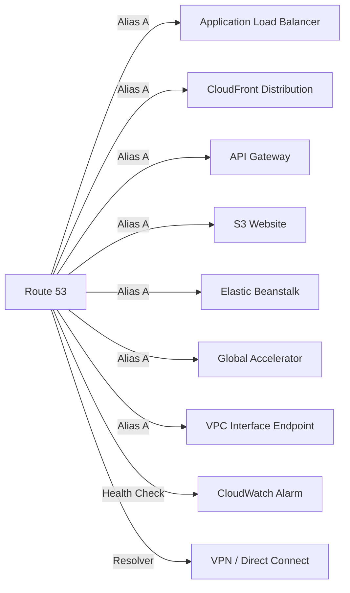
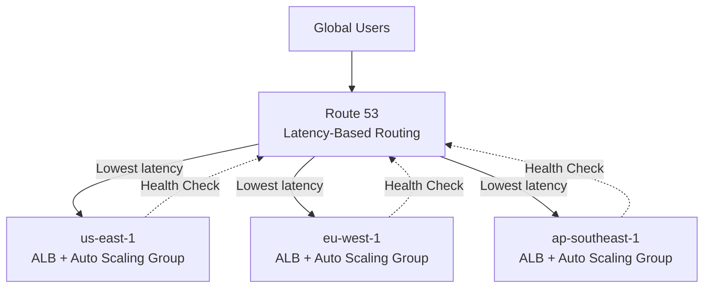
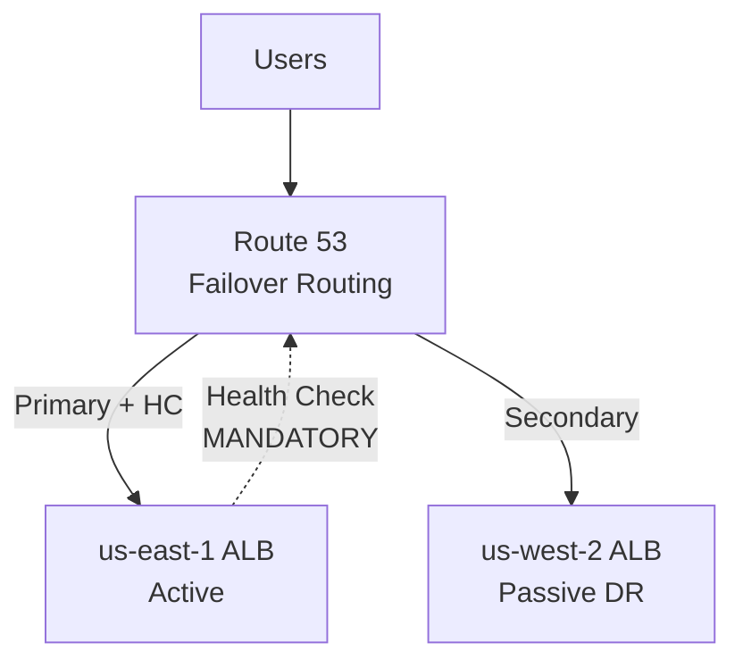
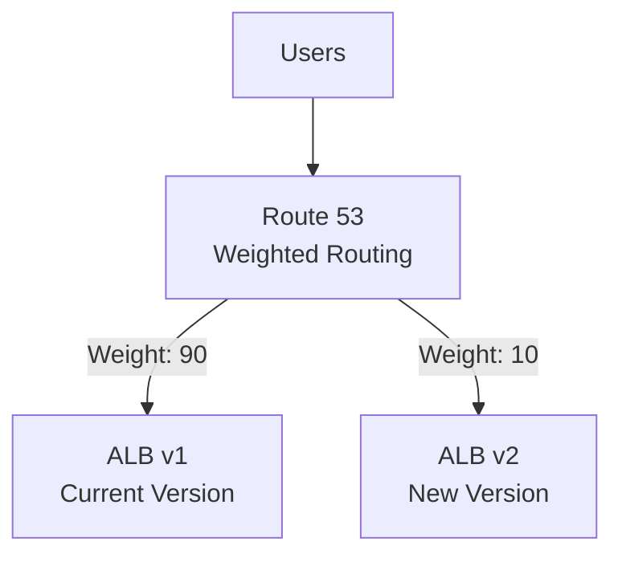
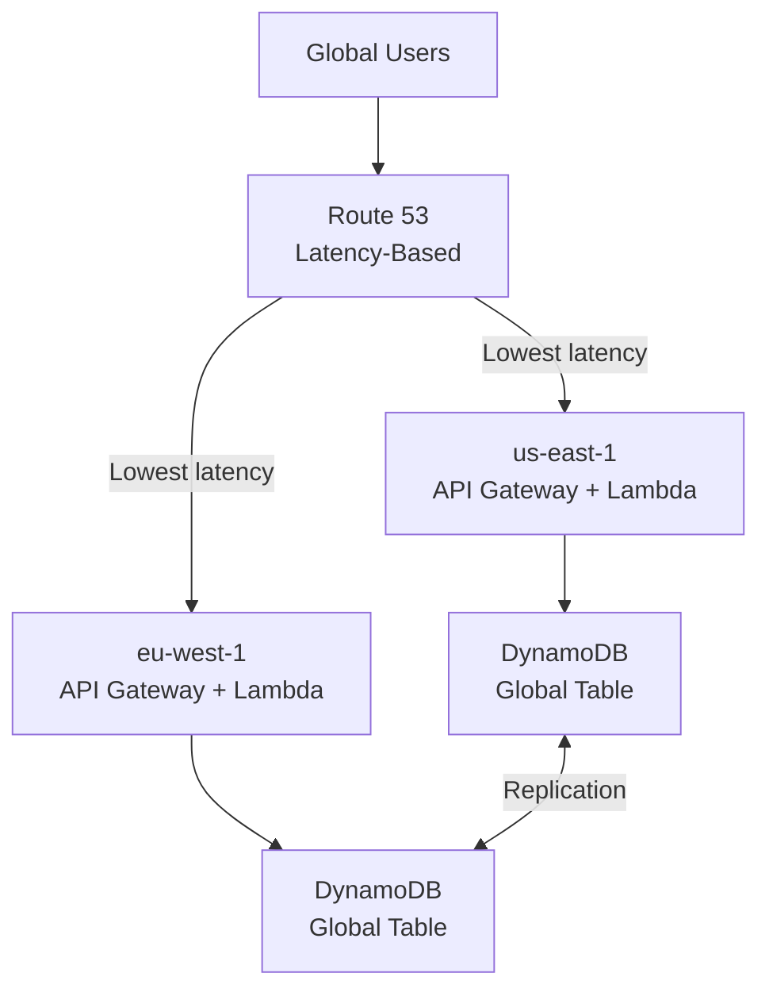
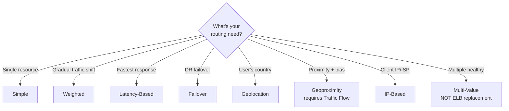

# DNS — Learn and Test (Phase 1)
**Date:** 2026-06-03 15:47
**Score:** 14/17 (82%) — All 7 sections complete

---

## Section 1: Service Overview

### Amazon Route 53
- **Fully managed, authoritative Domain Name System (DNS) service** — you control the DNS records
- Also a **Domain Registrar** — register domains directly in AWS
- **Only AWS service with a 100% availability Service Level Agreement (SLA)**
- Named after port 53 — the traditional DNS port
- Provides health checking for resource monitoring and automated failover

### Core DNS Concepts
- **Domain Name System (DNS)**: Translates human-friendly hostnames (www.example.com) to machine IP addresses (172.217.18.36)
- **Fully Qualified Domain Name (FQDN)**: Complete path — `http://api.www.example.com.` (includes root `.`)
- **Top Level Domain (TLD)**: .com, .org, .gov, .us
- **Second Level Domain (SLD)**: amazon.com, google.com
- **Domain Registrar**: Where you buy domain names (Route 53, GoDaddy, Namecheap)
- **Name Server**: Resolves DNS queries — **Authoritative** (you control records) vs **Non-Authoritative** (caching resolver like ISP DNS)

### Route 53 Record Types
| Type | Maps To | Key Detail |
|------|---------|------------|
| **A** | Hostname → IPv4 address | Most common record type |
| **AAAA** | Hostname → IPv6 address | IPv6 equivalent of A |
| **CNAME** | Hostname → another hostname | **Cannot use at Zone Apex** (root domain) |
| **NS** | Name Servers for the Hosted Zone | Controls how traffic is routed |

### Hosted Zones
- **Container** for DNS records that define traffic routing for a domain
- **Public Hosted Zone**: Routes traffic on the Internet (e.g., `app.mypublicdomain.com`)
- **Private Hosted Zone**: Routes traffic within one or more Virtual Private Clouds (VPCs) (e.g., `app.company.internal`)
- Cost: **$0.50 per month** per hosted zone

### Alias Records — Route 53 Extension
- Maps a hostname to an **AWS resource** (not arbitrary hostnames)
- **Can be used at Zone Apex** (e.g., `example.com`) — unlike CNAME
- Always type **A or AAAA**
- **Free of charge** — no query cost
- **TTL is managed by Route 53** — you cannot set it
- Automatically tracks changes in the resource's IP addresses

**Alias targets:** Elastic Load Balancer (ELB), CloudFront Distribution, API Gateway, Elastic Beanstalk, S3 Website, VPC Interface Endpoint, Global Accelerator, Route 53 record in same zone

**Cannot target:** EC2 instance DNS name

### CNAME vs Alias — Critical Comparison

| Feature | CNAME | Alias |
|---------|-------|-------|
| Zone Apex (root domain) | **NOT allowed** | **Allowed** |
| Target | Any hostname | AWS resources only |
| Query cost | Charged | **Free** |
| Time To Live (TTL) | You set it | Route 53 manages it |
| Health Check | No native support | Native support |
| Can target EC2 DNS | Yes | **No** |

### Quiz: Section 1
**Q1** ✓ — route-53-basics
Company wants root domain `example.com` → ALB. CNAME fails. What to do?
A) A record with ALB IP  B) Alias A to ALB  C) CNAME www + redirect  D) Re-register with Route 53
💡 Hint: Which record type works at root domain for AWS resources?
**Your answer: B** — Correct. Alias supports Zone Apex, tracks ALB IPs automatically, free queries.

**Q2** ✓ — hosted-zones
EC2 instances need to resolve `db.myapp.internal` privately. Which feature?
A) Public HZ with private IPs  B) Private HZ associated with VPC  C) Alias to EC2 in Public HZ  D) CNAME in Public HZ
💡 Hint: Which hosted zone type restricts resolution to within a VPC?
**Your answer: B** — Correct. Private Hosted Zones resolve only within associated VPCs.

**Q3** ✓ — alias-vs-cname
Which statement about Alias records is INCORRECT?
A) Free queries  B) Can target EC2 DNS  C) Auto-tracks IP changes  D) Works at Zone Apex
💡 Hint: One AWS service is excluded from Alias targets.
**Your answer: B** — Correct. Alias cannot target EC2 DNS names — the one excluded AWS resource.

---

## Section 2: Real-World Use Cases

### Use Case 1: E-Commerce Multi-Region Deployment
**Scenario:** An online retailer serves customers in North America, Europe, and Asia-Pacific. They need users to reach the nearest AWS Region for low latency.

**Solution:** Latency-based routing with health checks
- Create A/Alias records for `shop.example.com` in us-east-1, eu-west-1, ap-southeast-1
- Route 53 measures latency from user to each region and returns the lowest-latency endpoint
- Health checks ensure unhealthy regions are excluded automatically

### Use Case 2: Blue-Green Deployment with DNS
**Scenario:** A SaaS company wants to gradually shift traffic from the old version (blue) to the new version (green) of their application.

**Solution:** Weighted routing
- Blue environment: weight 90 → receives 90% of traffic
- Green environment: weight 10 → receives 10% of traffic
- Gradually shift: 70/30 → 50/50 → 10/90 → 0/100
- Health checks on both ensure only healthy versions receive traffic

### Use Case 3: Content Compliance by Country
**Scenario:** A media streaming service must serve different content libraries based on the user's country due to licensing restrictions.

**Solution:** Geolocation routing
- US users → us-east-1 (US content library)
- France users → eu-west-1 (EU content library)
- Japan users → ap-northeast-1 (APAC content library)
- Default record → nearest region for unlisted countries

### Use Case 4: Disaster Recovery (DR) with Failover
**Scenario:** A financial services company needs automatic failover from primary (us-east-1) to DR site (us-west-2).

**Solution:** Failover routing (active-passive)
- Primary record: ALB in us-east-1 with **mandatory** health check
- Secondary record: ALB in us-west-2 (DR)
- Route 53 automatically returns secondary IP when primary fails health check
- Recovery Time Objective (RTO) depends on TTL + health check interval

### Use Case 5: Hybrid Cloud DNS Resolution
**Scenario:** A company has on-premises servers that need to resolve AWS private hostnames, and AWS EC2 instances that need to resolve on-premises hostnames.

**Solution:** Route 53 Resolver Endpoints
- **Inbound Endpoint**: On-premises DNS resolvers forward `*.aws.internal` queries → Route 53 Resolver → Private Hosted Zone
- **Outbound Endpoint**: Route 53 Resolver forwards `*.onprem.corp` queries → on-premises DNS resolvers
- Both use VPN or Direct Connect connection

### Use Case 6: Serverless API with Custom Domain (Cross-Domain)
**Scenario:** A company deploys an API Gateway with Lambda backend and needs `api.example.com` as the custom domain.

**Solution:** Route 53 Alias + API Gateway custom domain
- Register domain in Route 53 (or use 3rd-party registrar with Route 53 NS records)
- Create custom domain in API Gateway with AWS Certificate Manager (ACM) certificate
- **Edge-Optimized API**: Alias A record → CloudFront distribution (ACM cert in us-east-1)
- **Regional API**: Alias A record → Regional API Gateway endpoint (ACM cert in same region)

### Quiz: Section 2
**Q1** ✓ — routing-policies
Media company needs country-based content routing (licensing). Which policy?
A) Latency-based  B) Geoproximity  C) Geolocation  D) Weighted
💡 Hint: Routing based on WHERE user is located, not which region is fastest.
**Your answer: C** — Correct. Geolocation routes by country/continent/state. Include Default record for unmatched.

**Q2** ✗ — hybrid-dns
On-premises servers need to resolve AWS Private Hosted Zone names via Direct Connect. Which component?
A) Outbound Resolver  B) Inbound Resolver  C) Public HZ with private IPs  D) CloudWatch Health Check
💡 Hint: Direction of query — on-premises querying INTO AWS.
**Your answer: A** — Incorrect. Correct: B. Inbound = on-prem resolves AWS names (queries flow IN). Outbound = AWS resolves on-prem names (queries flow OUT).

---

## Section 3: Service Integrations

### How Route 53 Connects to AWS Services



ASCII fallback:
```
Route 53 ──Alias──→ ALB / CloudFront / API Gateway / S3 Website / Elastic Beanstalk / Global Accelerator / VPC Endpoint
Route 53 ──Health Check──→ CloudWatch Alarm (for private resources)
Route 53 ──Resolver Endpoints──→ On-premises DNS (via VPN/DX)
```

### Integration Details

| AWS Service | Record Type | Key Detail |
|-------------|------------|------------|
| Application Load Balancer (ALB) | Alias A/AAAA | Most common; supports all routing policies |
| CloudFront | Alias A/AAAA | Edge-Optimized; global distribution |
| API Gateway | Alias A/AAAA | Edge-Optimized (us-east-1 cert) or Regional (same-region cert) |
| S3 Static Website | Alias A | Bucket name must match record name exactly |
| Elastic Beanstalk | Alias A/AAAA | Environment URL as target |
| Global Accelerator | Alias A | Static IP addresses for global routing |
| EC2 Instance | **A record** (not Alias) | Alias cannot target EC2 DNS name — use A with IP |

### Health Check → CloudWatch Integration (Private Resources)
Route 53 health checkers are **outside the VPC** — they cannot directly check private resources. The workaround:

1. Create a CloudWatch Metric monitoring the private resource (e.g., CPU, custom metric)
2. Create a CloudWatch Alarm on that metric
3. Create a Route 53 Health Check that monitors the CloudWatch Alarm state
4. Associate the health check with DNS records for failover

### Quiz: Section 3
**Q1** ✓ — health-checks
Private EC2 instances need health checking for Failover routing. Checkers can't reach private IPs. Solution?
A) NAT Gateway  B) CloudWatch Alarm → Route 53 Health Check  C) Move to public subnet  D) Calculated Health Check
💡 Hint: Route 53 provides specific integration for non-public resources.
**Your answer: B** — Correct. CloudWatch Alarm-based health check is the standard pattern for private resources.

**Q2** ✓ — service-integrations
Alias record won't show EC2 as target. Why and what to do?
A) Different Region  B) Alias can't target EC2 — use A record with Elastic IP  C) Need ALB first  D) SG blocking
💡 Hint: EC2 has a unique restriction among Alias targets.
**Your answer: B** — Correct. EC2 is the one AWS service excluded from Alias targets. Use standard A record.

---

## Section 4: Architectural Patterns

### Pattern 1: Multi-Region Active-Active (Latency-Based)



ASCII fallback:
```
Users → Route 53 (Latency) → us-east-1 ALB / eu-west-1 ALB / ap-southeast-1 ALB
Each ALB has health check ← Route 53 removes unhealthy regions
```

**When to use:** Global user base needing lowest latency. Each region runs a full stack.

### Pattern 2: Active-Passive Failover (Disaster Recovery)



ASCII fallback:
```
Users → Route 53 (Failover) → Primary (us-east-1, health-checked) | Secondary DR (us-west-2)
If primary fails health check → Route 53 returns secondary
```

**When to use:** Cost-sensitive DR where you don't need multi-region active-active. Secondary runs scaled-down.

### Pattern 3: Weighted Canary Deployment



ASCII fallback:
```
Users → Route 53 (Weighted) → 90% to ALB v1 (current) / 10% to ALB v2 (new)
Gradually shift weights: 90/10 → 70/30 → 50/50 → 0/100
```

**When to use:** Gradual rollouts. Shift weight to 0 to stop traffic to a version.

### Pattern 4: Multi-Region Serverless with Latency Routing (Cross-Domain)



ASCII fallback:
```
Users → Route 53 (Latency) → US API GW+Lambda / EU API GW+Lambda
Both regions → DynamoDB Global Table (active-active replication)
```

**When to use:** Global serverless applications needing low latency with active-active data.

### Routing Policy Decision Tree



### Quiz: Section 4
**Q1** ✓ — routing-policies
German user routed to us-east-1 instead of eu-west-1 with Latency-based routing. Expected?
A) No — use Geolocation  B) Yes — latency measures network speed not distance  C) No — latency = closest  D) Yes — equal weights
💡 Hint: Latency measures network property, not geographic proximity.
**Your answer: B** — Correct. Latency-based measures actual network latency. German user CAN have lower latency to US.

**Q2** ✓ — failover-design
Failover routing configured without health check on primary. What happens?
A) Always returns primary  B) Auto-creates health check  C) Route 53 rejects config — HC mandatory  D) Equal distribution
💡 Hint: Failover has a specific mandatory requirement.
**Your answer: C** — Correct. Health check on primary is mandatory for Failover routing.

**Q3** ✗ — weighted-routing
Canary weight set to 0 (production=90). What happens?
A) Canary record removed from DNS  B) All traffic to production (only non-zero)  C) Error  D) Equal distribution
💡 Hint: ONE record at 0 vs ALL records at 0 — different behavior.
**Your answer: A** — Incorrect. Correct: B. Weight 0 stops traffic to that record but doesn't remove it. Non-zero records get all traffic. ALL records at 0 = equal distribution (different case).

---

## Section 5: Cost Implications

### Route 53 Pricing Model

| Component | Cost |
|-----------|------|
| Hosted Zone | $0.50/month |
| Standard DNS queries | $0.40 per million |
| Latency-based queries | $0.60 per million |
| Geolocation/Geoproximity queries | $0.70 per million |
| **Alias queries to AWS resources** | **Free** |
| Health Checks (basic) | $0.50/month per check |
| Health Checks (HTTPS/string matching) | $0.75/month per check |
| Health Checks (fast interval — 10s) | $1.00/month per check |
| Domain Registration | $12-40/year (varies by TLD) |

### Cost Optimization Tips

1. **Use Alias records** for AWS resources — free queries vs $0.40-0.70/million for CNAME
2. **Set appropriate TTL** — higher TTL = fewer queries = lower cost (but slower DNS propagation)
3. **Consolidate hosted zones** — $0.50/month per zone adds up for many domains
4. **Health check consolidation** — use Calculated Health Checks to combine multiple checks into one logical check instead of creating redundant individual checks
5. **Choose routing policy wisely** — Latency/Geo queries cost more than standard queries

### Cost Comparison: Alias vs CNAME at Scale

| Monthly DNS Queries | CNAME Cost | Alias Cost | Savings |
|--------------------|------------|------------|---------|
| 1 million | $0.40 | **$0.00** | $0.40 |
| 10 million | $4.00 | **$0.00** | $4.00 |
| 100 million | $40.00 | **$0.00** | $40.00 |

**Exam takeaway:** Alias is always cheaper for AWS resources — free queries + works at Zone Apex.

### Quiz: Section 5
**Q1** ✓ — cost-optimization
50M queries/month CNAME to CloudFront. Switch to Alias benefit?
A) Lower latency  B) Eliminates query charges, saving ~$20/month  C) Auto SSL  D) Enables health checks
💡 Hint: Pricing difference between CNAME and Alias for AWS targets.
**Your answer: B** — Correct. Alias queries to AWS resources are free. 50M × $0.40/M = $20/month saved.

**Q2** ✓ — ttl-cost
TTL set to 60s for rapid deployments. DNS costs increased. Why?
A) Low TTL = more queries to Route 53 = higher costs — use Alias for free  B) More health checks  C) More record versions  D) DNSSEC validations
💡 Hint: What happens at resolvers when TTL expires.
**Your answer: A** — Correct. Low TTL = resolvers cache expires quickly = more Route 53 queries. Alias eliminates charges.

---

## Section 6: Security Considerations

### DNS Security in Route 53

- **DNSSEC (Domain Name System Security Extensions)**: Route 53 supports DNSSEC for domain registration and DNS signing — validates DNS responses aren't tampered with
- **IAM Policies**: Control who can create/modify/delete hosted zones and records
- **Private Hosted Zones**: DNS records only resolvable within associated VPCs — network isolation
- **Health Check IP Ranges**: Must allow Route 53 health checker IPs in Security Groups / Network Access Control Lists (NACLs) — published IP ranges

### Access Control Patterns

| Control | Mechanism |
|---------|-----------|
| Who manages DNS records | IAM policies on Route 53 APIs |
| Who can query private DNS | VPC association with Private Hosted Zone |
| Who receives traffic | Routing policies + health checks |
| Hybrid DNS resolution | Resolver Endpoints with VPN/Direct Connect |

### Security Best Practices
- Use **Private Hosted Zones** for internal service discovery (don't expose internal names publicly)
- Enable **DNSSEC** for public zones to prevent DNS spoofing
- Use **IAM condition keys** to restrict DNS changes to specific hosted zones
- Route 53 health checkers need **inbound access** — whitelist their published IP ranges in Security Groups
- For **private resource health checks**, use CloudWatch Alarm-based health checks (health checkers can't reach private IPs)

### Quiz: Section 6
**Q1** ✓ — security
Health checks failing for public ALB that's otherwise healthy. Cause?
A) SG doesn't allow Route 53 health checker IPs  B) TCP/HTTP mismatch  C) ALB in private subnet  D) HC TTL expired
💡 Hint: Health checkers are external agents initiating inbound connections.
**Your answer: A** — Correct. SG must include Route 53 health checker IP ranges for inbound access.

**Q2** ✓ — private-dns-security
Private HZ hostnames not resolvable from on-prem laptop over VPN. What to configure?
A) Convert to Public HZ  B) Inbound Resolver Endpoint + DNS forwarding  C) IAM read permissions  D) Upgrade to Direct Connect
💡 Hint: On-premises needs to send queries INTO the VPC.
**Your answer: B** — Correct. Inbound Resolver Endpoint receives queries from on-prem DNS. VPN supports this.

---

## Section 7: Exam Tips

### Top Exam Signals → Answers

| Exam Phrase | Answer |
|-------------|--------|
| "100% availability SLA" | Route 53 (only AWS service) |
| "Point root/apex domain to ALB" | **Alias record** (CNAME can't do apex) |
| "Route by user's country" | **Geolocation** routing |
| "Lowest network latency" | **Latency-based** routing (not geolocation!) |
| "Active-passive DR" | **Failover** routing (health check mandatory on primary) |
| "Gradual traffic shift / canary" | **Weighted** routing |
| "Shift traffic with bias" | **Geoproximity** (requires Traffic Flow) |
| "Route by client IP/ISP" | **IP-based** routing |
| "Multiple healthy DNS values" | **Multi-Value** (NOT ELB replacement) |
| "On-premises resolve AWS names" | **Inbound** Resolver Endpoint |
| "AWS resolve on-premises names" | **Outbound** Resolver Endpoint |
| "Health check private resources" | CloudWatch Alarm → Health Check |
| "Free DNS queries" | Alias records to AWS resources |

### Critical Traps to Avoid

1. **Geolocation ≠ Latency**: Geolocation = WHERE user IS (country/continent). Latency = WHICH region is FASTEST. A German user might route to US with latency-based if US happens to have lower latency.

2. **CNAME at root domain**: IMPOSSIBLE. `example.com` CNAME → fails. Use **Alias** for root/apex domain.

3. **Alias cannot target EC2**: Every AWS resource is an Alias target EXCEPT EC2 DNS names. Use an A record with the IP instead.

4. **Multi-Value is NOT ELB**: Multi-Value returns up to 8 healthy IPs — the **client picks** one randomly. ELB actively distributes and load-balances connections.

5. **Simple routing + multiple values**: Route 53 returns ALL values. The **client** randomly selects one. Route 53 doesn't select.

6. **Weighted all-zeros**: If ALL records have weight 0, all records returned equally (not zero traffic).

7. **Health checks on private resources**: Route 53 checkers are OUTSIDE the VPC. They can't reach private IPs. Use CloudWatch Alarm → Health Check.

8. **Failover requires health check**: The primary record MUST have a health check. It's mandatory, not optional.

9. **Geoproximity requires Traffic Flow**: You can't use Geoproximity routing without the Traffic Flow feature enabled.

10. **Domain Registrar ≠ DNS Service**: You can buy at GoDaddy and use Route 53 for DNS. Just update NS records at the registrar.

### Decision Framework: Which Routing Policy?

```
Need to route to ONE resource?
  → Simple (no health check)

Need gradual traffic control?
  → Weighted (set weights, e.g., 90/10)

Need lowest response time?
  → Latency-based (measures to AWS Region)

Need automatic DR failover?
  → Failover (primary + secondary, HC mandatory)

Need country/region-based routing?
  → Geolocation (user location)

Need proximity with adjustable bias?
  → Geoproximity (requires Traffic Flow)

Need ISP-specific routing?
  → IP-based (CIDR mapping)

Need multiple healthy endpoints in DNS?
  → Multi-Value (up to 8, NOT a load balancer)
```

### Quiz: Section 7
**Q1** ✗ — exam-traps
Multi-Value routing equivalent to ELB?
A) Yes — same load balancing  B) No — MV returns 8 IPs client picks; ELB actively distributes  C) Yes — DNS-based ELB  D) No — MV returns 100 IPs
💡 Hint: What layer does each operate at, who makes the routing decision?
**Your answer: D** — Incorrect. Correct: B. Multi-Value returns up to 8 (not 100) healthy IPs. Client picks randomly. ELB actively distributes at L4/L7.

**Q2** ✓ — geolocation-vs-latency
French users MUST reach eu-west-1 for data residency compliance. Which policy?
A) Latency with bias  B) Geolocation with France→eu-west-1 + Default  C) Geoproximity bias 99  D) Weighted by IP
💡 Hint: Requirement is user LOCATION, not network speed.
**Your answer: B** — Correct. Geolocation enforces country-level routing. Default record for unmatched countries.

**Q3** ✓ — resolver-endpoints
Bidirectional DNS: on-prem resolves AWS names AND EC2 resolves on-prem names. What endpoints needed?
A) Two Inbound  B) One Inbound + One Outbound  C) Two Outbound  D) One Outbound with forwarding
💡 Hint: Each direction needs its own endpoint type.
**Your answer: B** — Correct. Inbound = on-prem→AWS. Outbound = AWS→on-prem. Both needed for bidirectional.
