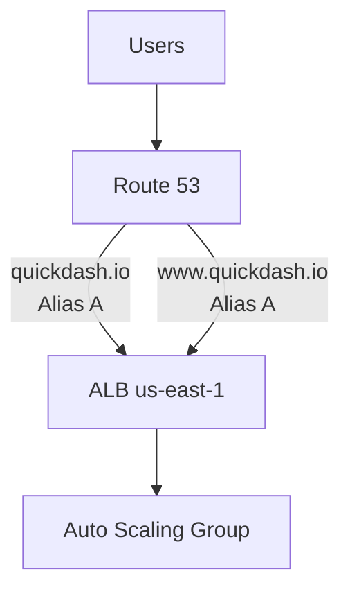
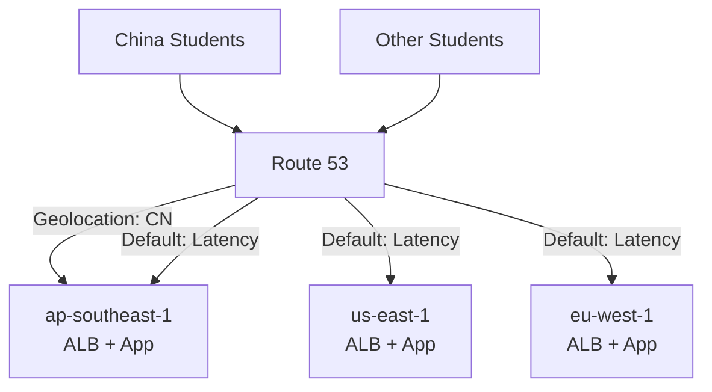
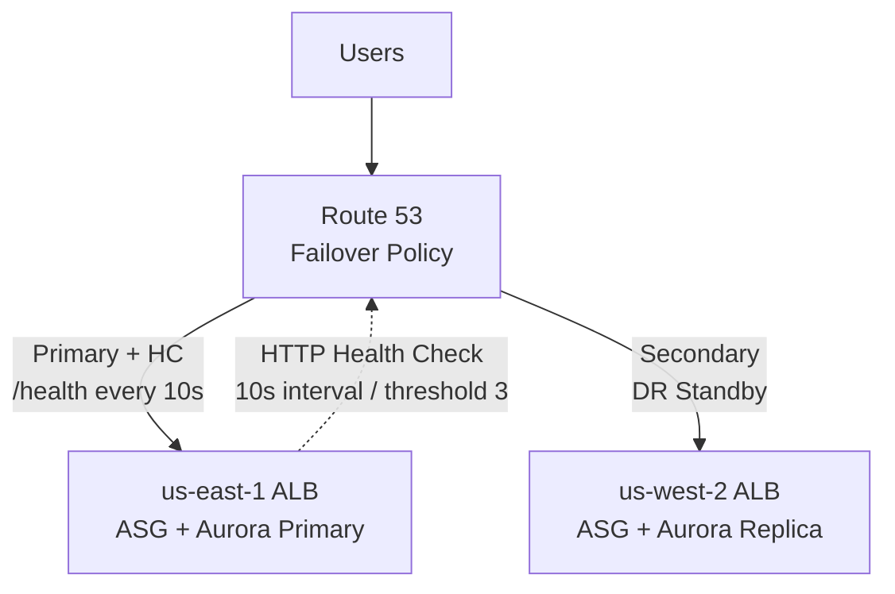
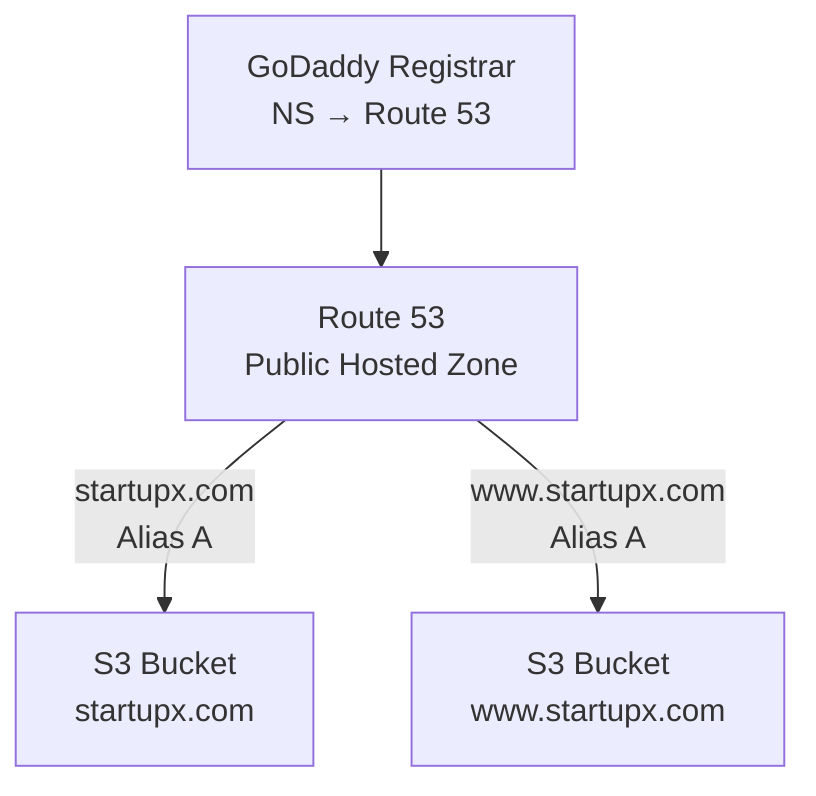
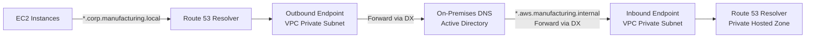

# DNS — Scenario Practice (Phase 2)
**Date:** 2026-06-03 17:03
**Score:** 4/5 (80%) — All 5 scenarios complete

---

### Scenario 1: Alias vs CNAME Selection (route-53-records)
**Context:** A SaaS company hosts their web application behind an Application Load Balancer (ALB) in us-east-1. They recently purchased the domain `quickdash.io` through a third-party registrar and created a Public Hosted Zone in Route 53 with the registrar's NS records updated. They need both `quickdash.io` (root domain) and `www.quickdash.io` to resolve to the ALB.

**Requirements:**
- Root domain (`quickdash.io`) must resolve to the ALB
- `www.quickdash.io` must also resolve to the ALB
- Minimize DNS query costs
- DNS must automatically track ALB IP address changes (ALB IPs are dynamic)

**Question:** Which combination of DNS records should the solutions architect create?

A) CNAME record for `quickdash.io` → ALB DNS name, and CNAME record for `www.quickdash.io` → ALB DNS name
B) A record for `quickdash.io` with the ALB's current IP address, and CNAME record for `www.quickdash.io` → ALB DNS name
C) Alias A record for `quickdash.io` → ALB, and Alias A record for `www.quickdash.io` → ALB
D) Alias A record for `quickdash.io` → ALB, and CNAME record for `www.quickdash.io` → `quickdash.io`

**Hint:** Consider which record type works at Zone Apex AND provides free queries for AWS resources.
**Your answer: C** — Correct
**Correct: C** — Both records should be Alias A records. Alias works at Zone Apex (root domain), is free for AWS resources, and automatically tracks ALB IP changes. Using two Alias records eliminates all query costs and handles dynamic IPs.
**Architecture:**

**Why others wrong:**
- A) CNAME cannot be used at Zone Apex (`quickdash.io`) — this would fail.
- B) A record with static IP won't track ALB's dynamic IPs. When ALB scales, the IP changes and DNS breaks.
- D) While the Alias for root is correct, chaining CNAME → root adds an extra DNS hop and CNAME queries are charged.
**Key Concept:** Alias records solve two problems at once: Zone Apex support + free queries + dynamic IP tracking.

---

### Scenario 2: Routing Policy Selection (routing-policies)
**Context:** A global e-learning platform has deployments in us-east-1, eu-west-1, and ap-southeast-1. They serve students in 40+ countries. The platform has two distinct requirements: (1) Students in China must ALWAYS be routed to ap-southeast-1 due to data residency regulations, regardless of latency. (2) Students in all other countries should be routed to the region with the lowest network latency.

**Requirements:**
- Chinese students → ap-southeast-1 (mandatory, regulatory)
- All other students → lowest latency region
- Automatic failover if a region becomes unhealthy
- Single domain: `learn.eduglobal.com`

**Question:** Which Route 53 configuration meets both requirements?

A) Latency-based routing for all three regions with health checks — Chinese students will naturally route to ap-southeast-1 since it's geographically closest and likely has lowest latency
B) Geolocation routing with China mapped to ap-southeast-1, and a Default record using Latency-based routing to handle all other countries
C) Geoproximity routing with a bias of +99 on ap-southeast-1 to attract Chinese users, and normal bias for other regions
D) Two separate hosted zones: a Private Hosted Zone for Chinese users mapping to ap-southeast-1, and a Public Hosted Zone with Latency-based routing for everyone else

**Hint:** You may need to combine two routing strategies — one for the regulatory requirement and one for performance optimization.
**Your answer: B** — Correct
**Correct: B** — Geolocation routing enforces the regulatory requirement (China → ap-southeast-1), while the Default record with Latency-based routing optimizes for all other countries. Route 53 evaluates Geolocation first; if no country match, falls through to Default.
**Architecture:**

**Why others wrong:**
- A) Latency-based doesn't guarantee Chinese students go to ap-southeast-1 — a VPN or CDN path might make another region faster. Doesn't meet the regulatory MUST.
- C) Geoproximity with bias shifts traffic probabilistically — doesn't enforce a hard country-level mandate. Some Chinese users near borders might still route elsewhere.
- D) Private Hosted Zones are for VPC-internal resolution, not geographic user routing. Chinese students on the public internet can't access a Private Hosted Zone.
**Key Concept:** Geolocation for hard regulatory requirements (country-based), Latency for performance optimization. Combine via Default record fallthrough.

---

### Scenario 3: Active-Passive Failover Design (health-checks)
**Context:** A financial trading platform runs their primary stack in us-east-1 with an ALB, Auto Scaling Group (ASG), and Amazon Aurora database. They maintain a warm standby Disaster Recovery (DR) environment in us-west-2 with a smaller ASG and an Aurora Read Replica that can be promoted. The Recovery Time Objective (RTO) is under 5 minutes.

**Requirements:**
- Automatic DNS failover when primary region is unhealthy
- RTO < 5 minutes
- Health check must verify the application is actually serving requests (not just that the instance is running)
- DR region should only receive traffic when primary fails

**Question:** Which Route 53 configuration achieves the required RTO?

A) Failover routing with an HTTP health check on the primary ALB (path `/health`, interval 10 seconds, threshold 3), primary record with mandatory health check, secondary record pointing to DR ALB in us-west-2
B) Weighted routing with primary at weight 100 and DR at weight 0, with health checks on both, manually changing weights during a disaster
C) Latency-based routing with health checks on both regions — when primary becomes unhealthy, latency routing automatically sends traffic to DR
D) Simple routing with both ALB endpoints, relying on the client to retry the second IP if the first fails

**Hint:** Calculate: health check interval × failure threshold = detection time. Add TTL for total failover time.
**Your answer: A** — Correct
**Correct: A** — Failover routing is purpose-built for active-passive DR. HTTP health check verifies the app is serving (not just running). Detection time: 10s interval × 3 failures = 30 seconds. With low TTL (e.g., 60s), total failover < 2 minutes — well within 5-minute RTO.
**Architecture:**

**Why others wrong:**
- B) Weighted routing requires MANUAL weight changes — violates the "automatic" requirement and adds human response time to RTO.
- C) Latency-based routes to the fastest region, not active-passive. Both regions would receive traffic during normal operations, which isn't the DR pattern described.
- D) Simple routing returns all values with no health check support — the client must handle failover, increasing RTO and complexity.
**Key Concept:** Failover RTO = (health check interval × threshold) + DNS TTL. Fast interval (10s) + low threshold (3) + low TTL (60s) = ~90s failover.

---

### Scenario 4: Zone Apex Routing (alias-vs-cname)
**Context:** A startup runs a static website on Amazon S3 configured as a static website hosting endpoint. Their domain is `startupx.com` registered with GoDaddy. They want both `startupx.com` and `www.startupx.com` to serve the S3 website. A developer attempts to create a CNAME record for `startupx.com` in GoDaddy's DNS pointing to the S3 website endpoint, but the configuration doesn't work as expected.

**Requirements:**
- `startupx.com` (root domain) must serve the S3 static website
- `www.startupx.com` must also serve the S3 static website
- S3 bucket name must match the record name for S3 website hosting
- Minimize complexity and cost

**Question:** What should the solutions architect recommend?

A) Keep DNS at GoDaddy and create an A record for `startupx.com` with the S3 endpoint's IP address, and a CNAME for `www.startupx.com` pointing to the S3 endpoint
B) Transfer the domain registration to Route 53, create a Public Hosted Zone, and use Alias A records for both `startupx.com` and `www.startupx.com` pointing to the S3 website endpoint
C) Create a Route 53 Public Hosted Zone, update GoDaddy NS records to point to Route 53, then create Alias A records for both `startupx.com` and `www.startupx.com` pointing to the S3 website endpoint
D) Use GoDaddy's URL forwarding to redirect `startupx.com` to `www.startupx.com`, then create a CNAME in GoDaddy for `www.startupx.com` pointing to the S3 website endpoint

**Hint:** You don't need to transfer domain registration to use Route 53's DNS features. What's the minimum change at the registrar?
**Your answer: A** — Incorrect
**Correct: C** — Create Route 53 Public Hosted Zone and update NS records at GoDaddy (no domain transfer needed). Alias A records work at Zone Apex and target S3 website endpoints for free. S3 bucket names must match the record names (`startupx.com` and `www.startupx.com`).
**Architecture:**

**Why others wrong:**
- A) S3 website endpoints don't have static IP addresses — you can't use A records with IP. Also, GoDaddy's DNS doesn't support Alias records (that's a Route 53 feature).
- B) Domain transfer is unnecessary and adds complexity/cost. You only need to update NS records.
- D) URL forwarding adds latency (extra redirect hop) and the redirect service becomes a dependency. Not the cleanest architecture.
**Key Concept:** Registrar ≠ DNS service. Update NS records at registrar to delegate DNS to Route 53 without transferring the domain.

---

### Scenario 5: On-Premises DNS Resolution (hybrid-dns)
**Context:** A manufacturing company is migrating to a hybrid cloud architecture. They have on-premises servers that need to resolve AWS Private Hosted Zone names (`*.aws.manufacturing.internal`) and AWS EC2 instances that need to resolve on-premises Active Directory domain names (`*.corp.manufacturing.local`). They have an AWS Direct Connect connection between their data center and VPC.

**Requirements:**
- Bidirectional DNS resolution (on-premises ↔ AWS)
- On-premises servers resolve `*.aws.manufacturing.internal` → AWS private IPs
- EC2 instances resolve `*.corp.manufacturing.local` → on-premises IPs
- Use existing Direct Connect connection
- Minimize operational overhead

**Question:** Which Route 53 Resolver configuration is needed?

A) Create an Inbound Resolver Endpoint for both directions — it handles bidirectional DNS queries automatically through the Direct Connect connection
B) Create an Outbound Resolver Endpoint with forwarding rules for both `*.aws.manufacturing.internal` and `*.corp.manufacturing.local` domains
C) Create an Inbound Resolver Endpoint (for on-premises → AWS resolution) and an Outbound Resolver Endpoint with a forwarding rule for `*.corp.manufacturing.local` (for AWS → on-premises resolution)
D) Create a Public Hosted Zone for `*.aws.manufacturing.internal` so on-premises servers can resolve it via the public Internet, and a VPN-based DNS proxy for on-premises resolution

**Hint:** Think about the DIRECTION of each DNS query — who is asking and who has the answer?
**Your answer: C** — Correct
**Correct: C** — Two endpoints, one per direction. Inbound receives queries FROM on-premises (their DNS forwards `*.aws.manufacturing.internal` to the Inbound Endpoint → Route 53 Resolver → Private Hosted Zone). Outbound forwards queries FROM AWS (Route 53 Resolver forwards `*.corp.manufacturing.local` via Outbound Endpoint → on-premises Active Directory DNS).
**Architecture:**

**Why others wrong:**
- A) Inbound Endpoints only handle one direction (inbound queries from outside the VPC). They cannot forward queries outbound.
- B) Outbound Endpoints only handle queries going OUT from AWS. On-premises servers can't send queries to an Outbound Endpoint.
- D) Making the Private Hosted Zone public defeats its security purpose. A DNS proxy adds unnecessary complexity.
**Key Concept:** Inbound = queries coming IN to AWS. Outbound = queries going OUT from AWS. Bidirectional = one of each.
