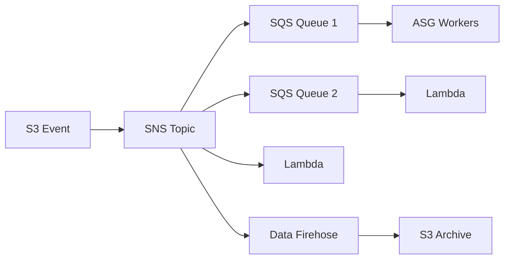
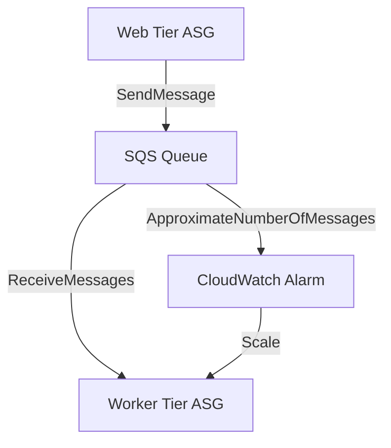
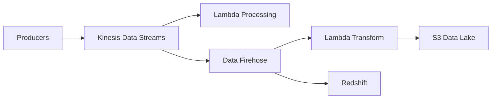
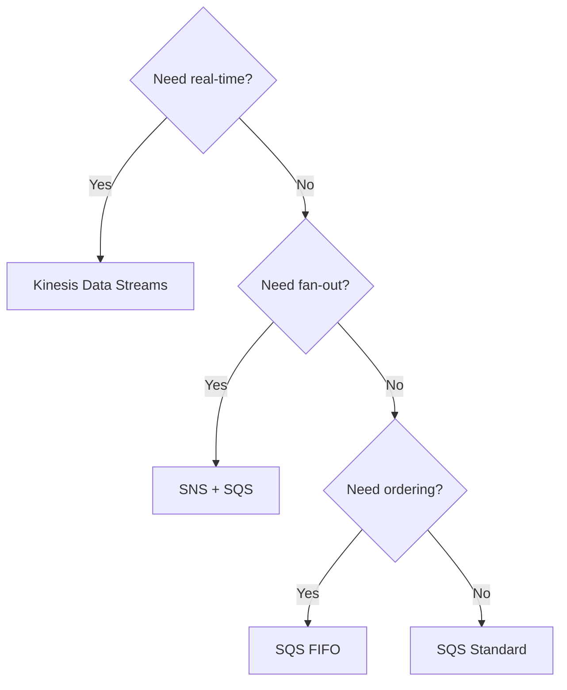

# Integration & Messaging — Learn and Test (Phase 1) [PARTIAL]
**Date:** 2026-06-04 11:49
**Score:** 0/0 (0%) — Section 1+ pending

---

## Section 1: Service Overview

### Amazon Simple Queue Service (SQS)
- **Fully managed message queue** — oldest AWS offering (10+ years)
- **Purpose:** Decouple application components using producer/consumer pattern
- **Two queue types:**
  - **Standard Queue:** Unlimited throughput, at-least-once delivery, best-effort ordering. Duplicates possible.
  - **FIFO Queue:** First-In-First-Out guaranteed ordering, exactly-once processing via Deduplication ID. Throughput: 300 msg/s (no batch), 3,000 msg/s (batched). Queue name must end in `.fifo`.
- **Message lifecycle:** Producer → `SendMessage` API → SQS (persisted up to 14 days) → Consumer polls → processes → `DeleteMessage` API
- **Message size:** Up to 1,024 KB (1 MB)
- **Retention:** Default 4 days, max 14 days
- **Latency:** <10 ms publish and receive
- **Consumers:** EC2, Lambda, on-premises servers — poll for messages (pull model)
- **Max messages per poll:** 10

### Amazon Simple Notification Service (SNS)
- **Fully managed pub/sub messaging** — push model
- **Purpose:** Send one message to many receivers (fan-out)
- **Model:** Producer → SNS Topic → all subscribers receive the message
- **Subscriber types:** SQS, Lambda, Kinesis Data Firehose, Email, SMS, HTTP(S) endpoints
- **Limits:** Up to 12,500,000 subscriptions per topic; 100,000 topics per account
- **Message persistence:** NONE — if subscriber unavailable at delivery time, message is lost
- **FIFO Topics:** Guaranteed ordering + deduplication; can have SQS Standard AND SQS FIFO as subscribers
- **Message Filtering:** JSON filter policy per subscription — subscriber only receives matching messages. No filter = receives ALL.

### Amazon Kinesis Data Streams (KDS)
- **Real-time streaming** data collection and storage
- **Purpose:** Collect, process, analyze streaming data in real-time
- **Use cases:** Clickstreams, IoT telemetry, application logs, metrics
- **Data persists:** 1 day (default) up to 365 days — supports replay
- **Immutable:** Data cannot be deleted, only expires
- **Record size:** Up to 1 MB
- **Ordering:** Guaranteed within same Partition Key (shard-level)
- **Two capacity modes:**
  - **Provisioned:** Manual shard management. Per shard: 1 MB/s in (1,000 rec/s), 2 MB/s out
  - **On-demand:** Auto-scales. Default: 4 MB/s in (4,000 rec/s)
- **Enhanced Fan-Out:** Push model — 2 MB/s per consumer per shard (vs standard: 2 MB/s shared across all consumers)

### Amazon Data Firehose (formerly Kinesis Data Firehose)
- **Fully managed, serverless delivery** service
- **NOT real-time** — near real-time with buffering (by size or time)
- **No data storage** — no replay capability
- **Sources:** Applications, SDK, KDS, CloudWatch, AWS IoT
- **Destinations:** S3, Redshift, OpenSearch (AWS); Splunk, MongoDB, Datadog (3rd party); HTTP endpoint (custom)
- **Transformation:** Lambda functions for inline data conversion (e.g., CSV → JSON, Parquet/ORC)
- **Record size:** Up to 1 MB
- **Backup:** All or failed data → S3 backup bucket

### Amazon MQ
- **Managed message broker** for legacy protocols
- **Supports:** RabbitMQ and ActiveMQ
- **Protocols:** MQTT, AMQP, STOMP, OpenWire, WSS
- **When to use:** Migrating on-premises apps using open messaging protocols (avoid rewriting to SQS/SNS)
- **NOT serverless** — runs on servers, does NOT scale like SQS/SNS
- **High Availability (HA):** Active/Standby brokers across 2 Availability Zones (AZs) with shared Amazon Elastic File System (EFS) storage

---

## Section 2: Real-World Use Cases

### SQS — Decoupling Microservices
- **E-commerce order processing:** Web tier → SQS → order processing tier. Each tier scales independently. Queue absorbs Black Friday traffic spikes without losing orders.
- **Video transcoding pipeline:** Upload service → SQS → transcoding workers (Auto Scaling Group scales based on `ApproximateNumberOfMessages` CloudWatch metric)
- **Database write buffer:** Application → SQS → consumer inserts to Relational Database Service (RDS)/DynamoDB. Prevents database overload during traffic spikes.

### SNS — Fan-Out Notifications
- **Multi-channel alerting:** CloudWatch Alarm → SNS Topic → subscribers: email to ops team, SMS to on-call, Lambda for auto-remediation, SQS for audit log
- **S3 event processing:** S3 bucket can only have ONE event rule per event-type + prefix. To send to multiple destinations: S3 → SNS → fan-out to multiple SQS queues + Lambda functions
- **Order state routing:** SNS topic with message filtering — "Placed" orders → fulfillment SQS, "Cancelled" → refund SQS, "Declined" → fraud analysis SQS

### Kinesis Data Streams — Real-Time Analytics
- **Clickstream analytics:** Website events → KDS → real-time dashboard + long-term S3 storage. Data persists for replay if analytics pipeline changes.
- **IoT telemetry:** 100,000 sensors → KDS (provisioned: 100 shards = 100 MB/s) → Lambda for anomaly detection + Firehose for S3 archival
- **Log aggregation:** Application logs → KDS → Firehose → S3 (raw) + OpenSearch (searchable)

### Data Firehose — Near Real-Time ETL
- **Data lake ingestion:** Multiple sources → Firehose → S3 data lake (Firehose native format conversion: JSON → Parquet/ORC, no Lambda needed). Lambda only needed for custom transformations like CSV → JSON or data enrichment.
- **Analytics pipeline:** KDS → Firehose → Redshift (automatic loading via COPY command)
- **Log delivery:** CloudWatch Logs → Firehose → Splunk/Datadog for monitoring

### Amazon MQ — Legacy Migration
- **Enterprise messaging migration:** On-premises ActiveMQ → Amazon MQ (same AMQP/STOMP protocols, minimal code changes). Active/Standby with EFS ensures HA.

---

## Section 3: Service Integrations

### SQS Integrations
- **SQS + Auto Scaling Group (ASG):** Scale consumers based on `ApproximateNumberOfMessages` metric via CloudWatch Alarm
- **SQS + Lambda:** Lambda polls SQS, processes batches. Event source mapping handles polling automatically.
- **SQS + SNS (fan-out):** SNS topic → multiple SQS queues. Each queue has independent consumers.
- **SQS as write buffer:** Application → SQS → consumer → RDS/DynamoDB (prevents DB overload)

### SNS Integrations
- **SNS + SQS (fan-out):** Primary decoupling pattern. SNS pushes to multiple SQS queues.
- **SNS + Lambda:** Trigger Lambda on every message. Used for real-time processing.
- **SNS + Kinesis Data Firehose:** SNS → Firehose → S3/Redshift. Combines fan-out with durable archival.
- **SNS FIFO + SQS FIFO:** Ordering + deduplication across fan-out.
- **AWS service integrations:** CloudWatch Alarms, S3 Events, ASG notifications, DynamoDB, CloudFormation state changes all publish to SNS.

### Kinesis Integrations
- **KDS → Lambda:** Real-time stream processing per record/batch
- **KDS → Firehose → S3/Redshift:** Ingestion + delivery pipeline
- **KDS → Managed Service for Apache Flink:** Complex real-time analytics (SQL/Java on streams)

### Cross-Domain: Serverless Integration
- **SQS + Lambda async processing:** Lambda auto-polls SQS, processes messages asynchronously. Failed messages → Dead Letter Queue (DLQ).
- **SNS + Lambda fan-out:** SNS pushes to Lambda for instant processing of each notification.
- **EventBridge + Lambda:** Event bus routes events by rules to Lambda targets — more flexible than SNS for AWS-event-driven architectures.

ASCII: S3 Event → SNS Topic → [SQS Queue 1 → ASG Workers] + [SQS Queue 2 → Lambda] + [Lambda] + [Firehose → S3 Archive]

---

## Section 4: Architectural Patterns

### Pattern 1: Queue-Based Decoupling (SQS)

ASCII: Web Tier → SQS Queue → Worker Tier (scales via CloudWatch alarm on queue depth)

**When to use:** Independent scaling of tiers, absorb traffic spikes, protect downstream services.

### Pattern 2: Fan-Out (SNS + SQS)
- Producer → SNS Topic → multiple SQS queues (each with independent consumers)
- **Key rule:** SQS queue must have an access policy allowing SNS to write
- Supports cross-region delivery (SQS queues in other regions)
- **When to use:** One event needs multiple independent processing paths

### Pattern 3: Ordered Fan-Out (SNS FIFO + SQS FIFO)
- SNS FIFO Topic → multiple SQS FIFO queues
- Preserves ordering (by Message Group ID) and deduplication across all subscribers
- **When to use:** Fan-out + strict ordering + exactly-once required

### Pattern 4: Real-Time Streaming Pipeline (KDS + Firehose)

ASCII: Producers → KDS → [Lambda (real-time)] + [Firehose → Lambda transform → S3/Redshift]

**When to use:** Real-time ingestion + near-real-time delivery to data stores

### Pattern 5: Message Filtering (SNS)
- Single SNS Topic with filter policies per subscription
- Different subscribers receive different message subsets based on attributes
- No filter → receives ALL messages
- **When to use:** Route messages by type/status without separate topics

### Decision: SQS vs SNS vs Kinesis

| Requirement | Best Service |
|---|---|
| Decouple + buffer + worker pool | SQS |
| Fan-out to multiple receivers | SNS (+SQS) |
| Real-time streaming + replay + ordering | Kinesis Data Streams |
| Near-real-time delivery to S3/Redshift | Data Firehose |
| Legacy protocol compatibility | Amazon MQ |
| Ordering + dedup + fan-out | SNS FIFO + SQS FIFO |

---

## Section 5: Cost Implications

### SQS Pricing
- **Pay per request:** First 1M requests/month free, then $0.40 per million (Standard), $0.50 per million (FIFO)
- **Data transfer:** Standard AWS egress charges
- **Cost optimization:** Use Long Polling (reduces empty API calls), batch messages (up to 10 per request), choose Standard over FIFO when ordering/dedup not needed

### SNS Pricing
- **Pay per publish + delivery:** First 1M publishes/month free; delivery costs depend on protocol (SQS, Lambda = free; HTTP, email, SMS = charged)
- **Use message filtering** to reduce unnecessary deliveries to subscribers

### Kinesis Data Streams Pricing
- **Provisioned:** Pay per shard-hour ($0.015/shard/hour) + data payload units
- **On-demand:** Pay per stream-hour + per GB in/out (no shard management needed)
- **Cost optimization:** Right-size shards; use on-demand for unpredictable traffic; use Enhanced Fan-Out only when needed (costs more per consumer)
- **Extended retention:** Additional charge for >24 hour retention

### Data Firehose Pricing
- **Pay per GB ingested** — no base charge, fully serverless
- **Transformation:** Lambda invocation costs if using inline transformation
- **Format conversion:** Additional charge for Parquet/ORC conversion

### Amazon MQ Pricing
- **Pay per broker instance-hour** + storage + data transfer
- Most expensive messaging option — use only for protocol compatibility, not for new architectures

---

## Section 6: Security Considerations

### Encryption
All messaging services support:
- **In-flight:** HTTPS API (TLS)
- **At-rest:** AWS Key Management Service (KMS) encryption

| Service | At-Rest | In-Flight | Client-Side |
|---|---|---|---|
| SQS | KMS | HTTPS | Yes (client manages) |
| SNS | KMS | HTTPS | Yes (client manages) |
| KDS | KMS | HTTPS | N/A |
| Firehose | KMS (at destination) | HTTPS | N/A |

### Access Control
- **SQS Access Policies** (resource-based, like S3 bucket policies): Allow cross-account access, allow SNS/S3 to write to queue
- **SNS Access Policies:** Same pattern — cross-account, service-to-service permissions
- **Identity and Access Management (IAM) policies:** Control who can call SQS/SNS/Kinesis APIs
- **Kinesis:** IAM policies for stream access; VPC endpoints for private connectivity

### Security Patterns
- **Cross-account messaging:** Use SQS/SNS resource-based policies to allow other accounts to send/receive
- **Principle of least privilege:** Separate IAM roles for producers and consumers
- **Dead Letter Queue (DLQ):** Move failed messages after N retries — prevents poison messages from blocking queue

---

## Section 7: Exam Tips

### Trigger Keywords → Service Mapping
| Exam Keyword | Answer |
|---|---|
| "decouple", "buffer", "job queue", "worker pool" | **SQS** |
| "fan-out", "pub/sub", "one-to-many", "notify multiple" | **SNS** |
| "real-time", "streaming", "replay", "clickstream", "IoT" | **Kinesis Data Streams** |
| "load into S3/Redshift", "near real-time", "ETL delivery" | **Data Firehose** |
| "MQTT", "AMQP", "RabbitMQ", "ActiveMQ", "migrate messaging" | **Amazon MQ** |
| "ordering", "exactly-once", "no duplicates" | **SQS FIFO** |
| "filter by attribute", "route by message type" | **SNS Message Filtering** |

### Top Exam Traps
1. **SQS Standard has duplicates** — consumers MUST be idempotent. FIFO eliminates duplicates but limits throughput.
2. **SNS does NOT persist data** — if subscriber is down, message is lost. SQS persists up to 14 days.
3. **Firehose is NOT real-time** — it buffers. Kinesis Data Streams IS real-time.
4. **S3 event rule limitation:** Only ONE rule per event-type + prefix → use SNS fan-out for multiple destinations.
5. **Amazon MQ does NOT scale like SQS/SNS** — it's server-based, not serverless.
6. **SQS Long Polling is preferred** — reduces API calls and cost. `WaitTimeSeconds` 1-20s (20s recommended).
7. **Visibility Timeout default is 30s** — too low = duplicates; too high = delayed reprocessing if consumer crashes.
8. **CloudWatch metric for SQS-based ASG:** `ApproximateNumberOfMessages` (not CPU utilization).
9. **SNS FIFO subscribers:** Only SQS queues (Standard or FIFO) can subscribe — not Lambda or HTTP directly.
10. **Enhanced Fan-Out (KDS):** Push model, 2 MB/s per consumer per shard. Standard: pull model, 2 MB/s shared across all consumers.
11. **KDS ordering:** By Partition Key within a shard. Different partition keys may land on different shards = no cross-shard ordering.
12. **SQS FIFO queue name** must end in `.fifo` — forgetting this suffix causes creation to fail.

ASCII: Need real-time? → Yes: KDS | No → Need fan-out? → Yes: SNS+SQS | No → Need ordering? → Yes: SQS FIFO | No: SQS Standard
