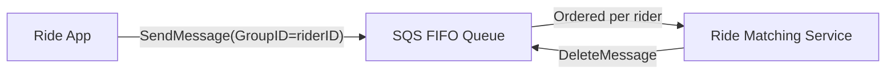
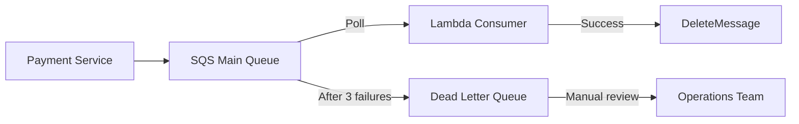
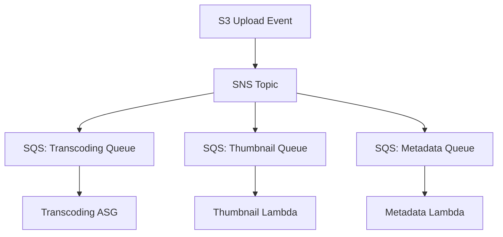
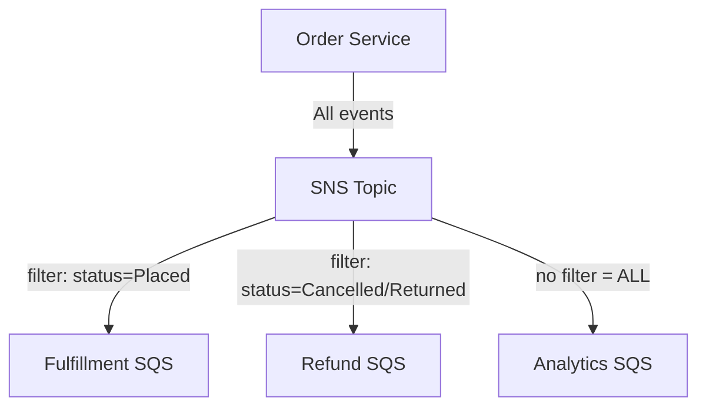
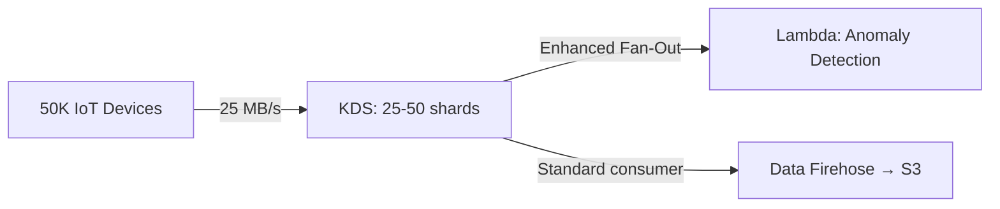
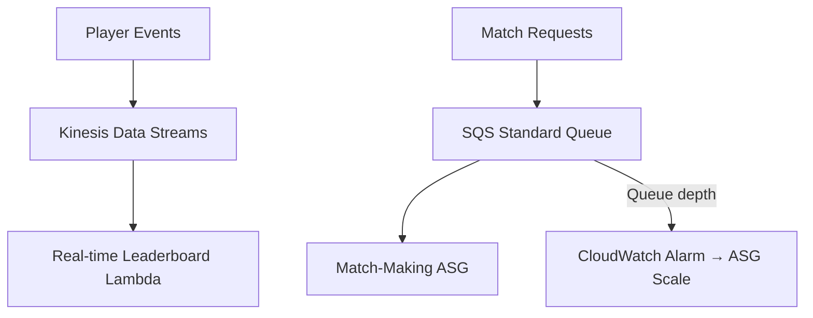
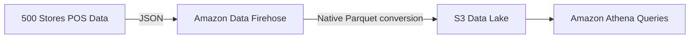
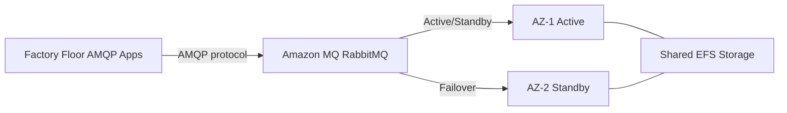

# Integration & Messaging — Scenario Practice (Phase 2)
**Date:** 2026-06-04 15:54
**Score:** 8/8 (100%) — All 8 scenarios complete

---

## Scenario 1: Standard vs FIFO Queue Selection
**Topic:** standard-vs-fifo-queue

**Context:** A ride-sharing company processes ride request events. Each ride request must be processed exactly once in the order received per rider (to prevent race conditions like double-booking a driver). Peak throughput is 200 ride requests per second.

**Requirements:**
- Exactly-once processing per ride request
- Strict ordering per rider (not globally)
- 200 requests/second peak throughput
- Decoupled from the ride-matching backend

**Question:** Which Simple Queue Service (SQS) configuration meets these requirements?

A) SQS Standard queue with application-level deduplication using rider ID as an idempotency key, processed by an Auto Scaling Group (ASG)
B) SQS FIFO queue with rider ID as the Message Group ID and ride request ID as the Deduplication ID
C) SQS Standard queue with two consumers — one for deduplication checking and one for processing — connected via a second SQS queue
D) SQS FIFO queue with a single Message Group ID for all riders to ensure global FIFO ordering across the entire system

**Your answer: B** — Correct.

**Answer:** B
**Explanation:** FIFO queue provides exactly-once processing (via Deduplication ID) and ordered delivery (via Message Group ID). Using rider ID as Message Group ID ensures per-rider ordering without forcing global ordering. 200 msg/s fits within the 300 msg/s no-batch FIFO limit. Option A doesn't guarantee ordering. Option C adds complexity without guaranteeing order. Option D creates a bottleneck — global ordering serializes all riders unnecessarily and may hit throughput limits.

ASCII: Ride App → SQS FIFO (GroupID=riderID) → Ride Matching Service

**Key Concept:** Message Group ID provides per-group ordering within FIFO queues — you get parallel processing across groups while maintaining strict order within each group.

---

## Scenario 2: Dead Letter Queue Design
**Topic:** dead-letter-queue-design

**Context:** An e-commerce platform processes payment transactions via an SQS queue. Occasionally, messages with malformed payment data cause the Lambda consumer to fail repeatedly. These "poison pill" messages block the queue, delaying valid payments.

**Requirements:**
- Isolate messages that fail processing after multiple attempts
- Allow manual inspection and reprocessing of failed messages
- Valid messages must not be delayed by failed ones
- Minimize operational overhead

**Question:** What is the recommended approach to handle these poison pill messages?

A) Increase the Visibility Timeout to 5 minutes so the Lambda function has more time to process malformed messages before they become visible again
B) Configure a Dead Letter Queue (DLQ) with a `maxReceiveCount` of 3; after 3 failed processing attempts, messages automatically move to the DLQ for manual inspection
C) Add a Lambda error handler that catches exceptions and writes failed messages to an Amazon DynamoDB table, then deletes the original message from the queue
D) Create a second SQS queue and configure the Lambda function to forward failed messages manually, using a try-catch block in the handler code

**Your answer: B** — Correct.

**Answer:** B
**Explanation:** DLQ is the AWS-native solution for poison pill isolation. After maxReceiveCount receive attempts without deletion, SQS automatically moves the message to the DLQ — no application code needed. Option A just delays the problem; the message still fails. Option C works but requires custom code, adds DynamoDB dependency, and loses SQS retry semantics. Option D requires manual forwarding logic in every consumer — DLQ handles this automatically.

ASCII: Payment Service → SQS Main Queue → Lambda (success: delete | 3 failures: → DLQ → Ops review)

**Key Concept:** DLQ `maxReceiveCount` threshold is the control knob — too low (1) and transient errors trigger DLQ; too high (20) and poison pills block the queue for extended periods. 3-5 is typical.

---

## Scenario 3: SNS Fan-Out Architecture
**Topic:** sns-fanout-pattern

**Context:** A media company uploads video files to Amazon Simple Storage Service (S3). Upon upload, three independent processes must execute: (1) transcoding to multiple formats, (2) thumbnail generation, (3) metadata extraction for search indexing. Each process has different resource requirements and processing times.

**Requirements:**
- Single S3 upload triggers all three processes
- Each process operates independently — failure in one doesn't affect others
- Processes can scale independently
- Must work within S3 event notification limitations

**Question:** Which architecture satisfies all requirements?

A) S3 event notification directly to three separate Lambda functions — one per process
B) S3 event notification to a Simple Notification Service (SNS) topic, with three SQS queue subscriptions — each queue consumed by a dedicated processing service
C) S3 event notification to a Kinesis Data Stream (KDS) with three shards, one Lambda consumer per shard for each processing task
D) S3 event notification to an SQS queue, with a single Lambda function that orchestrates all three processes using AWS Step Functions

**Your answer: B** — Correct.

**Answer:** B
**Explanation:** S3 only allows ONE event notification rule per event-type + prefix combination. SNS fan-out solves this: S3 → SNS → three SQS queues, each with independent consumers. SQS provides buffering, retry, and DLQ for each process. Option A fails because S3 can't send the same event to three separate Lambda functions (one-rule limitation). Option C misuses KDS — shards don't map to consumer types, and all consumers read all shards. Option D creates tight coupling and a single point of failure.

ASCII: S3 → SNS → [Transcoding Queue → ASG] + [Thumbnail Queue → Lambda] + [Metadata Queue → Lambda]

**Key Concept:** SNS + SQS fan-out is the standard answer whenever an exam question mentions one event needing multiple independent processing paths. The SQS queues provide durability that direct SNS→Lambda lacks.

---

## Scenario 4: SNS Message Filtering
**Topic:** message-filtering

**Context:** An order management system publishes all order events to a single Simple Notification Service (SNS) topic. Downstream systems need different subsets: the fulfillment service needs only "Placed" orders, the refund service needs "Cancelled" and "Returned" orders, and the analytics service needs ALL order events.

**Requirements:**
- Single SNS topic (no duplicate topics)
- Each subscriber receives only relevant messages
- Analytics service must receive every message
- Adding new order statuses should not require architecture changes

**Question:** How should the subscriptions be configured?

A) Create three separate SNS topics (one per order status) and have the producer publish to the correct topic based on order status
B) Use SNS message filtering with JSON filter policies: fulfillment subscription filters on `{"status": ["Placed"]}`, refund filters on `{"status": ["Cancelled", "Returned"]}`, and analytics subscription has no filter policy
C) Use a single SQS queue subscribed to the SNS topic, with a Lambda function that reads messages and routes them to the correct downstream service based on message attributes
D) Create an Amazon EventBridge rule with three targets, each filtered by order status using event patterns

**Your answer: B** — Correct.

**Answer:** B
**Explanation:** SNS message filtering applies JSON filter policies per subscription. A subscription without a filter policy receives ALL messages — perfect for analytics. Each subscriber only receives matching messages, reducing unnecessary processing. Option A creates operational overhead and coupling (producer must know all topics). Option C defeats the purpose of pub/sub by re-introducing a routing layer. Option D works but EventBridge is overkill when SNS filtering handles this natively.

ASCII: Order Service → SNS → [Fulfillment (Placed only)] + [Refund (Cancelled/Returned)] + [Analytics (ALL)]

**Key Concept:** "No filter = receives all" is a critical exam detail. When adding a new status type, only create a new filtered subscription — existing subscriptions and the unfiltered analytics subscription need no changes.

---

## Scenario 5: Kinesis Shard Capacity Planning
**Topic:** shard-capacity-planning

**Context:** An Internet of Things (IoT) platform collects sensor data from 50,000 devices. Each device sends a 500-byte reading every second. The data must be available for real-time anomaly detection AND archived to S3 for long-term analytics. The team needs to determine the Kinesis Data Streams (KDS) provisioned capacity.

**Requirements:**
- 50,000 records/second, 500 bytes each = 25 MB/s write throughput
- Real-time Lambda consumer for anomaly detection
- Near-real-time Firehose delivery to S3
- Provisioned mode (predictable traffic pattern)

**Question:** How many shards are required, and which consumer model should be used?

A) 13 shards (25 MB ÷ 2 MB/shard = 13 write shards); standard consumers for both Lambda and Firehose since two consumers share 2 MB/s read per shard adequately
B) 25 shards (25 MB ÷ 1 MB/shard = 25 write shards); Enhanced Fan-Out for Lambda (dedicated 2 MB/s per shard push delivery) and standard consumer for Firehose
C) 25 shards (25 MB ÷ 1 MB/shard = 25 write shards); standard consumers for both since Firehose doesn't actually consume from KDS — it pulls independently
D) 50 shards (one shard per 1,000 devices); Enhanced Fan-Out for both consumers to maximize throughput

**Your answer: B** — Correct.

**Answer:** B
**Explanation:** Write capacity determines shard count: 25 MB/s ÷ 1 MB/s per shard = 25 shards. (Also 50,000 rec/s ÷ 1,000 rec/s per shard = 50 shards by record count — take the higher: 50 shards would be needed if counting records). Enhanced Fan-Out for Lambda ensures dedicated 2 MB/s per shard without competing with Firehose. Firehose as a standard consumer is fine — it's near-real-time anyway. Option A uses wrong divisor (write is 1 MB/s, not 2 MB/s — 2 MB/s is read). Option C is factually wrong — Firehose does consume from KDS. Option D over-provisions and Enhanced Fan-Out for Firehose is unnecessary cost.

**Important Note:** In practice, shard count = max(throughput_shards, record_count_shards) = max(25, 50) = 50 shards. The exam may simplify to just the throughput calculation.

ASCII: 50K IoT Devices → KDS (25-50 shards) → [Lambda via Enhanced Fan-Out] + [Firehose → S3 via standard]

**Key Concept:** Shard count = max(write_MB / 1 MB, records / 1000). Write limit is 1 MB/s per shard. Read limit is 2 MB/s per shard. These are independent calculations — always use the write limit for sizing.

---

## Scenario 6: Kinesis vs SQS Decision
**Topic:** kinesis-vs-sqs-decision

**Context:** A gaming company needs to process player action events. Two teams have different requirements: Team A needs a real-time leaderboard that updates within 1 second of a player action, with the ability to replay events if the ranking algorithm changes. Team B needs a job queue where match-making requests are processed once and removed, scaling workers based on queue depth.

**Requirements:**
- Team A: real-time, replay, ordering by player, <1s latency
- Team B: process-once, delete after processing, auto-scale workers

**Question:** Which services should Team A and Team B use respectively?

A) Team A: SQS FIFO (ordering + exactly-once); Team B: SQS Standard (job queue + ASG scaling)
B) Team A: Kinesis Data Streams (real-time + replay + ordering); Team B: SQS Standard (job queue + ASG scaling on `ApproximateNumberOfMessages`)
C) Team A: Kinesis Data Streams; Team B: Kinesis Data Streams with a separate consumer group
D) Team A: Amazon Data Firehose (real-time delivery); Team B: SQS FIFO (ordered processing)

**Your answer: B** — Correct.

**Answer:** B
**Explanation:** Team A needs real-time processing, data replay, and ordering — KDS provides all three (replay via retention, ordering via Partition Key = player ID). Team B needs a classic job queue where messages are consumed and deleted — SQS Standard with ASG scaling on ApproximateNumberOfMessages is the textbook pattern. Option A fails because SQS doesn't support replay. Option C over-engineers Team B's simple requirement and KDS doesn't auto-delete consumed records. Option D is wrong because Firehose is near-real-time delivery, not real-time processing.

ASCII: Player Events → KDS → Leaderboard | Match Requests → SQS → ASG (scales on queue depth)

**Key Concept:** "Replay" is the killer keyword for KDS over SQS. SQS deletes messages after processing — no replay. KDS retains data (1-365 days) and consumers can rewind.

---

## Scenario 7: Real-Time ETL to S3/Redshift
**Topic:** real-time-etl-to-s3-redshift

**Context:** A retail analytics team needs to ingest point-of-sale transaction data from 500 stores into an Amazon S3 data lake in Apache Parquet format for Athena queries. Transactions arrive as JSON records. The team wants near-real-time availability (within 1-2 minutes) with minimal operational overhead.

**Requirements:**
- JSON input → Parquet output in S3
- Near-real-time delivery (1-2 minute acceptable latency)
- Minimal operational overhead (no servers to manage)
- Automatic scaling with no capacity planning

**Question:** Which service handles this ingestion pipeline?

A) Kinesis Data Streams (KDS) with a Lambda consumer that converts JSON to Parquet and writes to S3 using the AWS SDK
B) Amazon Data Firehose with native Parquet format conversion, buffered delivery to S3 at 1-minute intervals
C) AWS Glue streaming ETL job reading from a Kinesis Data Stream, converting to Parquet, and writing to S3 every 60 seconds
D) Amazon Managed Streaming for Apache Kafka (MSK) with a Kafka Connect S3 sink connector configured for Parquet output

**Your answer: B** — Correct.

**Answer:** B
**Explanation:** Firehose natively converts JSON → Parquet/ORC without Lambda (uses an AWS Glue table definition for the schema). It's fully serverless, auto-scales, and buffers by time (minimum 60 seconds) or size before delivering to S3. Option A requires custom Lambda code for Parquet conversion — operational overhead. Option C works but Glue streaming has higher cost and complexity than Firehose for simple format conversion. Option D introduces Kafka infrastructure — maximum operational overhead.

ASCII: POS Data (JSON) → Firehose (Parquet conversion) → S3 → Athena

**Key Concept:** Firehose native format conversion (Parquet/ORC) uses a Glue Data Catalog table definition — no Lambda needed. Lambda is only needed for CUSTOM transformations (e.g., CSV→JSON, data enrichment, filtering). This is a common exam trap.

---

## Scenario 8: Amazon MQ Migration from On-Premises
**Topic:** mq-migration-from-on-premises

**Context:** A manufacturing company runs an on-premises message broker using RabbitMQ with AMQP protocol. Dozens of factory floor applications (PLCs, SCADA systems) publish sensor readings and consume control messages. The company is migrating to AWS but cannot modify the factory floor applications that use AMQP.

**Requirements:**
- Must support AMQP protocol (no application code changes)
- High availability across Availability Zones (AZs)
- Managed service (no self-hosted brokers)
- Similar queue + topic semantics to current RabbitMQ setup

**Question:** Which AWS messaging service meets these requirements?

A) Amazon Simple Queue Service (SQS) with an AMQP-to-HTTPS protocol adapter Lambda function in front of the queue
B) Amazon MQ for RabbitMQ with a multi-AZ cluster deployment for high availability
C) Amazon Managed Streaming for Apache Kafka (MSK) which supports AMQP as a native protocol alongside Kafka protocol
D) Amazon Simple Notification Service (SNS) with SQS backend queues, using the AWS IoT Core MQTT bridge to translate AMQP messages

**Your answer: B** — Correct.

**Answer:** B
**Explanation:** Amazon MQ supports RabbitMQ and ActiveMQ with native AMQP/MQTT/STOMP protocols. Multi-AZ deployment with Active/Standby brokers sharing Amazon Elastic File System (EFS) provides HA. Zero application code changes needed — same protocol, same semantics. Option A requires building a custom protocol adapter — operational overhead and latency. Option C is wrong — MSK uses Kafka protocol, not AMQP. Option D over-engineers a simple protocol compatibility requirement.

ASCII: Factory Apps (AMQP) → Amazon MQ RabbitMQ → [AZ-1 Active + AZ-2 Standby, shared EFS]

**Key Concept:** Amazon MQ = legacy protocol compatibility. If the exam says "MQTT", "AMQP", "STOMP", "ActiveMQ", "RabbitMQ", or "migrate existing message broker" → answer is Amazon MQ. For new cloud-native apps → SQS/SNS.
