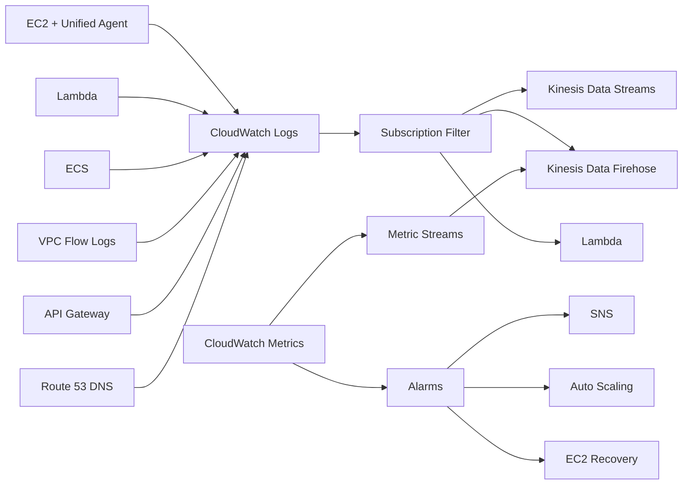
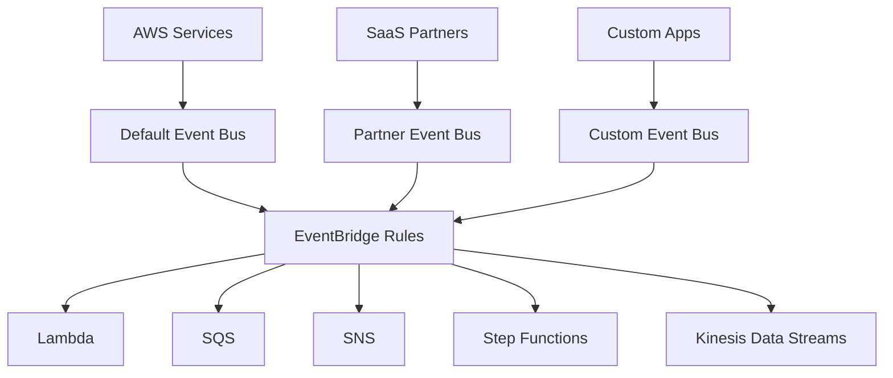
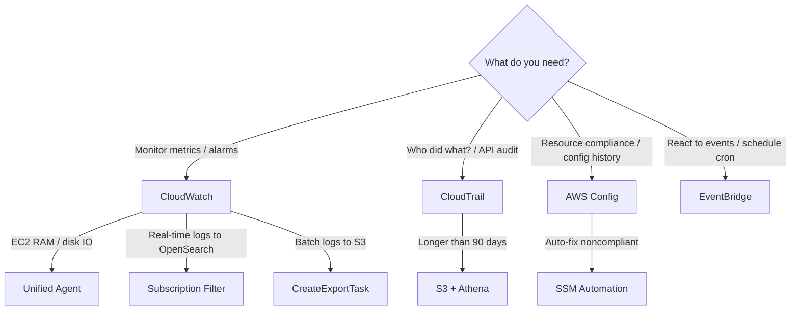

# Monitoring & Audit — Learn and Test (Phase 1)
**Date:** 2026-06-05 10:16
**Score:** 11/17 (65%) — All 7 sections complete
**Time:** 320 min

---

## Section 1: Service Overview

### Amazon CloudWatch
- Core **monitoring service** for all AWS resources and applications
- Provides: **metrics**, **logs**, **alarms**, **dashboards**, and **events**
- **CloudWatch Metrics**: Variables to monitor (e.g., CPUUtilization, NetworkIn). Each metric belongs to a **namespace** (e.g., AWS/EC2) and can have up to **30 dimensions** per metric
- **Custom Metrics**: Push your own metrics (e.g., RAM utilization — **NOT available by default** on EC2)
- **CloudWatch Logs**: Centralized log collection organized by **Log Groups** (applications) and **Log Streams** (instances/containers). Retention: **never expire** (default) or 1 day to 10 years
- **CloudWatch Alarms**: Trigger notifications based on metric thresholds. Three states: **OK**, **INSUFFICIENT_DATA**, **ALARM**. Targets: EC2 actions (stop/terminate/reboot/recover), Auto Scaling Group (ASG) actions, Amazon Simple Notification Service (SNS)
- **CloudWatch Dashboards**: Visual monitoring of key metrics across services

### Amazon EventBridge (formerly CloudWatch Events)
- **Serverless event bus** for building event-driven architectures
- Three event bus types: **Default** (AWS services), **Partner** (SaaS: Zendesk, Datadog), **Custom** (your applications)
- Core features: **Schedule** (cron jobs), **Event Pattern** (react to AWS service events)
- Can **archive events** and **replay** them later — useful for debugging and reprocessing
- Destinations: Lambda, Simple Queue Service (SQS), Simple Notification Service (SNS), Step Functions, Kinesis Data Streams, and more

### AWS CloudTrail
- **Governance, compliance, and audit** service for AWS accounts
- Records **history of API calls** made by Console, SDK, CLI, and AWS services
- **Enabled by default** — logs management events automatically
- Three event types: **Management Events** (default on), **Data Events** (default off — high volume), **Insights Events** (default off — unusual activity detection)
- Events retained for **90 days**; for longer retention, ship to **S3 → analyze with Athena**

### AWS Config
- Auditing and recording **compliance** of AWS resource configurations
- Records configuration **changes over time** — "How has my resource changed?"
- **Per-region service** (can aggregate across regions/accounts)
- **Cannot prevent/deny actions** — detection and notification only (unlike Service Control Policies (SCPs) or Identity and Access Management (IAM))
- Over **75 AWS Managed Rules** available; custom rules via Lambda

### Quiz: Section 1
**Q1** ✗ — cloudwatch-unified-agent
A) Enable detailed monitoring B) Install Unified Agent C) Logs Insights D) Composite Alarm
**Your answer: A** — Incorrect. Correct: B. Detailed monitoring increases resolution (5→1 min) but doesn't add RAM. Unified Agent pushes RAM as custom metric.

**Q2** ✗ — cloudtrail
A) CloudWatch B) Config C) CloudTrail D) EventBridge
**Your answer: B** — Incorrect. Correct: C. "Who deleted?" = CloudTrail (API call history). Config tracks config changes but not who made them.

**Q3** ✗ — aws-config-remediation
A) CloudTrail+EventBridge+Lambda B) Config+SSM C) CloudWatch+SNS D) Config+SQS manual
**Your answer: A** — Incorrect. Correct: B. Config managed rule + SSM auto-remediation for continuous compliance. CloudTrail only catches at creation time.

---

## Section 2: Real-World Use Cases

### Scenario 1: "Our EC2 instances run out of memory but we can't see RAM usage"
- **Problem**: EC2 default CloudWatch metrics include CPU, disk, and network — but **NOT RAM**
- **Solution**: Install the **CloudWatch Unified Agent** on EC2. It collects system-level metrics: RAM (free/used/total/cached), CPU (active/idle/steal), disk I/O, swap, netstat, and processes
- **Key distinction**: The old **Logs Agent** only sends logs. The **Unified Agent** sends logs AND system metrics. Unified Agent config is centralized via **Systems Manager (SSM) Parameter Store**

### Scenario 2: "We need to know who deleted our DynamoDB table last week"
- **Service**: AWS CloudTrail
- **Pattern**: `DeleteTable` API call → CloudTrail logs it → search CloudTrail Event History (90-day window) or query S3 logs with Athena for older events
- **Rule of thumb**: "Who did what?" → CloudTrail

### Scenario 3: "Alert us whenever someone changes a Security Group's inbound rules"
- **Pattern**: User calls `AuthorizeSecurityGroupIngress` → CloudTrail records it → EventBridge matches the event pattern → sends SNS notification to the security team
- CloudTrail + EventBridge = **security alerting for any API call**

### Scenario 4: "Ensure no S3 bucket is publicly accessible"
- **Service**: AWS Config
- **Rule**: `s3-bucket-public-read-prohibited` (AWS managed rule)
- Config evaluates each S3 bucket → marks as **Compliant** or **Noncompliant**
- If noncompliant: auto-remediation via **SSM Automation Document** (e.g., remove public access)

### Scenario 5: "Stream all CloudWatch metrics to our Splunk dashboard in near-real-time"
- **Service**: CloudWatch Metric Streams → Kinesis Data Firehose → Splunk
- Supports: Datadog, Dynatrace, New Relic, Sumo Logic, and custom HTTP endpoints

### Quiz: Section 2
**Q1** ✗ — cloudwatch-unified-agent-config
**Your answer: D** — Incorrect. Correct: B. Unified Agent config stored in SSM Parameter Store for centralized management. Dashboards are visualization only.

**Q2** ✓ — cloudtrail-eventbridge-alerting
**Your answer: C** — Correct. CloudTrail + EventBridge = near-real-time API action alerting.

---

## Section 3: Service Integrations

### CloudWatch Integration Map



ASCII fallback:
```
EC2/Lambda/ECS/VPC → CloudWatch Logs → Subscription Filter → KDS / KDF / Lambda
CloudWatch Metrics → Alarms → SNS / ASG / EC2 Actions
CloudWatch Metrics → Metric Streams → KDF → S3 / Splunk / Datadog
```

### EventBridge Integration Map



### CloudTrail → EventBridge → Action Pattern
- **Any API call** recorded by CloudTrail generates an EventBridge event
- Create rules to match specific API actions and trigger automated responses
- Examples: root user login → SNS alert; security group change → Lambda remediation

### Config → SSM → Remediation Pattern
- Config detects noncompliant resource → triggers SSM Automation Document → executes remediation
- Built-in AWS remediation documents available (e.g., `RevokeUnusedIAMUserCredentials`)
- Configurable retries (e.g., 5 attempts)

### Quiz: Section 3
**Q1** ✓ — cloudwatch-logs-subscription-kds-fanout
**Your answer: B** — Correct. KDS as hub for multiple consumers: Lambda→OpenSearch (real-time) + KDF→S3 (near-real-time).

**Q2** ✓ — aws-config-ssm-remediation
**Your answer: B** — Correct. Config remediation uses SSM Automation Documents with configurable retries.

---

## Section 4: Architectural Patterns

### Pattern 1: Real-Time Log Processing
```
CloudWatch Logs → Subscription Filter → Lambda → OpenSearch (real-time search)
```
- Use when you need **instant analysis** of log events
- Alternative: → Kinesis Data Streams → custom consumers

### Pattern 2: Near-Real-Time Log Archival
```
CloudWatch Logs → Subscription Filter → Kinesis Data Firehose → S3
```
- Near-real-time delivery (buffered)
- Cheaper than real-time; good for data lake ingestion

### Pattern 3: Batch Log Export (NOT Real-Time)
```
CloudWatch Logs → CreateExportTask → S3 (up to 12-hour delay)
```
- **Exam trap**: This is NOT near-real-time. Use Subscriptions for real-time needs

### Pattern 4: Multi-Account Log Aggregation
```
Account A/B/C → CloudWatch Logs → Subscription Filters → Central Kinesis Data Streams → KDF → S3
```
- Supports **cross-account** and **cross-region** log aggregation
- Requires IAM Role (cross-account) + Destination Access Policy

### Pattern 5: Security Alerting Pipeline
```
API Call → CloudTrail → EventBridge Rule → SNS / Lambda
```
- Detect: root login, security group changes, table deletions, IAM role assumptions

### Pattern 6: Compliance Auto-Remediation
```
Resource (noncompliant) → Config Rule detects → SSM Automation → Fix resource
```
- Example: expired IAM access key → Config → SSM revokes credentials (retries: 5)

### Decision Tree: Which Service for Which Use Case?



### Quiz: Section 4
**Q1** ✗ — cloudwatch-logs-multi-account-aggregation
**Your answer: A** — Incorrect. Correct: B. CreateExportTask takes up to 12 hours. Subscription Filters → central KDS → KDF → S3 = near-real-time aggregation.

**Q2** ✓ — cloudtrail-eventbridge-root-login
**Your answer: C** — Correct. Root sign-in → CloudTrail ConsoleLogin → EventBridge pattern match → SNS.

**Q3** ✓ — createexporttask-batch-cost
**Your answer: C** — Correct. CreateExportTask = cheapest for batch S3 export when hours of delay acceptable.

---

## Section 5: Cost Implications

### CloudWatch Pricing
- **Free tier**: 10 custom metrics, 10 alarms, 1M API requests, 5 GB log ingestion, 3 dashboards (50 metrics each)
- **Custom metrics**: $0.30/metric/month (first 10K)
- **Alarms**: $0.10/alarm/month (standard); $0.30/alarm/month (high-resolution)
- **Logs**: $0.50/GB ingested; storage: $0.03/GB/month
- **Metric Streams**: $0.003/1,000 metric updates

### CloudTrail Pricing
- **Management events**: first copy free; additional copies $2.00/100K events
- **Data events**: $0.10/100K events (read) or $0.02/100K events (write)
- **Insights**: $0.35/100K events analyzed

### AWS Config Pricing
- **No free tier**
- $0.003 per configuration item recorded per region
- $0.001 per Config rule evaluation per region
- **Cost optimization**: use only in regions where resources exist; select specific resource types

### EventBridge Pricing
- **AWS events**: free
- **Custom events**: $1.00/million events
- **Archive and replay**: $0.10/GB archived

### Cost Optimization Tips
- Use CloudWatch Logs retention policies — don't keep logs forever if not needed
- Enable CloudTrail Data Events only for critical buckets/functions (high volume = high cost)
- Use Config only in active regions; select specific resource types vs "all resources"
- Use Composite Alarms to reduce alarm count (fewer alarms = lower cost)

### Quiz: Section 5
**Q1** ✓ — aws-config-cost-optimization
**Your answer: B** — Correct. Disable Config in 17 empty regions + select specific resource types.

**Q2** ✗ — cloudwatch-high-resolution-alarm-cost
**Your answer: A** — Incorrect. Correct: B. 10-second periods = high-resolution alarms at $0.30/alarm. 50 × $0.30 = $15.00.

---

## Section 6: Security Considerations

### CloudWatch Security
- **Logs encrypted by default**; optional KMS Customer Managed Key (CMK) encryption for additional control
- **IAM policies** control who can view metrics, logs, and dashboards
- EC2 instances need an **IAM role** with CloudWatch permissions to send logs/metrics
- **Cross-account access**: CloudWatch Logs Subscriptions support cross-account delivery via IAM roles and destination access policies

### CloudTrail Security
- **Enabled by default** for all AWS accounts — cannot be fully disabled
- Log files delivered to S3 can be encrypted with **SSE-S3** or **SSE-KMS**
- Enable **Log File Integrity Validation** to detect tampering (uses SHA-256 hashing)
- **Organization Trail**: apply to all accounts in AWS Organizations — logs to a central S3 bucket
- Separate **read events** from **write events** for fine-grained monitoring

### AWS Config Security
- Config data stored in S3 can be encrypted
- **Config Rules** for security: `restricted-ssh`, `s3-bucket-public-read-prohibited`, `iam-password-policy`, `rds-instance-public-access-check`
- Config **cannot deny** actions — use it alongside SCPs and IAM policies for preventive controls
- **Remediation** via SSM can revoke credentials, disable access, modify security groups

### EventBridge Security
- **Resource-based policies** control which accounts/regions can put events on your event bus
- Use for **centralized event aggregation** across AWS Organizations
- Events delivered as JSON — sensitive data in events should be encrypted at the source

### Cross-Service Security Pattern
```
CloudTrail (detect API call) → EventBridge (match pattern) → Lambda (remediate) + SNS (notify)
```
Example: someone opens SSH to 0.0.0.0/0 → CloudTrail logs it → EventBridge triggers → Lambda removes the rule + SNS alerts the team

### Quiz: Section 6
**Q1** ✓ — cloudtrail-log-integrity-validation
**Your answer: B** — Correct. Log File Integrity Validation uses SHA-256 digest files for tamper detection.

**Q2** ✓ — aws-config-cannot-deny
**Your answer: B** — Correct. Config cannot deny/prevent — only detect and report. Use SCP or IAM for prevention.

---

## Section 7: Exam Tips

### Core Service Distinction Table
| Question keyword | Service |
|---|---|
| "monitor metrics", "dashboards", "alarms" | **CloudWatch** |
| "who deleted", "API calls", "audit", "governance" | **CloudTrail** |
| "compliance", "configuration history", "drift" | **AWS Config** |
| "schedule cron", "react to events", "event-driven" | **EventBridge** |

### Critical Exam Traps
1. **RAM is NOT a default EC2 metric** — requires CloudWatch Unified Agent (Custom Metric)
2. **EC2 logs are NOT sent to CloudWatch automatically** — must install agent + IAM role
3. **S3 log export is NOT real-time** — `CreateExportTask` takes up to 12 hours. Use Subscription Filters for real-time
4. **Logs Insights is NOT real-time** — it's a query engine for historical log analysis
5. **Config CANNOT deny/prevent** actions — it only detects and alerts. Use SCPs/IAM for prevention
6. **CloudTrail Data Events are OFF by default** — must enable explicitly (extra cost)
7. **CloudTrail retains events for 90 days** — ship to S3 + Athena for longer analysis
8. **EventBridge = CloudWatch Events** (renamed) — same service
9. **Old Logs Agent vs Unified Agent**: Logs Agent = logs only. Unified Agent = logs + system metrics (RAM, CPU details, disk I/O, etc.)
10. **EC2 Instance Recovery** preserves same Private IP, Public IP, Elastic IP, and metadata

### Keyword-to-Service Mapping
| Exam keyword | Points to |
|---|---|
| "detect who deleted a resource" | CloudTrail |
| "monitor RAM on EC2" | CloudWatch Unified Agent / Custom Metric |
| "ensure SSH port not open" | AWS Config rule |
| "alert when CPU > 80%" | CloudWatch Alarm |
| "schedule Lambda every hour" | EventBridge schedule/cron |
| "react to root user login" | EventBridge event pattern |
| "stream metrics to Splunk" | CloudWatch Metric Streams |
| "analyze logs across accounts" | CloudWatch Logs Insights (cross-account) |
| "find top IP addresses" | CloudWatch Contributor Insights |
| "troubleshoot Lambda cold starts" | CloudWatch Lambda Insights |
| "auto-fix noncompliant resources" | AWS Config + SSM Automation |
| "near-real-time logs to S3" | CW Logs Subscriptions → Firehose → S3 |
| "real-time log processing" | CW Logs Subscriptions → Lambda or KDS |
| "batch export logs to S3" | CreateExportTask (up to 12 hours) |
| "detect unusual API patterns" | CloudTrail Insights |
| "archive and replay events" | EventBridge event archiving |

### CloudWatch Insights Family (4 types)
| Insight | What it monitors | Key fact |
|---|---|---|
| **Container Insights** | ECS, EKS, K8s, Fargate | Uses containerized CW Agent |
| **Lambda Insights** | Lambda functions | Provided as a **Lambda Layer** |
| **Contributor Insights** | Top-N contributors in logs | VPC Flow Logs, DNS logs |
| **Application Insights** | Monitored apps (.NET, Java, IIS) | Powered by **SageMaker** |

### Quiz: Section 7
**Q1** ✓ — cloudtrail-s3-athena-long-term
**Your answer: B** — Correct. 90-day retention is fixed. S3 + Athena for long-term queryable storage.

**Q2** ✓ — cloudwatch-contributor-insights
**Your answer: B** — Correct. Contributor Insights = Top-N analysis on log data.

**Q3** ✓ — cloudwatch-lambda-insights
**Your answer: B** — Correct. Lambda Insights = Lambda Layer for cold starts + system metrics.
