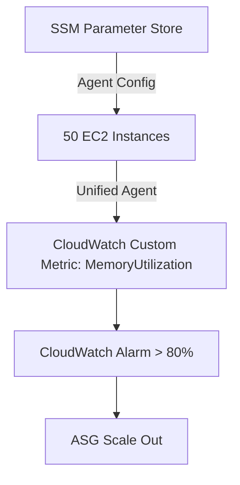
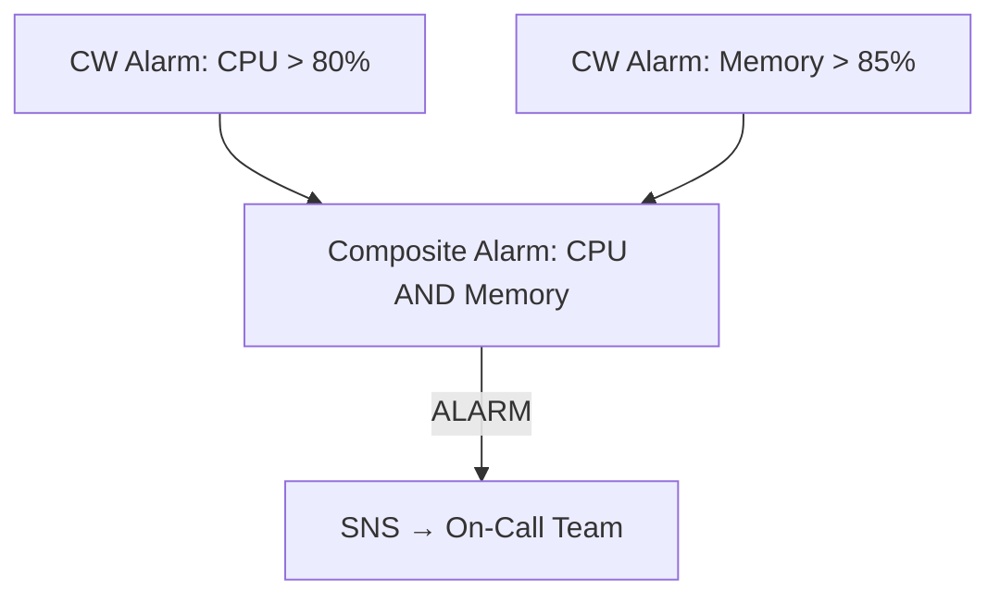
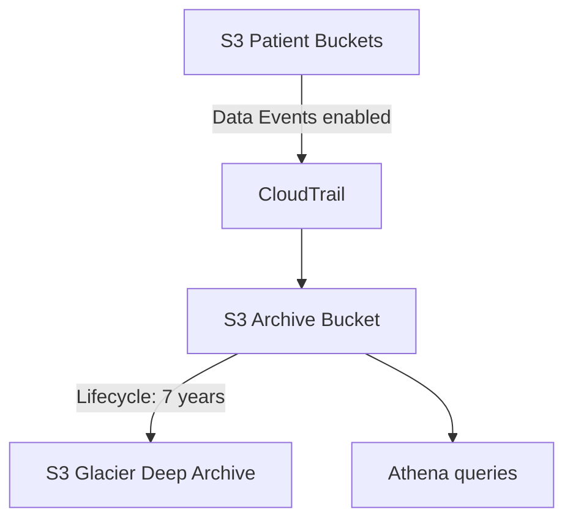
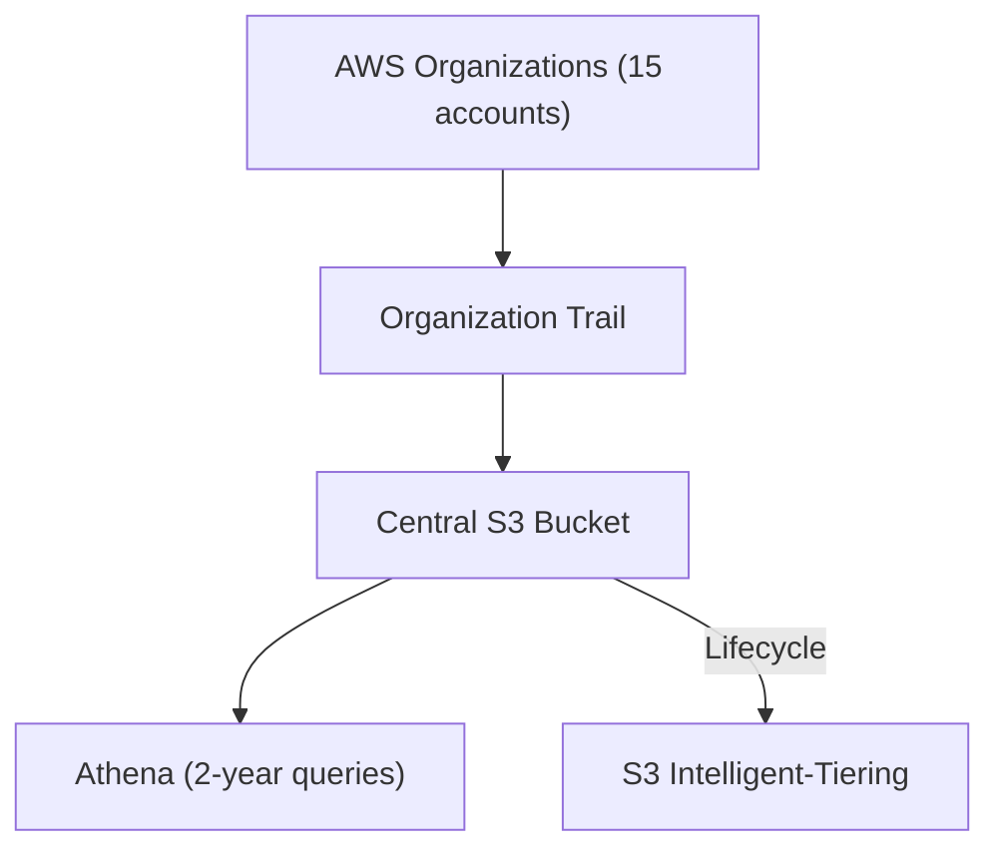
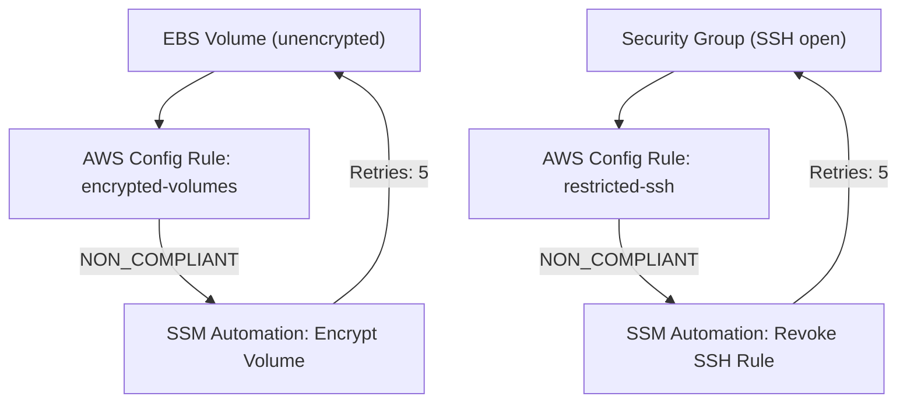
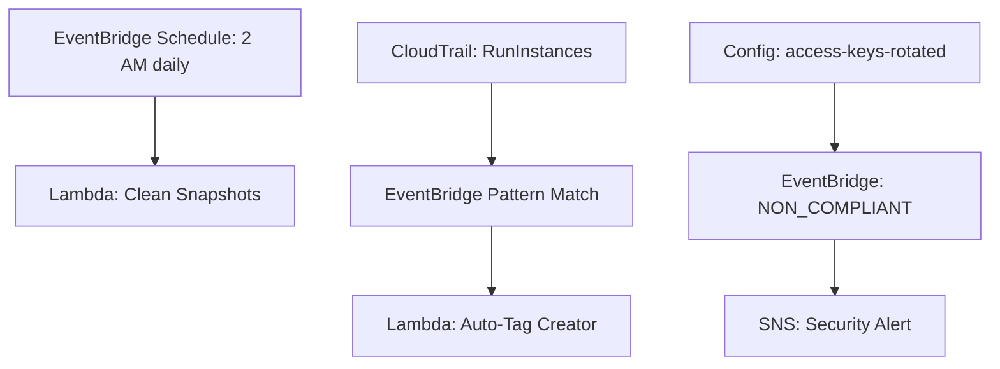
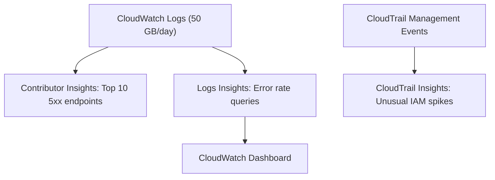

# Monitoring & Audit — Scenario Practice (Phase 2)
**Date:** 2026-06-05 15:38
**Score:** 6/7 (86%) — All 7 scenarios complete
**Time:** 17 min / 21 min ✓ within limit

---

### Scenario 1: Custom Metrics and Alarms (cloudwatch-custom-metrics-and-alarms)
**Context:** A gaming company runs 50 EC2 instances for their multiplayer backend. Players report lag during peak hours. The operations team suspects memory exhaustion but CloudWatch dashboards only show CPU at 40%. They need to monitor RAM utilization and trigger auto-scaling when memory exceeds 80%.
**Requirements:** Monitor RAM on all 50 instances. Auto-scale when memory > 80%. Centralized configuration. Minimal operational overhead.
**Question:** Which solution monitors RAM and triggers auto-scaling based on memory utilization?
A) Enable EC2 detailed monitoring to unlock RAM metrics, then create a CloudWatch Alarm on the MemoryUtilization metric with an Auto Scaling Group (ASG) scaling policy
B) Install the CloudWatch Unified Agent on all instances with configuration stored in Systems Manager (SSM) Parameter Store, publish RAM as a custom metric, create a CloudWatch Alarm targeting the ASG
C) Use CloudWatch Container Insights to collect memory metrics from the EC2 instances, then configure a Step Scaling policy based on the memory metric
D) Deploy a third-party monitoring agent (Datadog) on all instances and use CloudWatch Metric Streams to import the memory data back into CloudWatch for alarming
**Hint:** Think about which agent type can push system-level metrics as custom metrics to CloudWatch.
**Correct: B** — The CloudWatch Unified Agent collects system-level metrics including RAM, CPU details, disk I/O, swap, and netstat. Configuration in SSM Parameter Store enables centralized management across 50 instances. RAM is published as a custom metric → CloudWatch Alarm → ASG scaling action.
**Architecture:**

**Why others wrong:**
- A) Detailed monitoring increases resolution (5→1 min) but does NOT add RAM metrics — EC2 hypervisor doesn't expose memory.
- C) Container Insights monitors ECS/EKS/Fargate containers, not bare EC2 memory.
- D) Unnecessary complexity — CloudWatch Unified Agent is AWS-native and directly publishes to CloudWatch.
**Key Concept:** RAM is not a default EC2 metric; requires CloudWatch Unified Agent to publish as custom metric.

---

### Scenario 2: Composite Alarms (cloudwatch-composite-alarms)
**Context:** An e-commerce platform has CloudWatch Alarms on CPU, memory (via Unified Agent), disk I/O, and network for their order processing fleet. During routine maintenance, individual alarms fire for brief spikes, triggering unnecessary SNS notifications to the on-call team — creating alert fatigue.
**Requirements:** Only alert when multiple metrics are simultaneously unhealthy. Reduce false positives. Maintain individual metric monitoring.
**Question:** How should the architect reduce alarm noise while preserving granular monitoring?
A) Increase the evaluation period for each alarm from 1 minute to 15 minutes so brief spikes don't trigger alerts
B) Create a CloudWatch Composite Alarm that triggers only when BOTH the CPU alarm AND the memory alarm are in ALARM state simultaneously, using AND logic
C) Replace individual alarms with a single alarm on a calculated metric that averages CPU, memory, and disk I/O into a composite score
D) Configure alarm suppression windows during scheduled maintenance periods using EventBridge scheduled rules to disable alarms
**Hint:** CloudWatch has a specific alarm type designed to combine multiple alarm states with boolean logic.
**Correct: B** — Composite Alarms monitor the states of multiple other alarms using AND/OR conditions. Requiring BOTH CPU AND memory to be in ALARM eliminates false positives from brief single-metric spikes while keeping individual alarms active for granular monitoring.
**Architecture:**

**Why others wrong:**
- A) Longer evaluation periods delay detection of real issues — masks problems instead of correlating them.
- C) Averaged composite metric loses individual signal granularity and doesn't represent actual failure conditions.
- D) Maintenance windows help but don't solve noise from non-maintenance periods; also requires knowing maintenance schedules in advance.
**Key Concept:** Composite Alarms reduce alarm noise by combining multiple alarms with AND/OR conditions.

---

### Scenario 3: Management vs Data Events (cloudtrail-management-vs-data-events)
**Context:** A healthcare company stores patient records in S3 and needs to audit who accessed which patient files for HIPAA compliance. Their CloudTrail is enabled with default settings, but they can't find S3 object-level access logs (GetObject, PutObject) in the event history.
**Requirements:** Track every S3 object-level read and write for compliance. Maintain logs for 7 years. Cost-conscious — only enable what's required.
**Question:** Why are the S3 object-level events missing and how should the architect fix this?
A) CloudTrail only logs management events (CreateBucket, DeleteBucket) by default. Enable Data Events for the specific S3 buckets containing patient records, then ship logs to S3 with lifecycle policies for 7-year retention.
B) CloudTrail doesn't support S3 logging. Enable S3 Server Access Logging on each bucket and export to a central S3 bucket with 7-year retention.
C) CloudTrail Data Events are enabled by default but filtered out of the console view. Use CloudTrail Insights to surface the hidden S3 access patterns.
D) Enable CloudTrail Management Events for S3 — the default only covers EC2, IAM, and RDS management events.
**Hint:** CloudTrail has two event types with different default settings — one is on, one is off.
**Correct: A** — CloudTrail logs Management Events by default (account-level actions: CreateBucket, DeleteBucket). Data Events (object-level: GetObject, PutObject) are disabled by default due to high volume. Enable Data Events specifically for the patient record buckets to minimize cost. Ship to S3 with lifecycle policies for 7-year HIPAA retention.
**Architecture:**

**Why others wrong:**
- B) CloudTrail absolutely supports S3 logging via Data Events. S3 Server Access Logging is a separate feature with less structured data.
- C) Data Events are NOT enabled by default — they must be explicitly turned on. Insights detects unusual patterns, not hidden events.
- D) Management Events already cover all AWS services by default, not just a subset.
**Key Concept:** CloudTrail Data Events are OFF by default (high volume, extra cost). Must enable explicitly per bucket/function.

---

### Scenario 4: Multi-Account Trail (cloudtrail-multi-account-trail)
**Context:** A financial services firm has 15 AWS accounts managed under AWS Organizations. The security team needs a single view of all API activity across every account for SOX compliance auditing. They want to query 2 years of historical data efficiently.
**Requirements:** Centralized audit trail from all 15 accounts. 2-year queryable retention. Single pane of glass for security investigations.
**Question:** Which architecture provides centralized multi-account API auditing with long-term retention?
A) Create individual CloudTrail trails in each of the 15 accounts, each sending logs to the same central S3 bucket with Athena for querying
B) Create an Organization Trail in the management account, which automatically applies to all 15 member accounts, delivering logs to a central S3 bucket — use Athena for historical queries beyond 90 days
C) Enable CloudWatch Logs in each account and use CloudWatch Logs Insights with cross-account querying to search API events across all 15 accounts
D) Use AWS Config aggregator to collect API change events from all 15 accounts into a central Config dashboard
**Hint:** AWS Organizations has a specific CloudTrail feature for multi-account audit.
**Correct: B** — An Organization Trail automatically applies to all member accounts — no need to configure individual trails. Logs centralize in one S3 bucket. CloudTrail retains 90 days in-service; for 2-year requirement, query S3 with Athena.
**Architecture:**

**Why others wrong:**
- A) Individual trails in 15 accounts works but requires manual setup and maintenance in each account — Organization Trail automates this.
- C) CloudWatch Logs stores log data, not structured API events. Logs Insights queries log groups, not CloudTrail event history.
- D) Config tracks resource configuration compliance, not API calls. Config aggregator collects compliance data, not audit trails.
**Key Concept:** Organization Trail = single trail for all accounts in AWS Organizations.

---

### Scenario 5: Compliance Rules and Remediation (aws-config-compliance-rules-and-remediation)
**Context:** A bank's security policy requires all Elastic Block Store (EBS) volumes to be encrypted and all Security Groups to block SSH from 0.0.0.0/0. When violations are found, they must be remediated automatically within 5 minutes — not just flagged for manual review.
**Requirements:** Continuous compliance monitoring. Automatic remediation of violations. Retry if remediation fails. No manual intervention.
**Question:** Which architecture provides continuous compliance monitoring with automatic remediation?
A) CloudTrail detects CreateVolume and AuthorizeSecurityGroupIngress API calls → EventBridge rules → Lambda functions that encrypt volumes and remove SSH rules
B) AWS Config with managed rules (encrypted-volumes, restricted-ssh) evaluating continuously, with SSM Automation Documents configured for auto-remediation and 5 retry attempts
C) CloudWatch custom metrics tracking encryption status and SSH port exposure → CloudWatch Alarms → Lambda remediation functions
D) AWS Security Hub with security standards enabled, sending findings to EventBridge → Step Functions workflow for remediation
**Hint:** Which service continuously evaluates resource compliance and has a native auto-remediation mechanism?
**Correct: B** — AWS Config managed rules (`encrypted-volumes`, `restricted-ssh`) continuously evaluate resource compliance. When noncompliant, Config triggers SSM Automation Documents for auto-remediation with configurable retries (5 attempts). This is the native Config compliance + remediation pattern.
**Architecture:**

**Why others wrong:**
- A) CloudTrail + EventBridge detects at creation time only — doesn't catch existing noncompliant resources or configuration drift.
- C) CloudWatch monitors performance metrics, not resource configuration compliance. No metric exists for "encryption status."
- D) Security Hub aggregates findings but doesn't have native auto-remediation with retries like Config + SSM.
**Key Concept:** Config + SSM Automation = continuous compliance monitoring + auto-remediation with retries.

---

### Scenario 6: Event-Driven Automation (eventbridge-event-driven-automation)
**Context:** A DevOps team wants to automate three operational tasks: (1) schedule a Lambda function to clean up old snapshots every night at 2 AM, (2) automatically tag any new EC2 instance with the creator's IAM username, and (3) alert the security team when any IAM access key is more than 90 days old.
**Requirements:** All three automations in one service. Minimal custom infrastructure. Event-driven where possible, scheduled where needed.
**Question:** Which service handles all three automation requirements?
A) AWS Systems Manager (SSM) with Maintenance Windows for scheduling, State Manager for tagging, and Automation Documents for key rotation alerting
B) Amazon EventBridge with: a scheduled rule (cron) triggering Lambda for snapshot cleanup, an event pattern rule matching RunInstances → Lambda for auto-tagging, and integration with AWS Config for access key age → SNS alerting
C) AWS Lambda with CloudWatch Events (cron) for scheduling, CloudTrail log parsing for new instance detection, and a scheduled Lambda scanning IAM keys
D) AWS Step Functions orchestrating three parallel workflows: one for scheduled cleanup, one for instance tagging, one for key monitoring
**Hint:** Which service provides both scheduled (cron) and event-pattern-based triggers in a unified event bus?
**Correct: B** — Amazon EventBridge provides both **scheduled rules** (cron for nightly cleanup) and **event pattern rules** (match RunInstances for auto-tagging). For the 90-day key check, Config rule `access-keys-rotated` detects noncompliant keys → Config sends to EventBridge → SNS alert. All three automations use EventBridge as the central orchestrator.
**Architecture:**

**Why others wrong:**
- A) SSM handles some automation but doesn't provide event pattern matching for API calls like EventBridge does.
- C) CloudWatch Events IS EventBridge (renamed), but "CloudTrail log parsing" for instance detection is more complex than an EventBridge event pattern. Lambda scanning IAM keys is unnecessary when Config + EventBridge handles it.
- D) Step Functions orchestrates workflows but doesn't provide event triggers or scheduling natively — it needs EventBridge or CloudWatch Events to trigger it.
**Key Concept:** EventBridge = schedule (cron) + event patterns (API actions) + cross-service integration in one service.

---

### Scenario 7: Log Analysis and Anomaly Detection (cloudwatch-insights-log-analysis-and-anomaly-detection)
**Context:** A SaaS platform runs 200 microservices generating 50 GB of logs per day to CloudWatch Logs. The team needs to: (1) find the top 10 API endpoints generating 5xx errors, (2) detect unusual spikes in IAM API activity, and (3) create a real-time dashboard showing error rates per microservice.
**Requirements:** Identify top error contributors. Detect unusual IAM patterns. Near-real-time dashboard. Use managed services.
**Question:** Which combination of services addresses all three requirements?
A) CloudWatch Logs Insights for all three — query top endpoints, detect anomalies, and build dashboards from query results
B) CloudWatch Contributor Insights for top error endpoints, CloudTrail Insights for unusual IAM activity, and CloudWatch Logs Insights queries saved to a CloudWatch Dashboard for error rates
C) Amazon OpenSearch Service for log search and anomaly detection, with Kibana dashboards for visualization
D) CloudWatch Application Insights for error detection, CloudTrail for IAM monitoring, and Amazon QuickSight for dashboard visualization
**Hint:** Each of the three requirements maps to a different specialized CloudWatch/CloudTrail feature.
**Correct: B** — Three specialized tools: **Contributor Insights** finds Top-N error endpoints in CW Logs. **CloudTrail Insights** detects unusual IAM API patterns by analyzing management event baselines. **Logs Insights** queries saved to a **CloudWatch Dashboard** provide near-real-time error rate visualization.
**Architecture:**

**Why others wrong:**
- A) Logs Insights can query for top endpoints and build dashboards, but it cannot detect unusual IAM API activity — that's CloudTrail Insights territory.
- C) OpenSearch works but adds operational overhead (cluster management) vs managed CloudWatch features.
- D) Application Insights monitors specific applications (.NET/Java/IIS), not arbitrary microservice logs. QuickSight is BI, not real-time operational dashboards.
**Key Concept:** Match each requirement to the right Insights variant: Contributor (Top-N), CloudTrail (unusual API), Logs (queries/dashboards).
