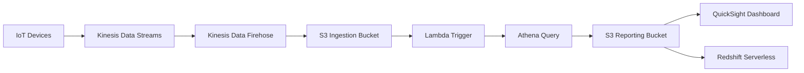
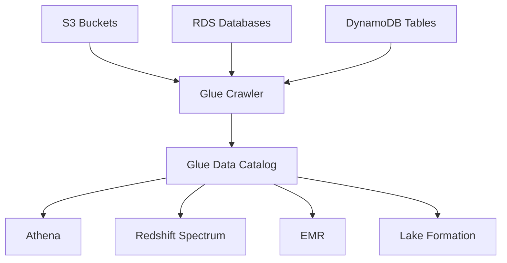
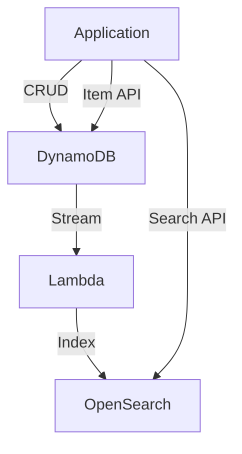
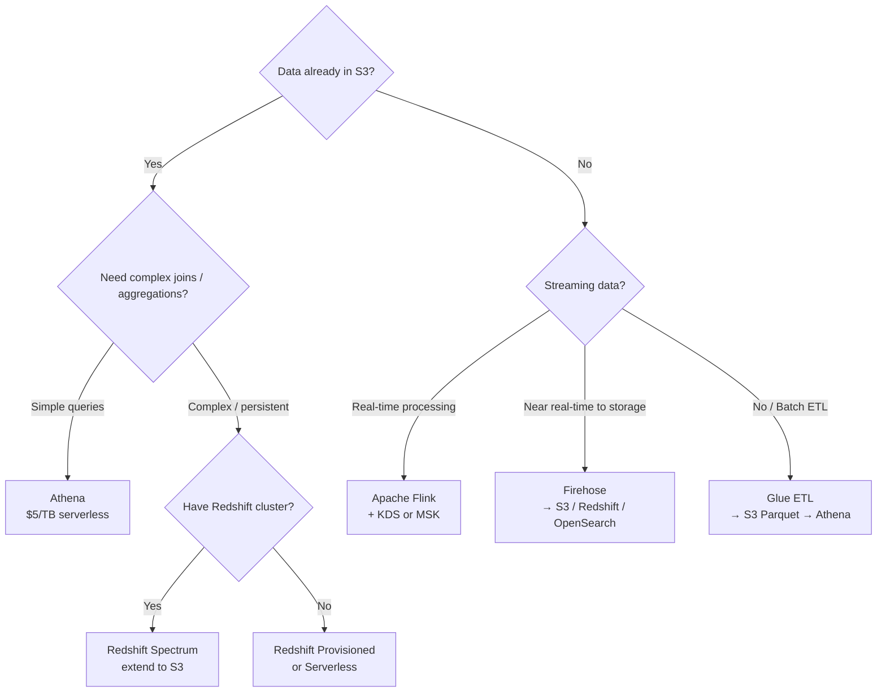
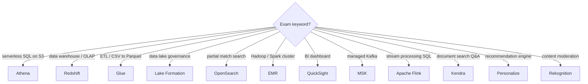

# Data & Analytics — Learn and Test (Phase 1)
**Date:** 2026-06-06 09:03
**Score:** 14/17 (82%) — All 7 sections complete
**Time:** 139 min / 51 min ⚠️ over limit

---

## Section 1: Service Overview

### Amazon Athena
- **Serverless** interactive query service — analyze data stored in **Amazon Simple Storage Service (S3)** using standard SQL (built on Presto engine)
- Supports formats: CSV, JSON, ORC, Avro, **Parquet** (columnar, most cost-effective)
- Pricing: **$5.00 per TB of data scanned** — use columnar formats + compression to reduce cost
- Common use cases: Business Intelligence (BI) / analytics / reporting, query **Virtual Private Cloud (VPC)** Flow Logs, **Elastic Load Balancer (ELB)** Logs, **CloudTrail** trails
- **Federated Query**: run SQL across relational, non-relational, object, and custom data sources (AWS or on-premises) using **Lambda-based Data Source Connectors**; results stored back in S3

### Amazon Redshift
- Cloud data warehouse based on PostgreSQL — **Online Analytical Processing (OLAP)**, NOT Online Transaction Processing (OLTP)
- **10x** better performance than other data warehouses; scales to **petabytes (PBs)** of data
- **Columnar storage** + massively parallel query engine
- Two deployment modes: **Provisioned cluster** (Leader Node + Compute Nodes) or **Serverless**
- Accessed via JDBC/ODBC; integrates with QuickSight, Tableau
- **Redshift Spectrum**: query data in S3 **without loading** it into Redshift; requires an existing Redshift cluster; query submitted to thousands of Spectrum nodes
- **Snapshots**: point-in-time backups (incremental, stored in S3)
  - Automated: every 8 hours / every 5 GB / on schedule; retention 1–35 days
  - Manual: retained until deleted
  - **Cross-region copy**: configure automatic snapshot replication to another Region
- **Loading data**: Kinesis Data Firehose (via S3 COPY), S3 COPY command, EC2 JDBC driver (batch writes)
  - Without Enhanced VPC Routing = over internet; with = through VPC

### Amazon OpenSearch Service
- Successor to Amazon ElasticSearch — **search any field, even partial matches** (unlike DynamoDB which only queries by primary key/index)
- Used as a **complement** to another database (not primary data store)
- Two modes: **managed cluster** or **serverless cluster**
- Does **NOT** natively support SQL (plugin required)
- Ingestion from: Kinesis Data Firehose, AWS IoT, CloudWatch Logs
- Security: Cognito & Identity and Access Management (IAM), Key Management Service (KMS) encryption, Transport Layer Security (TLS)
- Includes **OpenSearch Dashboards** for visualization

### Amazon Elastic MapReduce (EMR)
- Creates **Hadoop clusters** (Big Data) on hundreds of EC2 instances
- Bundled with: Apache Spark, HBase, Presto, Flink
- Auto-scaling; integrates with Spot Instances for cost savings
- Use cases: data processing, machine learning, web indexing, big data
- **Node types**:
  - **Master Node**: manage cluster, coordinate, health monitoring — **long running**
  - **Core Node**: run tasks AND store data — **long running**
  - **Task Node** (optional): run tasks **only** (no data storage) — ideal for **Spot Instances**
- Purchasing: On-Demand (reliable), Reserved (min 1 year), Spot (cheaper, interruptible)
- Can be **long-running** cluster or **transient** (temporary) cluster

### Amazon QuickSight
- **Serverless**, ML-powered Business Intelligence (BI) service for interactive dashboards
- **Per-session pricing**; auto-scalable; embeddable in applications
- In-memory computation via **SPICE engine** (when data is imported, not live connections)
- Enterprise edition: **Column-Level Security (CLS)**
- **Data sources**: Relational Database Service (RDS), Aurora, Redshift, Athena, S3, OpenSearch, Timestream, Salesforce, Jira, XLSX/CSV/JSON, on-premises databases via JDBC
- **Users and Groups exist ONLY within QuickSight** — NOT IAM users
- **Dashboard** = read-only snapshot of an Analysis; must publish before sharing

### AWS Glue
- **Managed Extract, Transform, Load (ETL)** service — fully serverless
- **Glue Data Catalog**: central metadata repository
  - Populated by **Glue Data Crawler** scanning S3, RDS, DynamoDB, JDBC sources
  - Used by Athena, Redshift Spectrum, EMR for **data discovery**
- **Glue ETL Jobs**: transform data (e.g., CSV → Parquet) and load to destinations

#### Native Features
- **Glue Job Bookmarks**: prevent re-processing old data (incremental loads)
- **Glue DataBrew**: clean and normalize data with pre-built transformations (no code)
- **Glue Studio**: GUI to create, run, and monitor ETL jobs
- **Glue Streaming ETL**: built on Apache Spark Structured Streaming; compatible with Kinesis Data Streams, Apache Kafka, Amazon Managed Streaming for Apache Kafka (MSK)

#### Lambda/Custom Features
- Triggering Glue jobs: S3 event notification → Lambda → start Glue ETL Job
- EventBridge can also trigger Glue jobs on schedule or event

### AWS Lake Formation
- Fully managed service to set up a **data lake** in days — built **on top of AWS Glue**
- Automates: collecting, cleansing, moving, cataloging, de-duplicating (ML Transforms)
- **Fine-grained Access Control**: **row-level and column-level security**; centralized permissions
- Source blueprints: S3, RDS, relational & NoSQL databases
- Architecture: Data Sources → Lake Formation → Data Lake (S3) → consumed by Athena, Redshift, EMR

### Amazon Managed Service for Apache Flink
- Previously: Kinesis Data Analytics for Apache Flink
- Process data streams using Flink (Java, Scala, or SQL)
- Managed cluster: provisioned compute, parallel computation, auto-scaling
- Sources: **Kinesis Data Streams** and **Amazon MSK** only
- **CRITICAL: Flink does NOT read from Amazon Data Firehose**

### Amazon Managed Streaming for Apache Kafka (MSK)
- Fully managed Apache Kafka on AWS — alternative to Amazon Kinesis
- Creates/manages Kafka broker nodes and Zookeeper nodes
- Deployed in VPC, **multi-Availability Zone (AZ) — up to 3** for High Availability (HA)
- Data stored on Elastic Block Store (EBS) volumes **indefinitely**
- **MSK Serverless**: no capacity management; auto-provisions and scales
- **Consumers**: Apache Flink, AWS Glue Streaming ETL, Lambda, EC2/Elastic Container Service (ECS)/Elastic Kubernetes Service (EKS)

### Machine Learning Services (Exam Quick Reference)

| Service | Purpose | Key Signal |
|---------|---------|------------|
| **Rekognition** | Image/video analysis: faces, objects, text, content moderation | "detect faces", "content moderation", "celebrity recognition" |
| **Transcribe** | Speech-to-text with Automatic Speech Recognition (ASR) | "transcribe audio", "speech to text", auto PII **Redaction** |
| **Polly** | Text-to-speech (Lexicon + SSML for pronunciation control) | "text to speech", "read aloud" |
| **Translate** | Language translation at scale | "translate", "localize content" |
| **Lex** | Chatbots + NLU (same tech as Alexa) | "chatbot", "call center bot", "NLU intent" |
| **Connect** | Cloud virtual contact center (80% cheaper than traditional) | "contact center", "call center" |
| **Comprehend** | NLP: sentiment, key phrases, language detection, topic modeling | "sentiment analysis", "NLP", "key phrase extraction" |
| **Comprehend Medical** | Clinical text analysis + PHI detection (DetectPHI API) | "clinical text", "medical NLP", "PHI" |
| **SageMaker** | End-to-end ML model build/train/deploy | "build ML model", "train model", "custom ML" |
| **Kendra** | ML-powered document search (Q&A from docs) | "document search", "natural language Q&A over docs" |
| **Personalize** | Real-time personalized recommendations (Amazon.com tech) | "recommendation engine", "personalized recommendations" |
| **Textract** | Extract text + structured data from scanned documents (OCR) | "OCR", "extract from scanned docs", "form/table extraction" |

### Quiz: Section 1
**Q1** ✗ — redshift
A company stores petabytes of historical sales data and needs complex multi-table joins and aggregations. Which service is BEST suited?
A) Athena with S3 partitioning B) Redshift Provisioned cluster C) OpenSearch managed cluster D) EMR with Apache Spark
💡 Hint: Purpose-built data warehouse with indexes for complex analytical queries.
**Your answer: A** — Incorrect. Correct: B. Redshift is OLAP with columnar storage + parallel query engine for complex joins at PB scale. Athena lacks indexes and persistent optimization.

**Q2** ✓ — flink-sources
IoT platform needs real-time stream processing with Apache Flink. Which source can Flink read from?
A) Data Firehose B) S3 event notifications C) Kinesis Data Streams D) CloudWatch Logs subscription filters
💡 Hint: Flink has strict source requirements — only two specific streaming services.
**Your answer: C** — Correct. Flink reads from Kinesis Data Streams and Amazon MSK only — never Firehose.

**Q3** ✓ — quicksight-users
How does QuickSight manage user access for marketing dashboard viewers?
A) IAM users/groups B) QuickSight internal users with per-session pricing C) AWS console access D) Cognito User Pools
💡 Hint: QuickSight has its own internal user management system.
**Your answer: B** — Correct. QuickSight users/groups exist only within QuickSight, not IAM. Per-session pricing suits occasional users.

---

## Section 2: Real-World Use Cases

### Use Case 1: Ad-Hoc Log Analysis (Athena)
A startup needs to analyze VPC Flow Logs and ELB access logs stored in S3 without setting up infrastructure.
→ **Athena**: serverless SQL on S3, pay only $5/TB scanned. Use Parquet + partitioning to minimize cost.

### Use Case 2: Enterprise Data Warehouse (Redshift)
A retail company with petabytes of sales data needs complex joins/aggregations across years of history for quarterly business reviews.
→ **Redshift Provisioned**: persistent cluster with columnar storage + indexes for fast complex queries. Use Reserved Nodes for steady-state cost savings.

### Use Case 3: Query S3 Without Loading (Redshift Spectrum vs Athena)
- **Athena**: fully serverless, no cluster needed. Best for ad-hoc, infrequent queries.
- **Redshift Spectrum**: requires existing Redshift cluster. Best when you already have a Redshift warehouse and want to extend queries to S3 data without loading.

### Use Case 4: Real-Time Search Complement (OpenSearch)
An e-commerce platform stores products in DynamoDB but needs full-text, partial-match search.
→ **DynamoDB** (primary store) → DynamoDB Stream → Lambda → **OpenSearch** (search index). API layer queries both.

### Use Case 5: Big Data Processing with Cost Optimization (EMR)
A genomics lab processes terabytes of sequencing data using Apache Spark.
→ **EMR**: Master Node (On-Demand), Core Nodes (On-Demand or Reserved for data durability), Task Nodes (**Spot Instances** — no data, fault-tolerant).

### Use Case 6: Self-Service BI Dashboards (QuickSight)
A marketing team needs interactive dashboards from Redshift data, shared with non-technical stakeholders.
→ **QuickSight**: serverless BI with SPICE for fast in-memory analysis. Per-session pricing = cost-effective for occasional use. Users managed within QuickSight (not IAM).

### Use Case 7: ETL Pipeline — CSV to Parquet (Glue)
Raw CSV files land in S3 daily. Analytics team needs Parquet format for Athena queries.
→ S3 event → Lambda trigger → **Glue ETL Job** (CSV → Parquet conversion) → output S3 bucket → **Athena** analyzes. **Glue Job Bookmarks** prevent re-processing.

### Use Case 8: Centralized Data Lake Governance (Lake Formation)
A healthcare company consolidates data from RDS, S3, and on-premises databases. Requires row-level + column-level access control for compliance.
→ **Lake Formation**: built on Glue, adds centralized permissions. Fine-grained access control ensures only authorized users see Protected Health Information (PHI) columns.

### Use Case 9: Real-Time Stream Processing (Flink + Kinesis/MSK)
An IoT platform processes millions of sensor events per second for anomaly detection.
→ **Kinesis Data Streams** (ingestion) → **Managed Apache Flink** (real-time processing with SQL/Java). NOT Firehose — Flink cannot read from Firehose.

### Use Case 10: Kafka Migration to AWS (MSK)
A company running self-managed Kafka on-premises wants managed Kafka on AWS without rewriting consumers.
→ **Amazon MSK**: drop-in replacement, multi-AZ HA, EBS-backed indefinite storage. Existing Kafka consumers work unchanged.

### Use Case 11: Content Moderation at Scale (Rekognition + A2I)
A social media platform needs automated image moderation with human review for edge cases.
→ **Rekognition** Content Moderation with confidence threshold → low-confidence items routed to **Amazon Augmented AI (A2I)** for human review.

### Use Case 12: Intelligent Document Processing (Textract + Comprehend)
An insurance company processes thousands of claim forms daily.
→ **Textract** extracts structured data from scanned forms → **Comprehend** performs sentiment analysis on claim descriptions → results stored in DynamoDB.

### Quiz: Section 2
**Q4** ✓ — emr-node-types
Genomics company processing data with Spark — which EMR configuration optimizes cost with data durability?
A) Spot for Core Nodes B) On-Demand Master/Core + Spot Task C) Spot for all D) Reserved for Task
💡 Hint: Which node type stores data vs only runs tasks?
**Your answer: B** — Correct. Core Nodes store data (need On-Demand), Task Nodes only run tasks (safe for Spot).

**Q5** ✓ — opensearch-complement
Company needs partial-match search on DynamoDB products. Which solution?
A) DynamoDB GSIs B) Athena SQL on DynamoDB C) DynamoDB Streams → Lambda → OpenSearch D) Kendra
💡 Hint: Which service specializes in partial-match, full-text search as a complement?
**Your answer: C** — Correct. OpenSearch is the search complement pattern: DynamoDB → Stream → Lambda → OpenSearch.

---

## Section 3: Service Integrations

### Data Ingestion Pipeline (Full Stack)



```
ASCII: IoT → Kinesis Streams → Firehose (~1 min) → S3 → Lambda → Athena → S3 Reports → QuickSight/Redshift
```

### Glue Data Catalog — Central Metadata Hub



```
ASCII: S3/RDS/DynamoDB → Glue Crawler → Data Catalog → used by Athena / Redshift Spectrum / EMR / Lake Formation
```

### OpenSearch Integration Patterns

| Pattern | Flow | Latency |
|---------|------|---------|
| DynamoDB complement | DynamoDB → Stream → Lambda → OpenSearch | Real-time |
| CloudWatch Logs (real-time) | CW Logs → Subscription Filter → Lambda → OpenSearch | Real-time |
| CloudWatch Logs (near real-time) | CW Logs → Subscription Filter → Firehose → OpenSearch | Near real-time (~1 min) |
| Kinesis (real-time) | Kinesis Streams → Lambda → OpenSearch | Real-time |
| Kinesis (near real-time) | Kinesis Streams → Firehose → OpenSearch | Near real-time (~1 min) |

### Cross-Domain Integration: Storage + Analytics
- **Athena + S3 partitioning**: partition S3 data by date/region/category using `s3://bucket/table/year=2026/month=06/` — Athena only scans relevant partitions, reducing cost
- **Glue + S3 Data Catalog**: Glue Crawler auto-discovers schema from S3 files; Athena and Redshift Spectrum leverage this catalog for queries
- **Lake Formation + S3**: centralizes permissions on S3 data lake; replaces complex IAM + S3 bucket policies with fine-grained row/column-level access

### Cross-Domain Integration: Serverless + Analytics
- **Lambda + Glue ETL trigger**: S3 PutObject event → Lambda → starts Glue ETL Job for transformation
- **Kinesis Data Firehose + Lambda transformation**: Firehose invokes Lambda for inline data transformation before delivering to S3/Redshift/OpenSearch

### Cross-Domain Integration: Databases + Analytics
- **Redshift + RDS federation**: Athena Federated Query can query RDS data alongside S3 data using Lambda connectors
- **DynamoDB Streams + analytics pipeline**: DynamoDB Streams → Lambda → Kinesis Data Firehose → S3 → Athena/Redshift for analytics on transactional data

### Cross-Domain Integration: Messaging + Analytics
- **Kinesis Data Streams → analytics pipeline**: KDS → Firehose → S3 (data lake) or Redshift (warehouse); KDS → Apache Flink (real-time processing)
- **MSK → analytics**: MSK consumers include Glue Streaming ETL (Spark), Lambda, and Apache Flink
- **Kinesis Firehose → S3 delivery**: near real-time delivery (~1 min batches) with optional format conversion (Parquet/ORC) and compression

### Quiz: Section 3
**Q6** ✓ — opensearch-cloudwatch-integration
CloudWatch Logs → real-time delivery to OpenSearch. Which pattern?
A) Subscription Filter → Firehose → OpenSearch B) Subscription Filter → Lambda → OpenSearch C) S3 Export → Glue ETL → OpenSearch D) EventBridge → Step Functions → OpenSearch
💡 Hint: Which intermediary provides immediate event-by-event processing?
**Your answer: B** — Correct. Real-time = Lambda. Firehose is near real-time (~1 min batches).

**Q7** ✓ — athena-cost-optimization (multi-select)
Athena queries on CSV are slow and expensive. Which TWO actions reduce cost 30-90%?
A) Convert CSV to Parquet via Glue B) Enable Redshift Spectrum C) Partition S3 by date D) Migrate to OpenSearch
💡 Hint: Two Athena-specific optimizations — one reduces data per file, one reduces files scanned.
**Your answer: A, C** — Correct. Parquet = columnar (read only needed columns). Partitioning = scan only relevant date ranges.

---

## Section 4: Architectural Patterns

### Pattern 1: Serverless Analytics Stack
**When**: ad-hoc queries, variable workload, cost-sensitive analytics
```
S3 (data lake) → Glue Crawler (catalog) → Athena (SQL) → QuickSight (dashboard)
```
- No infrastructure to manage; pay per query ($5/TB)
- Optimize: use Parquet format, partition data, compress files (>128 MB)

### Pattern 2: Enterprise Data Warehouse
**When**: complex joins, aggregations, petabyte-scale, predictable workload
```
Sources → Firehose/S3 COPY → Redshift Cluster → QuickSight/Tableau
              ↳ Redshift Spectrum → S3 (cold data, no loading)
```
- Leader Node plans; Compute Nodes execute; Spectrum extends to S3
- Use Enhanced VPC Routing for secure data loading through VPC

### Pattern 3: Real-Time Streaming Analytics
**When**: sub-second latency requirements, continuous data streams
```
Producers → Kinesis Data Streams/MSK → Apache Flink (processing) → destination
                                     → Firehose → S3/Redshift (near real-time)
```
- **Flink for real-time**: reads from KDS or MSK only (NOT Firehose)
- **Firehose for near real-time**: ~1 min batches to S3/Redshift/OpenSearch

### Pattern 4: ETL Pipeline with Data Lake
**When**: raw data needs transformation before analytics
```
S3 (raw CSV) → Glue Crawler → Catalog → Glue ETL → S3 (Parquet) → Athena
                                                                   → Redshift Spectrum
```
- **Lake Formation** adds governance: row/column-level security on the data lake
- **Glue Job Bookmarks** ensure incremental processing only

### Pattern 5: Search-Augmented Database



```
ASCII: App → CRUD → DynamoDB → Stream → Lambda → OpenSearch ← Search API ← App
```
- DynamoDB for primary storage; OpenSearch for full-text + partial match search
- Lambda syncs changes in real-time via DynamoDB Streams

### Decision Tree: Analytics Service Selection



```
ASCII Decision Tree:
Data in S3? → Yes → Complex queries? → Simple: Athena / Complex + cluster: Spectrum / Complex no cluster: Redshift
Data in S3? → No  → Streaming? → Real-time: Flink / Near RT: Firehose / Batch: Glue ETL
```

### Quiz: Section 4
**Q8** ✓ — redshift-spectrum
Company with existing Redshift needs to query archived S3 data without loading. Which approach?
A) Athena separate B) Redshift Spectrum C) Glue ETL load into Redshift D) EMR Spark
💡 Hint: Leverage existing Redshift cluster to query S3 in-place.
**Your answer: B** — Correct. Spectrum extends Redshift queries to S3 without loading data.

**Q9** ✗ — serverless-analytics-pattern
Startup with variable query volumes (idle days then bursts). Cost-effective pattern for S3 CSV data?
A) Redshift Provisioned + Reserved B) Kinesis + Flink streaming C) Serverless: Glue → Athena → QuickSight D) DynamoDB + OpenSearch
💡 Hint: Which pattern has zero idle cost?
**Your answer: B** — Incorrect. Correct: C. Serverless stack (Athena $5/TB + QuickSight per-session) = zero idle cost. Kinesis+Flink is for continuous real-time streaming, not ad-hoc analytics.

**Q10** ✓ — glue-job-bookmarks
CSV→Parquet ETL needs to skip already-processed files. Which Glue feature?
A) Data Catalog B) Job Bookmarks C) DataBrew D) Glue Studio
💡 Hint: Feature for incremental ETL loads — tracking what's processed.
**Your answer: B** — Correct. Glue Job Bookmarks track processed data for incremental loads.

---

## Section 5: Cost Implications

### Pricing Models by Service

| Service | Pricing Model | Cost Optimization |
|---------|--------------|-------------------|
| **Athena** | $5.00/TB scanned | Use Parquet/ORC (30-90% savings), partition data, compress, use files >128 MB |
| **Redshift Provisioned** | Per-node-hour (Leader free) | Reserved Nodes for steady-state; Spectrum to avoid loading cold data |
| **Redshift Serverless** | Per RPU-hour + storage | Scales to zero; best for variable/unpredictable workloads |
| **OpenSearch** | Instance-hour + storage + data transfer | Right-size instances; use UltraWarm for infrequent data |
| **EMR** | EC2 instance pricing + EMR surcharge | Spot for Task Nodes; Reserved/On-Demand for Master/Core; transient clusters |
| **QuickSight** | Per-session or per-user/month | Per-session for occasional users; SPICE for faster queries (reduces repeated data source charges) |
| **Glue** | Per DPU-hour for ETL jobs | Optimize job duration; use Job Bookmarks for incremental processing |
| **Lake Formation** | No additional cost (built on Glue) | Uses Glue pricing for ETL; S3 storage costs apply |
| **MSK** | Per broker-hour + storage (EBS) | MSK Serverless for variable; right-size broker instance types |
| **Kinesis Data Streams** | Per shard-hour + PUT payload units | On-Demand mode for variable; Provisioned for predictable |
| **Firehose** | Per GB ingested | Batch efficiently; use compression |

### Key Cost Optimization Strategies
1. **Format conversion**: CSV → Parquet reduces Athena scan cost by 30-90%
2. **Partitioning**: S3 partitions (`year=2026/month=06/`) limit Athena scans
3. **Compression**: gzip/snappy reduces both storage and scan costs
4. **File sizing**: files >128 MB minimize Athena overhead
5. **Right-sizing**: EMR nodes, Redshift nodes, MSK brokers — monitor and adjust
6. **Spot Instances**: EMR Task Nodes are ideal for Spot (no data stored)
7. **Serverless options**: Athena, Redshift Serverless, MSK Serverless, QuickSight — pay only for use
8. **Glue Job Bookmarks**: avoid re-processing already-processed data
9. **Redshift Spectrum**: query S3 cold data without loading = no additional Redshift storage cost

### Quiz: Section 5
**Q11** ✓ — athena-parquet-cost
500 GB CSV daily at $5/TB = $2.50/day. After converting to Parquet (90% reduction), new cost?
A) $2.50/day B) $0.25/day C) $1.25/day D) $0.00/day
💡 Hint: Athena charges per TB scanned — Parquet reduces amount read.
**Your answer: B** — Correct. 90% reduction: 500 GB × 10% = 50 GB → $0.25/day.

**Q12** ✓ — emr-pricing-optimization
EMR cluster runs 4 hours daily. Master/Core must be reliable, Task Nodes tolerate interruption. Best pricing?
A) On-Demand all B) Reserved Master/Core + Spot Task C) Spot all D) Savings Plans Master + On-Demand Core + Reserved Task
💡 Hint: Which nodes store data vs only compute?
**Your answer: B** — Correct. Reserved for Master/Core (store data, need reliability). Spot for Task (no data, fault-tolerant).

---

## Section 6: Security Considerations

### Encryption at Rest
| Service | Default | Options |
|---------|---------|---------|
| **Athena** | Query results encrypted in S3 | SSE-S3, SSE-KMS, client-side encryption for source data |
| **Redshift** | Optional | KMS or Hardware Security Module (HSM); encrypt cluster at creation |
| **OpenSearch** | Optional | KMS encryption; node-to-node encryption |
| **EMR** | Optional | LUKS encryption for EBS volumes; S3 SSE for EMRFS |
| **Glue** | Job bookmarks encrypted | KMS for Data Catalog; SSE for S3 targets |
| **Lake Formation** | Inherits S3 encryption | KMS; fine-grained access is the primary security feature |
| **MSK** | Optional | KMS at-rest; TLS in-transit; SASL/SCRAM authentication |

### Encryption in Transit
- **All services**: support TLS/SSL for data in transit
- **Redshift**: JDBC/ODBC connections support SSL; Enhanced VPC Routing ensures traffic stays within VPC
- **MSK**: TLS between brokers and clients; mutual TLS authentication available
- **OpenSearch**: node-to-node TLS encryption

### Access Control Patterns
- **Lake Formation**: centralized fine-grained permissions — **row-level and column-level security** across Athena, Redshift, EMR
  - Replaces complex IAM + S3 bucket policies with a single permission model
- **QuickSight**: users/groups managed within QuickSight (NOT IAM); Column-Level Security (Enterprise edition)
- **Redshift**: database-level users + IAM authentication; role-based access
- **Athena**: IAM policies control who can run queries; S3 bucket policies control data access
- **Glue Data Catalog**: resource policies + IAM control who can access metadata
- **MSK**: IAM authentication, SASL/SCRAM, or mutual TLS

### Defense-in-Depth for Analytics

```
┌──────────────────────────────────────────────┐
│ Perimeter: VPC + Security Groups + NACLs     │
│  ┌──────────────────────────────────────────┐ │
│  │ Identity: IAM Policies + Lake Formation  │ │
│  │  ┌──────────────────────────────────────┐ │ │
│  │  │ Service: KMS Encryption + Audit Logs │ │ │
│  │  │  ┌──────────────────────────────────┐ │ │ │
│  │  │  │ Data: Column/Row Level Security  │ │ │ │
│  │  │  └──────────────────────────────────┘ │ │ │
│  │  └──────────────────────────────────────┘ │ │
│  └──────────────────────────────────────────┘ │
└──────────────────────────────────────────────┘
```

### Quiz: Section 6
**Q13** ✓ — lake-formation-column-security
Healthcare data lake needs PHI column restrictions across Athena/Redshift/EMR. Which service?
A) IAM + S3 bucket policies B) Lake Formation fine-grained permissions C) QuickSight CLS D) Glue Catalog resource policies
💡 Hint: Governance layer on top of data lake with centralized permissions.
**Your answer: B** — Correct. Lake Formation provides centralized row/column-level security across analytics services.

**Q14** ✗ — redshift-enhanced-vpc-routing
Redshift COPY from S3 goes over public internet. How to force VPC routing?
A) SSE-KMS on S3 B) VPC Gateway Endpoint for S3 C) Enhanced VPC Routing on Redshift D) NAT Gateway
💡 Hint: Redshift cluster-level setting for data loading path.
**Your answer: B** — Incorrect. Correct: C. Enhanced VPC Routing is the Redshift cluster setting that forces COPY/UNLOAD through VPC. VPC endpoints provide private S3 connectivity but don't control Redshift's routing behavior.

---

## Section 7: Exam Tips

### Critical Distinctions for SAA-C03

| Distinction | Key Difference |
|-------------|---------------|
| **Athena vs Redshift** | Athena = serverless ad-hoc on S3 ($5/TB); Redshift = persistent warehouse with indexes (faster complex queries, requires cluster) |
| **Redshift Spectrum vs Athena** | Both query S3; Spectrum requires existing Redshift cluster; Athena is standalone serverless |
| **Flink sources** | Reads from Kinesis Data Streams and MSK ONLY — **never from Firehose** |
| **MSK vs Kinesis** | MSK: message >1 MB configurable, indefinite retention, partitions add-only; Kinesis: 1 MB hard limit, 1-365 day retention, shard split+merge |
| **Lake Formation vs Glue** | Lake Formation = governance layer BUILT ON Glue; adds row/column security |
| **QuickSight users** | Exist within QuickSight only — NOT IAM users |
| **EMR Core vs Task Nodes** | Core = tasks + data (long-running); Task = tasks only (Spot-friendly) |
| **OpenSearch SQL** | NOT native — requires plugin; don't confuse with Athena/Redshift |
| **Kendra vs OpenSearch** | Kendra = ML document Q&A; OpenSearch = keyword/full-text search |
| **Comprehend vs Transcribe** | Comprehend = NLP text analysis; Transcribe = speech-to-text with PII **Redaction** |

### Keyword-to-Answer Mapping



```
ASCII Keyword Map:
"serverless SQL on S3"      → Athena
"data warehouse / OLAP"     → Redshift
"ETL / CSV to Parquet"      → Glue
"data lake governance"      → Lake Formation
"partial match search"      → OpenSearch
"Hadoop / Spark cluster"    → EMR
"BI dashboard"              → QuickSight
"managed Kafka"             → MSK
"stream processing"         → Apache Flink
"document search Q&A"       → Kendra
"recommendation engine"     → Personalize
"content moderation"        → Rekognition
"OCR / form extraction"     → Textract
"sentiment analysis / NLP"  → Comprehend
"speech to text"            → Transcribe
"chatbot / NLU"             → Lex
"build custom ML model"     → SageMaker
```

### Common Exam Traps
1. **"PostgreSQL-based" trap**: Redshift is PostgreSQL-based but is OLAP, NOT a relational DB for transactions
2. **Firehose ≠ Flink source**: Flink reads from KDS and MSK only — never Firehose
3. **QuickSight IAM trap**: QuickSight users/groups are internal — don't look for IAM user management
4. **OpenSearch SQL trap**: OpenSearch does NOT natively support SQL — if question says "SQL query", think Athena/Redshift
5. **EMR Task Node trap**: Task Nodes don't store data — safe for Spot; Core Nodes store data — not ideal for Spot
6. **Lake Formation ≠ separate service**: it's built on Glue — adds governance, doesn't replace ETL
7. **Comprehend Medical vs Transcribe**: Transcribe does speech-to-text with PII redaction; Comprehend Medical analyzes clinical TEXT (not audio)
8. **Kendra vs Personalize**: Kendra = document Q&A search; Personalize = product recommendations — completely different use cases

### Key Takeaways
- **Athena** is the go-to for serverless SQL on S3 — optimize with Parquet, partitioning, compression
- **Redshift** for persistent, complex analytical queries at PB scale — Spectrum extends to S3
- **Glue** is the ETL backbone — Data Catalog is shared by Athena, Redshift Spectrum, EMR
- **Lake Formation** adds governance ON TOP of Glue — row/column-level security
- **OpenSearch** complements other databases for search — never a standalone primary store
- **EMR** for Hadoop/Spark big data — Spot only on Task Nodes
- **Flink** for real-time stream processing — KDS/MSK sources only
- **ML services** are keyword-driven on the exam — match signal to service

### Quiz: Section 7
**Q15** ✓ — flink-firehose-trap
Architecture uses Firehose as Flink source. What's the issue?
A) Flink only Java/Scala B) Flink doesn't read from Firehose C) Firehose too fast D) Flink requires EMR
💡 Hint: Most commonly tested Flink constraint.
**Your answer: B** — Correct. Flink reads from KDS and MSK only — never Firehose.

**Q16** ✓ — redshift-postgresql-trap
Colleague says Redshift is "PostgreSQL-based" so it can replace transactional PostgreSQL. What's the trap?
A) OLAP not OLTP B) Different query language C) Only queries S3 D) Deprecated
💡 Hint: Exam uses "PostgreSQL-based" to make Redshift sound general-purpose.
**Your answer: A** — Correct. Redshift is OLAP (analytical), not OLTP (transactional).

**Q17** ✓ — textract-comprehend-ml
Extract data from scanned claim forms + analyze sentiment for fraud. Which ML services?
A) Kendra + Lex B) Textract + Comprehend C) Rekognition + Transcribe D) SageMaker + Personalize
💡 Hint: One for OCR extraction, one for text sentiment analysis.
**Your answer: B** — Correct. Textract for document extraction, Comprehend for sentiment analysis.
