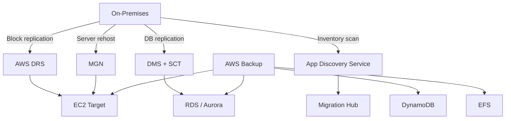
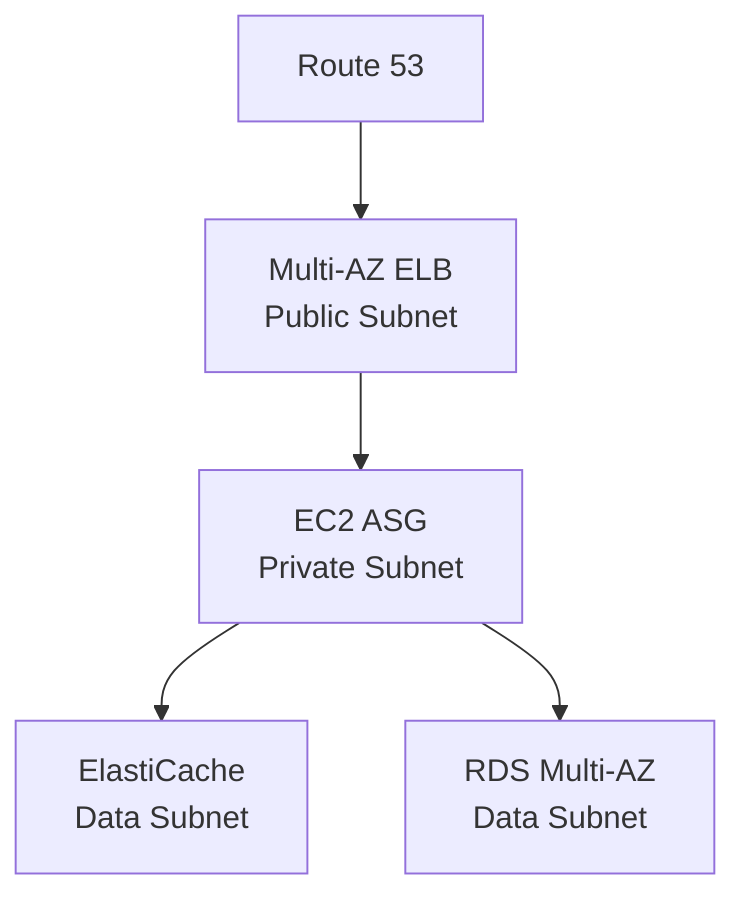
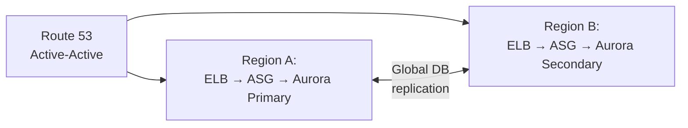
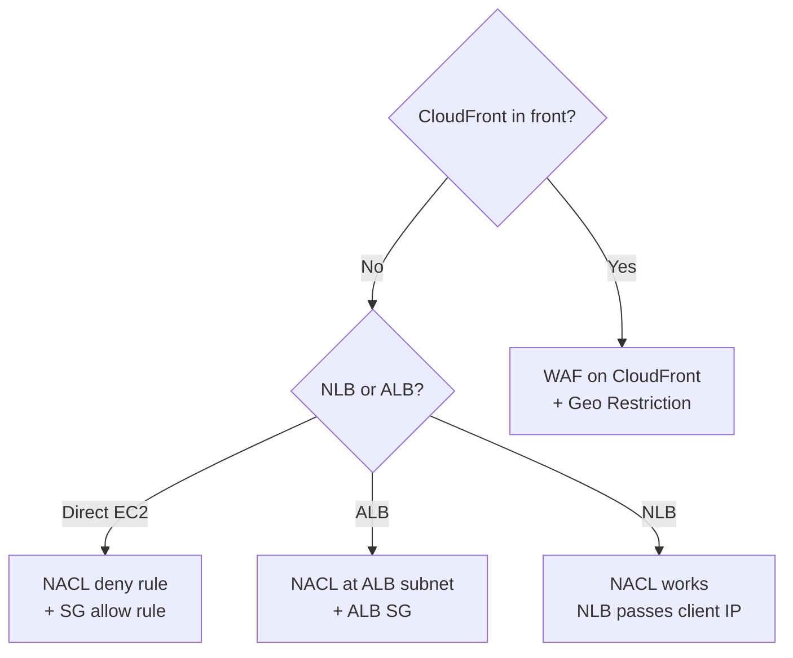
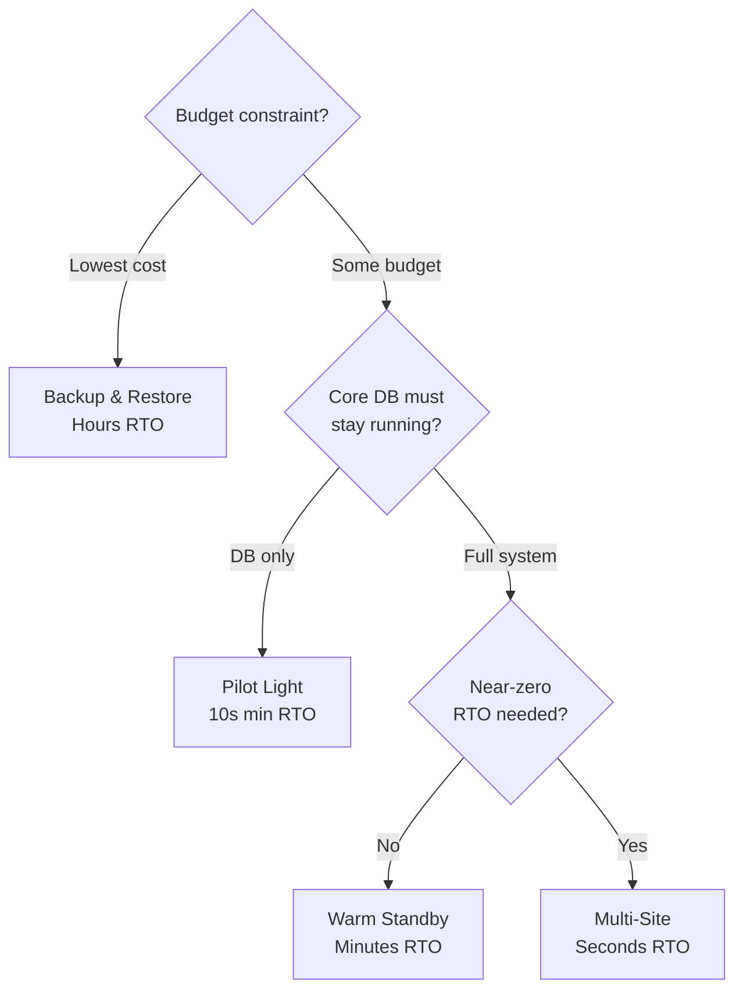
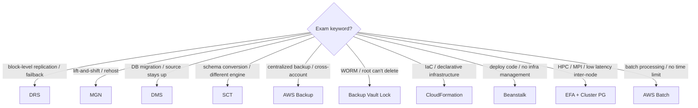

# DR & Architecture — Learn and Test (Phase 1) [PARTIAL]
**Date:** 2026-06-06 11:49
**Score:** 0/0 (0%) — Section 1+ pending
**Time:** pending

---

## Section 1: Service Overview

### Disaster Recovery (DR) Core Concepts
- **Recovery Point Objective (RPO)**: maximum acceptable data loss — gap between last backup and disaster event
- **Recovery Time Objective (RTO)**: maximum acceptable downtime — gap between disaster and full recovery
- **DR Spectrum** (cheapest/slowest → costliest/fastest):

| Strategy | RTO | RPO | Cost | Key Characteristic |
|----------|-----|-----|------|--------------------|
| **Backup & Restore** | Hours | Hours | Lowest | Restore from snapshots/backups |
| **Pilot Light** | 10s of min | Minutes | Low-Med | Core DB running, compute stopped |
| **Warm Standby** | Minutes | Seconds | Med-High | Full system at reduced capacity |
| **Multi-Site (Hot)** | Seconds | Near-zero | Highest | Active-active, full production |

### DR Strategy 1: Backup & Restore
- Highest RPO/RTO — cheapest option
- On-prem data → S3/Glacier via Storage Gateway or Snowball
- Scheduled Elastic Block Store (EBS) / Relational Database Service (RDS) / Redshift snapshots in S3
- Recovery: restore Amazon Machine Image (AMI) → EC2, restore RDS snapshot → new DB instance
- Lifecycle policies: S3 → S3 Infrequent Access (IA) → Glacier to save cost

### DR Strategy 2: Pilot Light
- Small critical core always running (e.g., RDS replica running, EC2 stopped)
- Data continuously replicated from on-prem to RDS
- On disaster: update Route 53, start EC2 from AMI
- Faster than Backup & Restore because database is already up

### DR Strategy 3: Warm Standby
- Full system running at **minimum/reduced capacity** in cloud
- Elastic Load Balancer (ELB) + EC2 Auto Scaling Group (ASG) at min size + RDS Secondary running
- On disaster: Route 53 failover, scale ASG to production load
- Higher cost than Pilot Light but faster RTO

### DR Strategy 4: Multi-Site / Hot Site
- Full production scale running in **both** on-prem AND AWS simultaneously
- **Active-active** via Route 53 weighted/latency routing
- RTO: seconds — most expensive
- All-AWS variant: **Aurora Global Database** for cross-region replication

### AWS Elastic Disaster Recovery (DRS)
- Formerly "CloudEndure Disaster Recovery"
- **Continuous block-level replication** (sub-second RPO) from any source to AWS
- Agent installed on source servers (physical, virtual, or cloud)
- Staging: low-cost EC2 + EBS volumes receive continuous replication
- Failover in **minutes**; supports **failback** to original environment
- Key signal: "continuous replication" + "failback needed" → DRS

### AWS Backup
- Fully managed **centralized backup** service — no custom scripts
- Supported: EC2, EBS, S3, RDS (all engines), Aurora, DynamoDB, DocumentDB, Neptune, Elastic File System (EFS), FSx, Storage Gateway
- **Cross-region** and **cross-account** backup supported
- Backup Plans: frequency, window, cold storage transition, retention period
- **Point-in-Time Recovery (PITR)** for supported services

#### AWS Backup Vault Lock
- **Write Once Read Many (WORM)** enforcement on backup vault
- Prevents: accidental/malicious deletes, retention period shortening
- **Even root user cannot delete** backups when Vault Lock enabled
- Key signal: "prevent backup deletion even by admins/root" → Vault Lock

### Database Migration Service (DMS)
- Migrate databases to AWS; **source DB remains available** during migration
- Runs on EC2 replication instance
- **Homogeneous**: same engine (Oracle → Oracle) — no Schema Conversion Tool (SCT) needed
- **Heterogeneous**: different engines (SQL Server → Aurora) — requires SCT
- **Continuous Data Replication** using Change Data Capture (CDC)
- **Multi-AZ**: synchronous standby replica in different Availability Zone (AZ)

### AWS Schema Conversion Tool (SCT)
- Converts DB schema from one engine to another
- Online Transaction Processing (OLTP): SQL Server/Oracle → MySQL/PostgreSQL/Aurora
- Online Analytical Processing (OLAP): Teradata/Oracle → Redshift
- **NOT needed for same-engine migrations**

### Application Migration Service (MGN)
- **Lift-and-shift (rehost)** to AWS with minimal downtime
- Continuous replication to low-cost staging (EC2 + EBS)
- Cutover: move to target EC2 + EBS in production
- Supports physical, virtual, cloud-based servers
- **No failback** (unlike DRS)

### AWS CloudFormation
- **Declarative Infrastructure as Code (IaC)**: define resources, CloudFormation creates in right order
- Supports almost all AWS resources; "custom resources" for unsupported
- **Infrastructure Composer**: visual diagram of stack
- **Service Role**: Identity and Access Management (IAM) role that allows CloudFormation to act on user's behalf

### Elastic Beanstalk
- Developer-centric Platform as a Service (PaaS) on top of EC2, ASG, ELB, RDS
- **Free** — pay for underlying resources
- **Web Server Tier**: ELB → ASG → EC2
- **Worker Tier**: Simple Queue Service (SQS) Queue → ASG → EC2; scales on queue depth
- Deployment: Single Instance (dev, Elastic IP) | High Availability (HA) with ALB (prod, Multi-AZ)

### High Performance Computing (HPC) on AWS
- **Cluster Placement Group**: same rack, same AZ, 10 Gbps, low latency
- **Enhanced Networking (SR-IOV)**: Elastic Network Adapter (ENA) up to 100 Gbps
- **Elastic Fabric Adapter (EFA)**: Linux only, Message Passing Interface (MPI), bypasses OS for ultra-low latency
- **Storage**: EBS io2 Block Express (256K IOPS), Instance Store (millions IOPS), FSx for Lustre (HPC-optimized)
- **Orchestration**: AWS Batch (multi-node parallel), AWS ParallelCluster (open-source HPC cluster)

### Well-Architected Framework
- **6 Pillars**: Operational Excellence, Security, Reliability, Performance Efficiency, Cost Optimization, Sustainability
- Pillars are a **synergy** — not trade-offs
- **Well-Architected Tool**: free review against 6 pillars
- **Trusted Advisor**: Cost, Performance, Security, Fault Tolerance, Service Limits, Operational Excellence; full checks require Business/Enterprise support

---

## Section 2: Real-World Use Cases

### Use Case 1: Cost-Effective DR for Startup (Backup & Restore)
A startup with limited budget needs DR for their RDS database and EC2 application servers.
→ **Backup & Restore**: schedule RDS automated snapshots (1-35 day retention) + EBS snapshots + S3 lifecycle to Glacier. Highest RPO/RTO but cheapest.

### Use Case 2: Financial Services Active-Passive (Pilot Light)
A bank needs their core database always recoverable but can tolerate 10-minute app recovery.
→ **Pilot Light**: RDS read replica running continuously in DR region. EC2 instances stopped (AMIs ready). Route 53 health check triggers failover → start EC2 + promote RDS replica.

### Use Case 3: E-Commerce Peak Season DR (Warm Standby)
An e-commerce site needs rapid failover during Black Friday — can't afford hours of downtime.
→ **Warm Standby**: full system at reduced capacity in DR region (ELB + ASG min=1 + RDS secondary). On disaster: Route 53 failover + scale ASG to production.

### Use Case 4: Healthcare Zero-Downtime (Multi-Site Active-Active)
A hospital system requires near-zero RTO/RPO for patient records.
→ **Multi-Site**: Aurora Global Database (cross-region replication < 1 second lag). Route 53 latency-based routing to both regions. Active-active — both serve traffic.

### Use Case 5: On-Prem Oracle to Aurora Migration (DMS + SCT)
A company migrates from on-premises Oracle to Aurora PostgreSQL — different engines.
→ **Heterogeneous migration**: SCT converts Oracle schema → PostgreSQL. DMS replicates data with CDC for continuous sync. Source Oracle stays online during migration.

### Use Case 6: Compliance-Mandated Backup Retention (AWS Backup + Vault Lock)
An enterprise in healthcare needs 7-year backup retention with regulatory requirement that no one — not even administrators — can delete backups.
→ **AWS Backup** with Vault Lock (WORM). Cross-region backup for geo-redundancy. Even root user cannot delete.

### Use Case 7: VM Migration from VMware (MGN)
A company running 500 VMware VMs on-prem wants to lift-and-shift to AWS EC2.
→ **Application Migration Service (MGN)**: install agents, continuous replication to staging, cutover to production EC2. No application changes needed.

### Use Case 8: HPC Genomics Processing (Batch + EFA)
A genomics lab needs to run MPI-based parallel computing across hundreds of instances.
→ **EC2 Cluster Placement Group** + **EFA** for ultra-low latency inter-node communication. FSx for Lustre for shared HPC storage backed by S3. AWS Batch or ParallelCluster for orchestration.

### Use Case 9: Developer Platform Without Infrastructure Management (Beanstalk)
A small dev team wants to deploy a Node.js web app with auto-scaling, load balancing, and health monitoring — without managing infrastructure.
→ **Elastic Beanstalk** Web Server Tier: uploads code, Beanstalk provisions ELB + ASG + EC2. HA mode for production with Multi-AZ ALB.

### Use Case 10: Ransomware Protection (DRS)
A company needs protection against ransomware with the ability to failover AND failback.
→ **AWS Elastic Disaster Recovery (DRS)**: continuous block-level replication, sub-second RPO, failover in minutes, supports failback to original environment after cleanup.

---

## Section 3: Service Integrations

### DR Services Integration Map



```
ASCII: On-Prem → DRS (block replication) → EC2
       On-Prem → DMS+SCT (DB migration) → RDS/Aurora
       On-Prem → MGN (lift-and-shift) → EC2
       On-Prem → App Discovery → Migration Hub
       AWS Backup → EC2/RDS/DynamoDB/EFS (centralized)
```

### Migration Service Selection

| Need | Service | Key Differentiator |
|------|---------|-------------------|
| Migrate database, source stays online | **DMS** | CDC for continuous sync |
| Convert schema (different engine) | **SCT** | Only for heterogeneous |
| Rehost servers (lift-and-shift) | **MGN** | No app changes, cutover only |
| DR with failback | **DRS** | Continuous block replication |
| Pre-migration inventory | **App Discovery Service** | Assessment only |
| Import VMs to EC2 | **VM Import/Export** | VMware/KVM/Hyper-V/VirtualBox |
| Extend VMware to AWS | **VMware Cloud on AWS** | Native vSphere tools |

### Cross-Domain Integration: DNS + DR
- **Route 53 failover routing**: active-passive DR pattern — health check on primary, failover to standby
- **Route 53 active-active**: weighted or latency-based routing to multi-region deployment
- Route 53 health check failure triggers **immediate** record removal (faster than TTL-based)

### Cross-Domain Integration: Databases + DR
- **Aurora Global Database**: cross-region replication < 1 second lag; promote secondary to primary
- **DynamoDB Global Tables**: multi-region active-active; automatic replication
- **RDS cross-region read replicas**: async replication; promote on disaster

### Cross-Domain Integration: Storage + DR
- **S3 Cross-Region Replication (CRR)**: async object replication to another region
- **EBS snapshot cross-region copy**: manual or automated copy for DR
- **EBS + ASG lifecycle pattern**: terminate hook → Lambda snapshots EBS → launch hook → restore

### Caching Strategy Layers

| Layer | Service | Purpose |
|-------|---------|---------|
| Edge/CDN | CloudFront | Static + dynamic content at edge |
| API | API Gateway | Response caching per stage |
| Application | ElastiCache (Redis/Memcached) | Session data, DB query cache |
| DynamoDB | DAX | In-memory DynamoDB read cache |
| Static assets | S3 + CloudFront | Origin for static files |

---

## Section 4: Architectural Patterns

### Pattern 1: Classic 3-Tier Web App



```
ASCII: Route 53 → ELB (public) → EC2 ASG (private) → ElastiCache + RDS (data)
```

**Security Group chaining**: ELB SG ← 0.0.0.0/0 | EC2 SG ← ELB SG only | RDS SG ← EC2 SG only

### Pattern 2: Stateless vs Stateful Design
- **Stateless**: ELB + ASG + Route 53 — no session stored on instances
- **Stateful (preferred)**: store session_id in cookie, actual session data in **ElastiCache** (or DynamoDB)
- **Anti-pattern**: ELB sticky sessions — risk of data loss if instance fails
- **Anti-pattern**: user cookies for cart data — 4 KB limit, security risk

### Pattern 3: Multi-Region Active-Active DR



```
ASCII: Route 53 (active-active) → Region A: ELB → ASG → Aurora Primary
                                → Region B: ELB → ASG → Aurora Secondary
       Aurora Global Database replicates between regions
```

### Pattern 4: HA EC2 Instance (Single Instance Pattern)
- **Option A**: CloudWatch Alarm → Lambda → start standby EC2 + attach Elastic IP
- **Option B**: ASG (min=1, max=1, desired=1, ≥2 AZs) — EC2 User Data attaches Elastic IP on launch
- **Option C**: ASG + EBS lifecycle hooks → Lambda snapshots EBS on terminate, restores on launch

### Pattern 5: IP Blocking Decision Tree



```
ASCII: CloudFront? → Yes: WAF + Geo Restriction (NACL useless — sees CF IPs)
       CloudFront? → No → Direct EC2: NACL + SG | ALB: NACL at subnet | NLB: NACL works
```

### Pattern 6: Instantiating Applications Quickly
- **EC2**: Golden AMI (pre-baked dependencies) + User Data (dynamic config) = fastest boot
- **RDS**: Restore from snapshot — schema + data ready instantly
- **EBS**: Restore from snapshot — disk formatted + data ready
- **Beanstalk**: hybrid approach (Golden AMI + User Data)

### Decision Tree: DR Strategy Selection



```
ASCII: Budget? → Lowest: Backup&Restore | Some → DB only running: Pilot Light
       Full system → Near-zero RTO? → No: Warm Standby | Yes: Multi-Site
```

---

## Section 5: Cost Implications

### DR Strategy Cost Comparison

| Strategy | Infrastructure Cost | Data Transfer | Recovery Cost | Total Relative |
|----------|-------------------|---------------|---------------|---------------|
| **Backup & Restore** | S3 storage only | Minimal | High (restore time) | $ |
| **Pilot Light** | RDS running + stopped EC2 AMIs | Replication bandwidth | Medium (start EC2) | $$ |
| **Warm Standby** | Full stack at min capacity | Continuous replication | Low (scale up) | $$$ |
| **Multi-Site** | Full production × 2 regions | Continuous active-active | Near-zero | $$$$ |

### Service-Specific Cost Optimization

| Service | Pricing Model | Optimization |
|---------|--------------|-------------|
| **DMS** | Replication instance hours + storage | Right-size instance; use Multi-AZ only for production |
| **AWS Backup** | Storage + cross-region transfer | Lifecycle to cold storage; tag-based policies |
| **DRS** | Staging instances (small) + EBS | Staging uses low-cost instances; production-size only on failover |
| **MGN** | Free service; pay for staging/target EC2 | Minimize staging duration |
| **CloudFormation** | Free; pay for provisioned resources | Use stack cost estimation before deploying |
| **Beanstalk** | Free; pay for underlying EC2/RDS/ELB | Single Instance for dev; HA for prod only |
| **Batch** | EC2/Spot pricing for compute | Use Spot Instances for fault-tolerant batch jobs |

### Key Cost Strategies
1. **Right-size DR tier**: don't over-provision — Backup & Restore covers most non-critical workloads
2. **Spot Instances for Batch/HPC**: AWS Batch dynamically uses Spot for up to 90% savings
3. **Beanstalk Single Instance**: dev environments don't need ELB — saves ~$18/month per ALB
4. **S3 lifecycle policies**: move DR backups S3 Standard → IA → Glacier → Deep Archive
5. **Reserved capacity for Warm Standby**: the always-running minimum instances benefit from Reserved pricing
6. **DRS staging instances**: use smallest viable instance type — only scale on actual failover
7. **Instance Scheduler**: auto start/stop non-production EC2/RDS on schedule — up to 70% savings

---

## Section 6: Security Considerations

### DR Security Patterns

| Concern | Solution |
|---------|----------|
| Backup integrity | AWS Backup Vault Lock (WORM) — even root can't delete |
| Encryption at rest | Key Management Service (KMS) encryption on snapshots, S3 backups |
| Cross-account isolation | AWS Backup cross-account backup to separate security account |
| Migration data in transit | DMS supports SSL/TLS for replication traffic |
| Session data protection | ElastiCache encryption at-rest + in-transit; Redis AUTH |
| Network segmentation | Security Group chaining: ELB SG → EC2 SG → RDS SG |

### Security Group Chaining (Best Practice)
```
┌─────────────────────────────────────────────────┐
│ PUBLIC SUBNET                                    │
│   ELB Security Group: Allow HTTP/S from 0.0.0.0/0│
│                                                   │
│ PRIVATE SUBNET                                    │
│   EC2 Security Group: Allow ONLY from ELB SG     │
│                                                   │
│ DATA SUBNET                                       │
│   RDS/ElastiCache SG: Allow ONLY from EC2 SG     │
└─────────────────────────────────────────────────┘
```
**Trap**: Never open RDS/ElastiCache directly to the internet

### IP Blocking Security
- **Without CloudFront**: Network Access Control List (NACL) deny rules at subnet level work fine
- **With CloudFront**: NACL sees CloudFront IPs, NOT client IPs → use **Web Application Firewall (WAF)** on CloudFront for IP filtering + **Geo Restriction** for country blocking

### CloudFormation Security
- **Service Role**: IAM role that CloudFormation assumes — user only needs `cloudformation:*` + `iam:PassRole`
- Principle of least privilege: CF role has resource permissions, user doesn't need them directly

### Well-Architected Security Pillar
- Defense in depth: perimeter (NACL) → network (SG) → identity (IAM) → data (encryption)
- Encryption everywhere: at rest (KMS) + in transit (TLS/SSL)
- Automate security: AWS Config rules, GuardDuty, automated remediation

---

## Section 7: Exam Tips

### Critical Distinctions for SAA-C03

| Distinction | Key Difference |
|-------------|---------------|
| **DRS vs MGN** | DRS = DR with failback; MGN = migration with cutover only (no failback) |
| **DMS vs SCT** | DMS = data migration; SCT = schema conversion (heterogeneous only) |
| **Pilot Light vs Warm Standby** | Pilot Light = DB running, compute stopped; Warm Standby = full system at min capacity |
| **Backup Vault Lock vs S3 Object Lock** | Both WORM; Vault Lock for AWS Backup; Object Lock for S3 objects |
| **EBS vs EFS** | EBS = AZ-locked, single instance; EFS = multi-AZ, shared across instances |
| **Batch vs Lambda** | Batch = no time limit, Docker, EBS; Lambda = 15 min limit, limited runtimes |
| **Beanstalk Web vs Worker** | Web = ELB → ASG; Worker = SQS → ASG (scales on queue depth) |
| **Golden AMI vs User Data** | Golden AMI = fast boot (pre-baked); User Data = dynamic config at launch |

### Keyword-to-Answer Mapping



```
ASCII Keyword Map:
"block-level replication / failback"  → DRS
"lift-and-shift / rehost"             → MGN
"DB migration / source stays up"      → DMS
"schema conversion"                   → SCT (heterogeneous only)
"centralized backup / cross-account"  → AWS Backup
"WORM / root can't delete backups"    → Backup Vault Lock
"IaC / declarative"                   → CloudFormation
"deploy code / no infra mgmt"         → Beanstalk
"HPC / MPI / inter-node"             → EFA + Cluster Placement Group
"batch processing / no time limit"    → AWS Batch
"on-prem inventory / plan migration"  → App Discovery Service
"SaaS → AWS data transfer"           → AppFlow
"run commands without SSH"            → SSM Session Manager / Run Command
"auto OS patching"                    → SSM Patch Manager
"on-prem with AWS APIs"              → Outposts
"extend VMware to AWS"               → VMware Cloud on AWS
```

### Common Exam Traps
1. **"Same DB engine migration"**: DMS without SCT — trap: SCT is NOT needed for homogeneous migrations
2. **"RDS MySQL → Aurora" fastest zero-downtime**: Aurora Read Replica (promote at lag=0), NOT snapshot restore
3. **"External MySQL → Aurora" fastest**: Percona XtraBackup to S3 import (NOT mysqldump — slower)
4. **"Block IPs from CloudFront"**: WAF on CloudFront, NOT NACL (NACL sees CF IPs, not client IPs)
5. **"Prevent root from deleting backups"**: AWS Backup Vault Lock — NOT S3 Object Lock
6. **"Continuous replication WITH failback"**: DRS, NOT MGN (MGN is cutover only)
7. **"Session data for web app"**: ElastiCache (primary choice) or DynamoDB — NOT cookies (4 KB limit)
8. **"Worker tier scales on queue depth"**: Beanstalk Worker Tier + SQS — NOT Web Server Tier

### Key Takeaways
- **DR strategies** are ordered by cost/speed: Backup & Restore → Pilot Light → Warm Standby → Multi-Site
- **DRS** for DR with failback; **MGN** for migration without failback — don't confuse them
- **DMS + SCT** for heterogeneous DB migration; DMS alone for same-engine
- **AWS Backup Vault Lock** is the answer when "root/admin can't delete" appears
- **Security Group chaining** is the correct multi-tier pattern — never open DB to internet
- **CloudFront + WAF** for IP blocking — NACL doesn't work with CloudFront
- **Beanstalk** is free PaaS — Worker Tier scales on SQS queue depth
- **HPC** = Cluster Placement Group + EFA + FSx for Lustre
