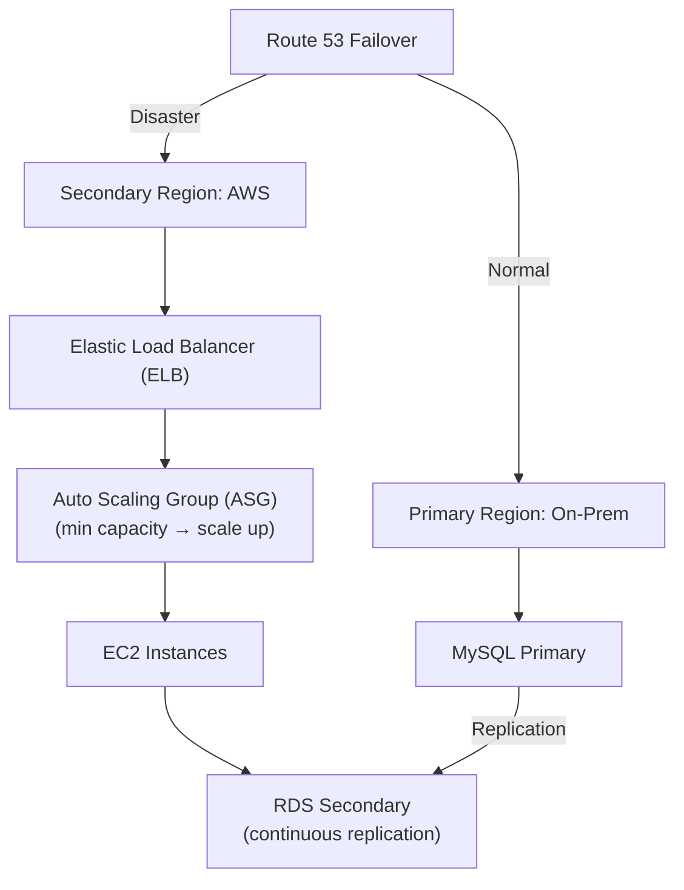
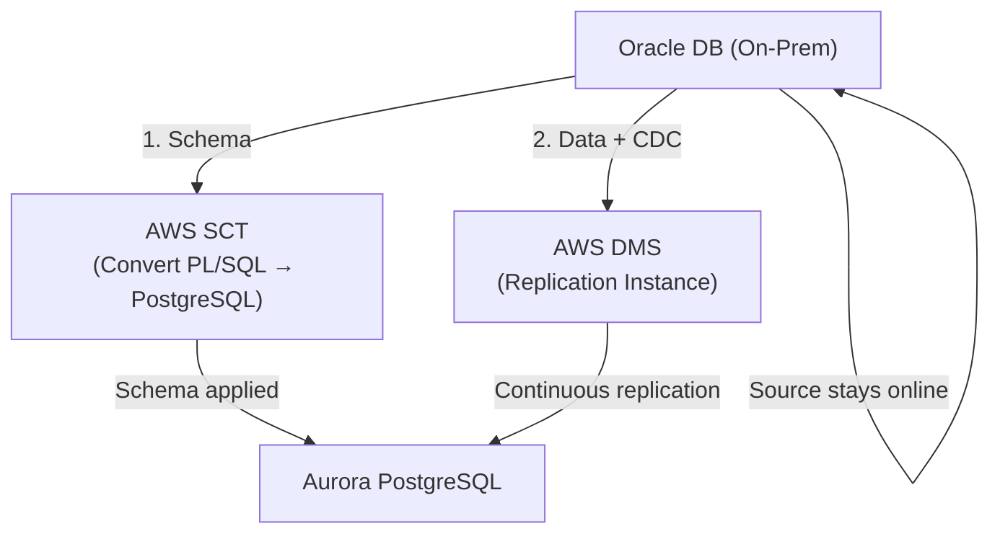
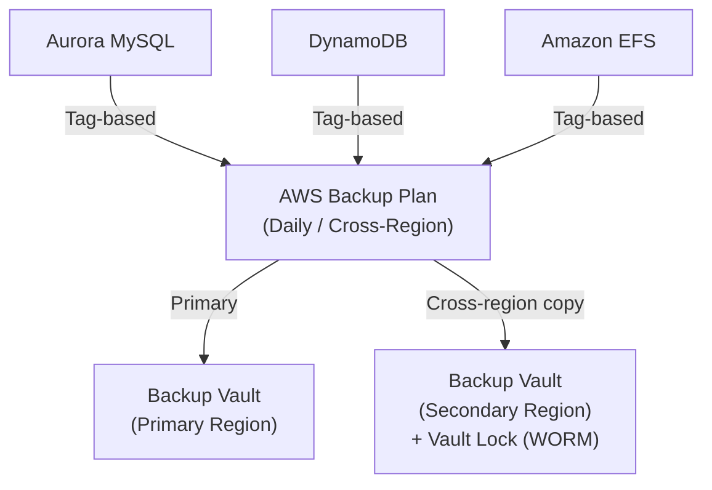
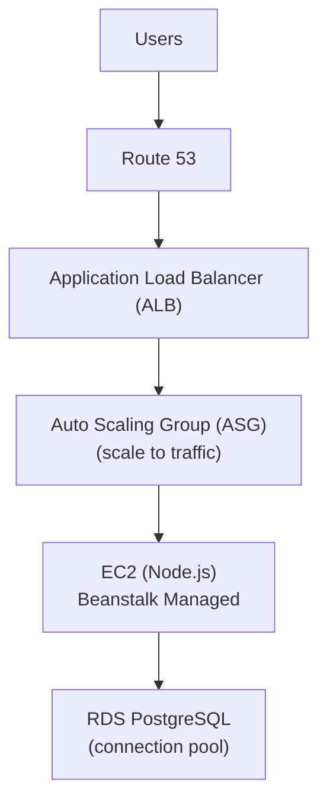
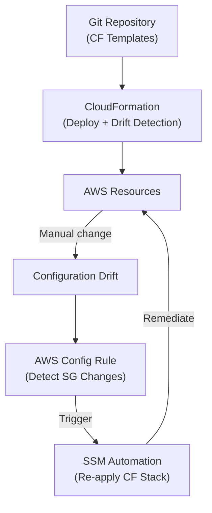
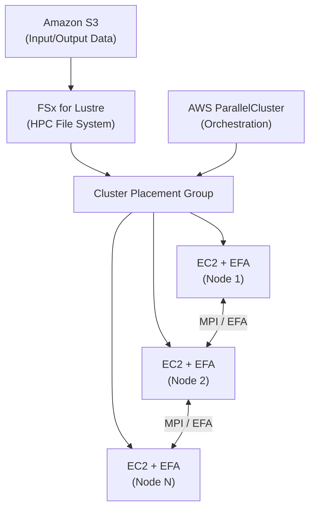
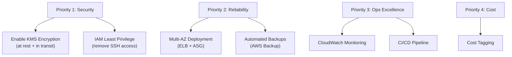

# DR & Architecture — Scenario Practice (Phase 2) [PARTIAL]
**Date:** 2026-06-08 22:25
**Score:** 0/0 (0%) — Scenario 1+ pending
**Time:** pending

---

### Scenario 1: Backup Restore vs Pilot Light vs Warm Standby vs Active-Active (dr-strategies)
**Context:** A mid-size e-commerce company runs an on-premises web application with a MySQL database. They experience seasonal traffic spikes during holiday sales (10x normal volume for 2-3 weeks). Their current RTO requirement is 15 minutes, and RPO is 5 minutes. Budget is moderate — they can't afford full active-active but need faster recovery than snapshot restore. The database sees 500 write transactions per second during peak.

**Requirements:**
- RTO ≤ 15 minutes, RPO ≤ 5 minutes
- Database must be continuously replicated to Disaster Recovery (DR) site
- Compute resources should not run at full production scale during normal operations
- Must handle 10x traffic spike within minutes of failover
- Moderate budget — not the cheapest, not the most expensive

**Question:** Which DR strategy best meets these requirements?

A) Backup & Restore with hourly Amazon Relational Database Service (RDS) snapshots to a secondary region, and stored Amazon Machine Images (AMIs) for quick EC2 launch
B) Pilot Light with RDS running continuous replication in the secondary region, EC2 instances stopped but pre-configured AMIs ready
C) Warm Standby with a scaled-down replica (ELB + Auto Scaling Group at minimum capacity + RDS Secondary) in the secondary region, scaling up on failover
D) Multi-Site Active-Active with Route 53 weighted routing distributing traffic to both regions simultaneously with Aurora Global Database

**Hint:** Consider which strategy keeps the full system already running at reduced capacity and can scale up within minutes — matching the 15-minute RTO requirement.
**Correct: C** — Warm Standby meets all requirements: continuous DB replication (RPO ≤ 5 min), full system at reduced capacity ready to scale (RTO ≤ 15 min), moderate cost (not paying for full production in both regions).

**Architecture:**

ASCII: On-Prem Primary → Route 53 Failover → AWS Secondary (ELB → ASG at min → EC2 → RDS Secondary with replication from on-prem)

**Why others wrong:**
- A) Backup & Restore: hourly snapshots = RPO of 1 hour (exceeds 5 min requirement); restore time likely > 15 min
- B) Pilot Light: DB running but compute stopped — starting EC2 + configuring + scaling takes > 15 min for 10x spike capacity
- D) Multi-Site Active-Active: meets requirements but exceeds budget — full production in both regions is the most expensive option

**Key Concept:** Warm Standby balances cost vs recovery speed — full system running at minimum with ability to scale on failover

---

### Scenario 2: Heterogeneous Migration with Schema Conversion Tool (dms-sct)
**Context:** A financial services company runs a critical Oracle database on-premises with stored procedures, triggers, and complex schemas. They want to migrate to Amazon Aurora PostgreSQL to reduce licensing costs. The source database must remain fully operational during migration. The Oracle schema uses Oracle-specific features (PL/SQL, materialized views, database links) that don't exist natively in PostgreSQL.

**Requirements:**
- Migrate from Oracle to Aurora PostgreSQL (different database engines)
- Source database must stay online during migration
- Oracle-specific schema objects must be converted to PostgreSQL equivalents
- Minimize downtime during cutover
- Continuous Data Replication via Change Data Capture (CDC) until cutover

**Question:** Which combination of AWS services should the architect use?

A) AWS Database Migration Service (DMS) alone — it handles schema conversion automatically for cross-engine migrations
B) AWS Schema Conversion Tool (SCT) to convert schema + AWS DMS with CDC for ongoing data replication
C) AWS Application Migration Service (MGN) to lift-and-shift the Oracle server, then convert schemas manually on AWS
D) Export Oracle data using Data Pump, upload to Simple Storage Service (S3), import into Aurora PostgreSQL using the `aws_s3` extension

**Hint:** Think about which tool handles schema translation between different database engines AND which tool handles the ongoing data movement.
**Correct: B** — Heterogeneous migration (different engines) requires SCT for schema conversion + DMS for data migration with CDC. SCT converts Oracle PL/SQL to PostgreSQL, DMS replicates data continuously.

**Architecture:**

ASCII: Oracle → SCT (schema conversion) → Aurora PostgreSQL ← DMS (continuous data replication via CDC) ← Oracle

**Why others wrong:**
- A) DMS alone: DMS handles data migration but NOT schema conversion for heterogeneous migrations — PL/SQL won't be converted
- C) MGN: Application Migration Service is for server lift-and-shift, not database migration — you'd still have Oracle on EC2, not Aurora PostgreSQL
- D) Data Pump + S3: Works for one-time data load but doesn't provide CDC for continuous replication; doesn't convert Oracle-specific schema objects

**Key Concept:** Heterogeneous migration = SCT (schema) + DMS (data with CDC); homogeneous = DMS only

---

### Scenario 3: Cross-Region Backup Strategy (aws-backup)
**Context:** A healthcare organization stores patient records in Amazon RDS Aurora MySQL, Amazon DynamoDB, and Amazon Elastic File System (EFS). Regulatory compliance (HIPAA) requires that all backups be stored in a separate AWS region, retained for 7 years, and protected so that even administrators (including root) cannot delete them. They currently manage backups manually with individual service snapshots, which is error-prone and inconsistent.

**Requirements:**
- Centralized backup management across RDS Aurora, DynamoDB, and EFS
- Cross-region backup copy to a secondary region
- 7-year retention with Write Once Read Many (WORM) protection
- Even root user cannot delete backups
- Automated backup scheduling (no manual scripts)
- Tag-based resource targeting

**Question:** Which solution meets all compliance requirements with the least operational overhead?

A) Create individual backup scripts using AWS Lambda that snapshot each service and copy to secondary region, with S3 Object Lock for WORM
B) AWS Backup with a Backup Plan (cross-region copy enabled), tag-based policies, 7-year retention, and Backup Vault Lock enabled on the destination vault
C) Enable automated backups on each service individually (RDS PITR, DynamoDB PITR, EFS backup), then use AWS DataSync to replicate to secondary region
D) AWS Backup with cross-region copy, store in S3 Glacier Deep Archive with S3 Object Lock Governance mode for retention

**Hint:** Consider which service provides centralized, automated backup across multiple services AND has a vault-level WORM feature that blocks even root from deletion.
**Correct: B** — AWS Backup centralizes all three services, supports cross-region copy, tag-based policies, and Backup Vault Lock provides WORM enforcement that even root cannot bypass.

**Architecture:**

ASCII: Aurora + DynamoDB + EFS → Backup Plan (tag-based) → Primary Vault → Cross-Region Copy → Secondary Vault with Vault Lock

**Why others wrong:**
- A) Lambda scripts: high operational overhead (custom code to maintain), S3 Object Lock ≠ Backup Vault Lock scope, doesn't centralize across services
- C) Individual service backups + DataSync: not centralized, DataSync doesn't provide WORM protection, high operational overhead
- D) S3 Glacier + Object Lock Governance: Governance mode can be bypassed by root with specific permissions — only Backup Vault Lock truly prevents root deletion

**Key Concept:** AWS Backup Vault Lock = WORM that even root cannot bypass; exam signal: "prevent admins/root from deleting backups"

---

### Scenario 4: Beanstalk vs ECS vs Lambda Decision (elastic-beanstalk)
**Context:** A development team needs to deploy a Node.js REST API that processes user requests and interacts with an RDS PostgreSQL database. The API handles steady traffic of ~1,000 requests/second during business hours and near-zero traffic at night. The team has no DevOps expertise and wants the simplest deployment experience. They don't want to manage infrastructure, scaling, or load balancing. The application requires a persistent connection pool to the database.

**Requirements:**
- Node.js REST API deployment
- Steady daytime traffic (~1,000 req/s), minimal nighttime traffic
- No infrastructure management (no Docker, no Kubernetes)
- Automated load balancing and auto scaling
- Persistent database connection pool
- Simplest possible deployment (git push or CLI deploy)

**Question:** Which compute platform best meets these requirements?

A) AWS Lambda with Amazon API Gateway — serverless, auto-scales to zero at night
B) Amazon Elastic Container Service (ECS) on AWS Fargate — serverless containers with no infrastructure management
C) AWS Elastic Beanstalk Web Server Tier — managed Platform-as-a-Service (PaaS) with built-in ELB + ASG
D) Amazon Elastic Kubernetes Service (EKS) with managed node groups — enterprise-grade container orchestration

**Hint:** Think about which service provides PaaS-level simplicity (just deploy code) with built-in scaling AND maintains persistent connections — without requiring containerization knowledge.
**Correct: C** — Elastic Beanstalk is the simplest PaaS: upload code (no Docker required), auto-provisions ELB + ASG, supports Node.js natively. Persistent connection pools work well on EC2-based instances. Near-zero at night handled by ASG scaling down.

**Architecture:**

ASCII: Users → Route 53 → ALB → ASG (Beanstalk-managed EC2 with Node.js) → RDS PostgreSQL

**Why others wrong:**
- A) Lambda + API Gateway: Lambda's cold starts and 15-min timeout are limitations; connection pooling requires RDS Proxy (additional cost/complexity); at 1,000 req/s steady, Lambda cost exceeds EC2
- B) ECS on Fargate: requires Docker containerization knowledge — more complex than Beanstalk for a team with no DevOps expertise
- D) EKS: enterprise-grade Kubernetes is vastly over-engineered for this use case — significant operational complexity

**Key Concept:** Beanstalk = simplest PaaS for code deployment (no Docker); free service, pay only for underlying resources

---

### Scenario 5: Infrastructure as Code (IaC) Stack Design and Drift Detection (cloudformation)
**Context:** A SaaS company manages 50+ microservices across three AWS regions. Developers frequently make manual console changes to troubleshoot production issues, causing configuration drift from the defined infrastructure. The operations team needs to detect when actual infrastructure deviates from the declared state AND automatically remediate certain types of drift (like Security Group rule changes). They want declarative infrastructure management with version control.

**Requirements:**
- Declarative Infrastructure as Code (IaC) for all resources
- Detect configuration drift from declared state
- Auto-remediate Security Group drift (unauthorized rule additions)
- Version-controlled templates in Git
- Cost estimation before deploying new stacks

**Question:** Which combination of AWS services provides drift detection with auto-remediation?

A) AWS CloudFormation (IaC + drift detection) + AWS Config rules (detect SG changes) + Systems Manager Automation (auto-remediate by re-applying CloudFormation stack)
B) AWS CloudFormation for IaC + manual drift review using CloudFormation console + AWS Lambda for remediation
C) Terraform for IaC + AWS Config for drift detection + Amazon EventBridge for auto-remediation
D) AWS CloudFormation with StackSets across regions + CloudWatch Alarms for drift detection + Simple Notification Service (SNS) for alerting ops team

**Hint:** Think about which service natively detects drift from declared state AND which service can automatically remediate configuration changes through runbooks.
**Correct: A** — CloudFormation provides declarative IaC with built-in drift detection. AWS Config detects Security Group changes in real-time. Systems Manager (SSM) Automation can auto-remediate by running CloudFormation stack updates to re-align actual state.

**Architecture:**

ASCII: Git → CloudFormation → Resources ← Manual Changes → AWS Config detects → SSM Automation remediates → Resources aligned

**Why others wrong:**
- B) Manual drift review + Lambda: manual review doesn't detect drift automatically; Lambda requires custom remediation code (higher maintenance)
- C) Terraform: valid IaC but not an AWS-native service — exam context favors CloudFormation; also Terraform doesn't have built-in AWS Config integration
- D) CloudWatch Alarms: CloudWatch monitors metrics (CPU, memory), not configuration drift — wrong tool for detecting infrastructure state changes

**Key Concept:** CloudFormation drift detection + AWS Config + SSM Automation = automated IaC compliance pipeline

---

### Scenario 6: High Performance Computing (HPC) Cluster Architecture (hpc)
**Context:** A pharmaceutical company needs to run molecular dynamics simulations using Message Passing Interface (MPI) across hundreds of compute nodes. Each simulation runs for 12-48 hours with intensive inter-node communication. The workloads require the lowest possible network latency between nodes. Data inputs and outputs are stored in Amazon Simple Storage Service (S3), but simulations need a high-performance shared file system during execution. The compute is burst-oriented: large runs every 2-3 weeks, idle between runs.

**Requirements:**
- Hundreds of nodes with MPI inter-node communication
- Lowest possible network latency between compute nodes
- High-performance shared file system during simulation runs
- Burst workloads (run for days, idle for weeks)
- Inputs from S3, outputs to S3
- Cost-effective for intermittent usage

**Question:** Which architecture provides the lowest latency inter-node communication with a high-performance shared file system?

A) EC2 Spread Placement Group with Enhanced Networking (Elastic Network Adapter / ENA), FSx for Windows File Server, and Reserved Instances
B) EC2 Cluster Placement Group with Elastic Fabric Adapter (EFA), FSx for Lustre backed by S3, managed via AWS ParallelCluster
C) Amazon Elastic Kubernetes Service (EKS) with Fargate for node management, Amazon Elastic File System (EFS) for shared storage, with Spot Instances
D) AWS Batch with EC2 Spot Instances, Amazon Elastic Block Store (EBS) io2 Block Express for storage, in a Spread Placement Group

**Hint:** Consider which placement group provides the lowest latency, which network adapter bypasses the OS for MPI, and which file system is purpose-built for HPC.
**Correct: B** — Cluster Placement Group provides 10 Gbps within the same rack. EFA bypasses the OS kernel for MPI communication (lowest inter-node latency). FSx for Lustre is the purpose-built HPC file system with S3 integration. ParallelCluster manages the cluster lifecycle.

**Architecture:**

ASCII: S3 → FSx for Lustre → Cluster Placement Group (EC2 nodes with EFA for MPI) ← ParallelCluster orchestration

**Why others wrong:**
- A) Spread Placement Group: spreads instances ACROSS racks — maximizes availability but INCREASES latency between nodes. FSx Windows is not HPC-optimized. Reserved Instances waste money for burst workloads.
- C) EKS + Fargate + EFS: Fargate doesn't support EFA or placement groups; EFS is not HPC-optimized (much lower throughput than Lustre)
- D) Batch + Spread PG: Spread PG increases latency (wrong for HPC); EBS is per-instance storage, not a shared file system

**Key Concept:** HPC = Cluster Placement Group + EFA + FSx for Lustre; Spread PG is the opposite — it maximizes distance between instances

---

### Scenario 7: Well-Architected Pillar Trade-Off Scenarios (well-architected-framework)
**Context:** A startup has built a successful SaaS application on AWS. As they scale, they face trade-off decisions across the Well-Architected Framework's 6 pillars. Currently they run everything in a single Availability Zone (AZ) with no monitoring, manual deployments via SSH, unencrypted data, and no cost tagging. Their CTO wants to prioritize improvements. The application serves 10,000 daily active users with financial transaction data.

**Requirements:**
- Financial transaction data (PCI-DSS compliance concerns)
- 10,000 daily active users with growth trajectory
- Current architecture: single AZ, no monitoring, manual SSH deployments, unencrypted data
- Must prioritize: which pillar improvements have highest immediate impact?

**Question:** Given this startup processes financial data in a single AZ with no encryption, which TWO improvements should be prioritized first? (Select TWO)

A) **Cost Optimization**: Implement cost tagging and Reserved Instances to reduce spending
B) **Security**: Enable encryption at rest (Key Management Service / KMS) and in transit (TLS), implement Identity and Access Management (IAM) least privilege
C) **Reliability**: Deploy across multiple AZs with Auto Scaling Group (ASG) and Elastic Load Balancer (ELB) for high availability
D) **Operational Excellence**: Set up CloudWatch monitoring, automated deployments via CodePipeline, and Infrastructure as Code (IaC)

**Hint:** Consider which pillars address the most critical risks first — data exposure and single point of failure — especially for financial transaction data.
**Correct: B, C** — Security is the top priority for financial data (PCI-DSS requires encryption). Reliability eliminates the single AZ SPOF, which could cause complete outage. These address the two most critical risks: data breach and total downtime.

**Architecture:**

ASCII: Priority 1: Security (encryption + IAM) → Priority 2: Reliability (Multi-AZ + backups) → Priority 3: Ops Excellence (monitoring + CI/CD) → Priority 4: Cost (tagging)

**Why others wrong:**
- A) Cost Optimization: important but not urgent — saving money doesn't matter if you lose customer financial data or have total downtime
- D) Operational Excellence: monitoring and CI/CD are important but less critical than encryption for financial data and HA for uptime — you can't monitor what's been breached

**Key Concept:** Well-Architected pillars are synergistic, but Security and Reliability take priority when handling sensitive data with no current protections
